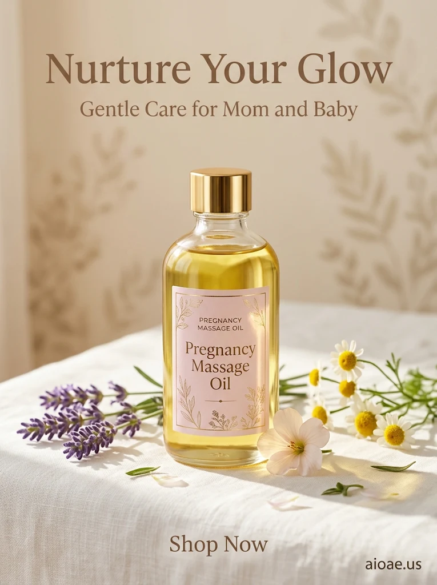

# 案例 197：孕期按摩油：呵護母嬰 | Case 197: Nurture Your Glow



暖米色 × 孕期按摩油：粉色標籤玻璃瓶配金蓋，薰衣草與洋甘菊環繞，窗光灑落的寧靜母嬰護理畫面。

Warm beige × pregnancy massage oil: a pink-labelled glass bottle with a gold cap, ringed by lavender and chamomile in soft window light — a serene maternal-care scene.

## 完整提示詞 / Full Prompt

```
SUBJECT: A bottle of pregnancy massage oil, presented in an elegant, serene composition.

SCENE: The bottle is made of clear glass, with a soft, pastel pink label and a gold cap. The bottle is placed on a soft, white surface, surrounded by a few sprigs of lavender and chamomile, adding a touch of freshness and fragrance. A small, delicate flower sits beside the bottle, its petals soft and gentle. The background is a soft, warm beige, with a subtle pattern of leaves and flowers adding depth and texture to the scene. A soft, warm light filters through a nearby window, casting a gentle glow on the bottle and highlighting its elegant shape. The overall composition is serene and peaceful, with a sense of calm and tranquility.

STYLE & LIGHT: The style is elegant, serene, and peaceful, with a focus on texture and detail. The lighting is soft and warm, with a golden hue that enhances the pastel pink color of the label and creates a sense of warmth and comfort.

CAMERA: A medium shot with a 50mm lens, capturing the bottle and its surroundings in sharp focus, with a shallow depth of field that blurs the background slightly.

ON-IMAGE TEXT: headline "Nurture Your Glow"; subheadline "Gentle Care for Mom and Baby"; CTA "Shop Now".

WATERMARK: Add the exact text "aioae.us" in the bottom-right corner at 70% transparency, with enough contrast to remain visible.
```

## 適用模型 / Recommended Models

擅長產品海報、母嬰用品與柔光靜物攝影的模型：GPT Image（Image2）、Flux Pro、Midjourney（建議加 `--ar 3:4`）。

Models strong at product posters, maternal-care products and soft-light still life: GPT Image (Image2), Flux Pro, Midjourney (add `--ar 3:4`).

## 修改說明 / How to Adapt

- 換產品：把按摩油換成妊娠霜或嬰兒潤膚乳，SCENE 的玻璃瓶與標籤描寫改成對應的包裝，薰衣草保留。
- 換花材：把薰衣草與洋甘菊換成玫瑰或茉莉，SCENE 的花卉描寫跟著改，暖米色背景不變。
- 換文案：把 ON-IMAGE TEXT 的標題換成自家母嬰品牌口號，副標與 CTA 同步改，構圖不用動。

- Change the product: swap the massage oil for a stretch-mark cream or baby lotion, reworking the glass-bottle and label lines in SCENE into the matching packaging while keeping the lavender.
- Change the flowers: swap the lavender and chamomile for roses or jasmine, updating the floral lines in SCENE while keeping the warm beige backdrop.
- Change the copy: replace the headline in ON-IMAGE TEXT with your own maternal-care brand slogan, updating the subheadline and CTA to match — the composition stays intact.

---
直達本案例 / Direct link: https://aioae.us/prompt?title=Nurture%20Your%20Glow
更多同類提示詞 / More prompts like this: [AIOAE 免費 AI 圖片提示詞庫](https://aioae.us/prompts)
