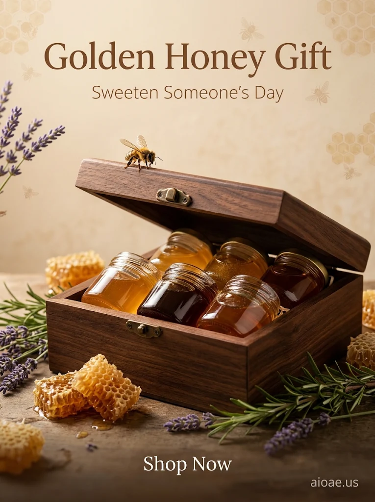

# 案例 198：黃金蜂蜜禮盒 | Case 198: Golden Honey Gift



蜂蜜金 × 深色木禮盒：六小罐金黃蜂蜜半掩盒蓋，蜜蜂停駐、蜂巢與薰衣草點綴，暖金光下的奢華送禮畫面。

Honey gold × dark wooden gift box: six small jars of golden honey under a half-open lid, a bee perched on top, honeycomb and lavender around — a luxurious gifting scene in warm golden light.

## 完整提示詞 / Full Prompt

```
SUBJECT: A luxurious gift box filled with natural honey, presented in an elegant, sophisticated composition.

SCENE: The gift box is made of dark, rich wood, with a hinged lid that is slightly ajar, revealing the golden honey inside. The box is filled with small jars of honey, each with a different flavor and color, ranging from light, golden amber to deep, rich brown. A few honeycomb pieces are scattered around the box, adding texture and visual interest. A small, delicate bee sits on the edge of the box, its wings spread wide, as if about to take flight. The background is a soft, warm beige, with a subtle pattern of honeycomb and bees adding depth and texture to the scene. A few sprigs of lavender and rosemary are arranged around the box, adding a touch of freshness and fragrance.

STYLE & LIGHT: The style is luxurious, elegant, and sophisticated, with a focus on texture and detail. The lighting is soft and warm, with a golden glow that highlights the honey and creates a sense of warmth and comfort.

CAMERA: A medium shot with a 50mm lens, capturing the gift box and its contents in sharp focus, with a shallow depth of field that blurs the background slightly.

ON-IMAGE TEXT: headline "Golden Honey Gift"; subheadline "Sweeten Someone's Day"; CTA "Shop Now".

WATERMARK: Add the exact text "aioae.us" in the bottom-right corner at 70% transparency, with enough contrast to remain visible.
```

## 適用模型 / Recommended Models

擅長產品海報、食品攝影與暖金光影的模型：GPT Image（Image2）、Flux Pro、Midjourney（建議加 `--ar 3:4`）。

Models strong at product posters, food photography and warm golden lighting: GPT Image (Image2), Flux Pro, Midjourney (add `--ar 3:4`).

## 修改說明 / How to Adapt

- 換內容：把蜂蜜換成堅果禮盒或茶葉禮盒，SCENE 的蜜罐與蜂巢描寫改成對應的內容物，木盒保留。
- 換場景：把暖米背景換成秋日果園或野餐布景，SCENE 的背景圖案與香草描寫跟著改。
- 換文案：把 ON-IMAGE TEXT 的標題換成自家食品品牌口號，副標與 CTA 同步改，構圖不用動。

- Change the contents: swap the honey for a mixed-nut or tea gift set, reworking the honey-jar and honeycomb lines in SCENE into the matching contents while keeping the wooden box.
- Change the setting: swap the warm beige backdrop for an autumn orchard or picnic scene, updating the background pattern and herb lines in SCENE.
- Change the copy: replace the headline in ON-IMAGE TEXT with your own food-brand slogan, updating the subheadline and CTA to match — the composition stays intact.

---
直達本案例 / Direct link: https://aioae.us/prompt?title=Golden%20Honey%20Gift
更多同類提示詞 / More prompts like this: [AIOAE 免費 AI 圖片提示詞庫](https://aioae.us/prompts)
