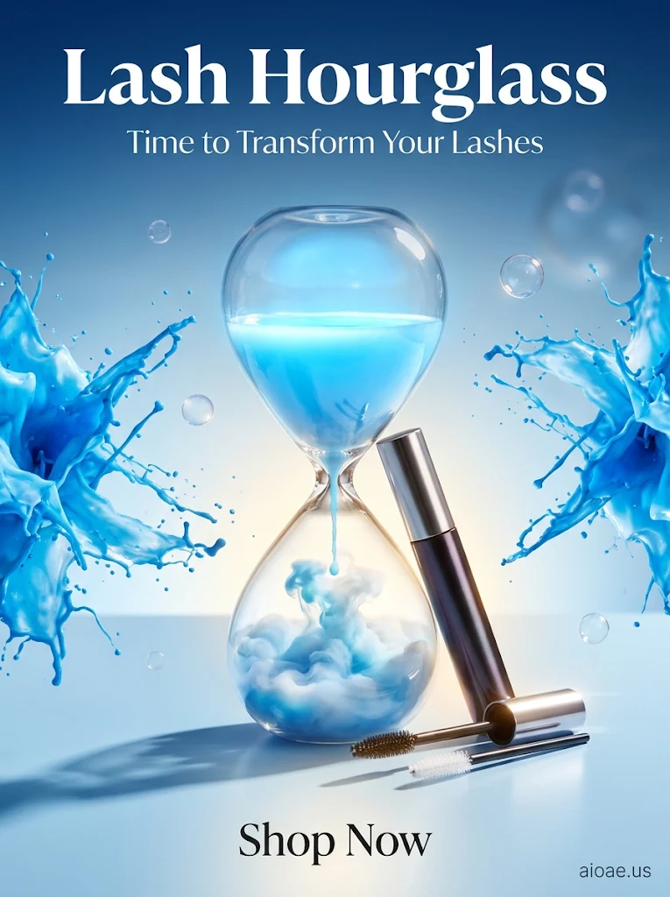

# 案例 199：睫毛沙漏：睫毛膏 | Case 199: Lash Hourglass



天空藍 × 睫毛沙漏：透明沙漏盛著發光藍液與雲霧蒸氣，珠光睫毛膏斜倚其旁，兩側藍墨水花定格動感。

Sky blue × lash hourglass: a glass hourglass holds luminous blue liquid and cloud-like vapor, a pearlescent mascara tube leaning beside it, blue ink splashes freezing the motion on both sides.

## 完整提示詞 / Full Prompt

```
SUBJECT: A transparent glass hourglass filled with a luminous sky-blue liquid in its upper bulb, its lower bulb containing a swirling, cloud-like vapor, centered in the middle of the frame.

SCENE: A luminous sky-blue liquid slowly drips from the upper bulb into the lower bulb, creating a swirling, cloud-like vapor. A glossy tube of a dark, pearlescent mascara sits at the center of the glass hourglass, its cap resting on the rim. Two tiny white brushes rest beside the tube, their bristles pointing toward the viewer. A splash of sky-blue ink erupts from the left side of the frame, while a second splash erupts from the right side, framing the hourglass and creating a sense of dynamic motion. The background is a soft, gradient sky-blue, fading from a deep, rich blue at the top to a pale, almost white blue at the bottom. A few delicate, translucent bubbles float in the air, adding a sense of lightness and airiness to the scene.

STYLE & LIGHT: The style is a blend of hyper-realistic product photography and surreal, dreamlike illustration. The lighting is soft and diffused, with a warm, golden glow emanating from the center of the frame, highlighting the glossy surface of the mascara tube and the luminous liquid in the hourglass. The overall color palette is cool and refreshing, dominated by shades of sky-blue, white, and silver, with pops of dark, pearlescent black.

CAMERA: A high-angle, top-down view with a 50mm lens, capturing the hourglass and its surroundings in sharp focus, with a shallow depth of field that blurs the background slightly.

ON-IMAGE TEXT: headline "Lash Hourglass"; subheadline "Time to Transform Your Lashes"; CTA "Shop Now".

WATERMARK: Add the exact text "aioae.us" in the bottom-right corner at 70% transparency, with enough contrast to remain visible.
```

## 適用模型 / Recommended Models

擅長美妝產品海報、超現實場景與水花動態的模型：GPT Image（Image2）、Flux Pro、Midjourney（建議加 `--ar 3:4`）。

Models strong at beauty product posters, surreal scenes and splash dynamics: GPT Image (Image2), Flux Pro, Midjourney (add `--ar 3:4`).

## 修改說明 / How to Adapt

- 換產品：把睫毛膏換成唇釉或眼線液，SCENE 的睫毛刷與珠光管身描寫改成對應的美妝品，沙漏保留。
- 換色調：把天空藍換成櫻花粉或薄荷綠，STYLE & LIGHT 的配色與墨水花描寫跟著改。
- 換文案：把 ON-IMAGE TEXT 的標題換成自家美妝品牌口號，副標與 CTA 同步改，構圖不用動。

- Change the product: swap the mascara for a lip gloss or eyeliner, reworking the brush and pearlescent-tube lines in SCENE into the matching beauty product while keeping the hourglass.
- Change the palette: swap the sky blue for cherry pink or mint green, updating the palette and ink-splash lines in STYLE & LIGHT.
- Change the copy: replace the headline in ON-IMAGE TEXT with your own beauty-brand slogan, updating the subheadline and CTA to match — the composition stays intact.

---
直達本案例 / Direct link: https://aioae.us/prompt?title=Lash%20Hourglass
更多同類提示詞 / More prompts like this: [AIOAE 免費 AI 圖片提示詞庫](https://aioae.us/prompts)
