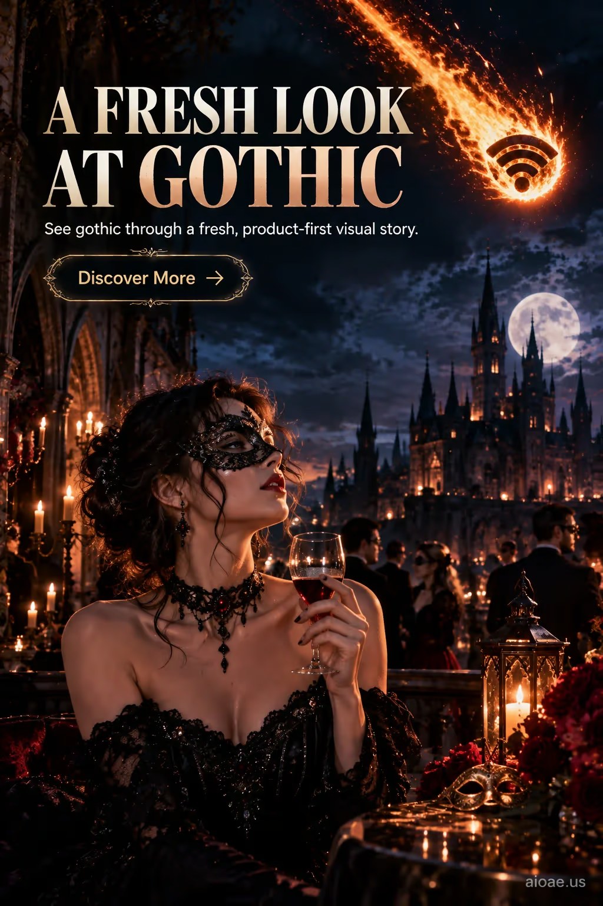

# 案例 20：哥特化裝舞會海報 | Case 20: Gothic Masquerade Ball Poster



面具舞會之夜：戴面具的女子、燭台與城堡，夜空劃過一道燃燒的 wifi 隕石。

A masquerade-ball night: a masked woman, candelabras and a castle, as a blazing wifi-signal meteor streaks across the night sky.

## 完整提示詞 / Full Prompt

```
SUBJECT & IDEA: Gothic Masquerade Ball Poster. Preserve named subject, requested relationships, main action and format.

HERO PRODUCT VISIBILITY: Keep gothic unambiguously dominant, large and readable. Preserve the actual form factor, function, silhouette, product identity and stated materials. Do not replace the product with a generic futuristic object or shrink it behind scenery.

PRODUCT VALUE STRATEGY: Distinctive product value — Make the product benefit visually understandable before decorative spectacle. Visible proof: clear product-function relationship; one visible cause-and-effect cue. Do not invent measurements or factual specifications.

PRODUCT ATMOSPHERE: visually clear, emotionally appropriate and benefit-led. Make the product benefit tangible through its real use context.. Use coherent lighting, materials and color that support this product.

SCENE: a coherent commercial setting grounded in the named product and its intended use. Maintain clear foreground, midground and background with a single coherent physical logic.

MUTATION RULES: icon object fusion. MAIN SUBJECT LOCK: Gothic Masquerade Ball Poster. Preserve: gothic. SINGLE DATABASE-GROUNDED CREATIVE MUTATION: Adapt the database-selected idea (a black wifi signal icon forms the glowing core of a falling pixel meteor, wrapped in a blazing orange-yellow fireball with a long ember trail streaking diagonally from the upper corner) to advertising_poster; implement it only in supporting display structures, environmental materials and reflections surrounding the protected hero product and connect its visual meaning to the protected subject.. Mutate supporting display structures, environmental materials and reflections surrounding the protected hero product only. Evidence: show a tangible material response, contact, reflections, shadows or a physically traceable visual consequence. Staging: Maintain the original setting with coherent lighting, scale, and foreground/background continuity. Purpose: Express the user's requested topic (Gothic Masquerade Ball Poster); do not substitute the subject, action, product identity, venue or format. Explain product benefit Distinctive product value through observable cues (clear product-function relationship; one visible cause-and-effect cue); no unverifiable performance claims. One transformation, one consistent physical logic; subject, format, original relationships, named products, setting and main action unchanged. No unsolicited portals, robots, random second worlds or subject replacement. No unrelated portal, no arbitrary second world and no subject replacement unless expressly requested.

ON-IMAGE AD COPY: Exact headline "A FRESH LOOK AT GOTHIC"; exact subheadline "See gothic through a fresh, product-first visual story."; exact CTA "Discover More". Keep the lettering legible and organized in negative space. Distinct typographic scale and hierarchy; no other invented brand, prices or specifications.

STYLE: coherent premium visual storytelling with readable subject geometry and motivated light. Lighting and color should respond to the actual setting rather than unrelated stock effects.

CAMERA: hero product dominates the frame, with legible details and controlled reflections. Preserve perspective and realistic scale.

WATERMARK: Add a small, subtle and readable "aioae.us" in the bottom-right corner.

AVOID: generic random genre backgrounds, contradictory lighting, product identity substitution, extra fingers, duplicate characters, disjointed composition, unintended copy and unsupported factual claims.
```

## 適用模型 / Recommended Models

適合需要精準渲染圖上英文文案的模型：GPT Image（Image2，本案例原生成模型）、Flux 1.1 Pro、Ideogram（海報文字專長）。

Works best on models that render on-image English copy accurately: GPT Image (Image2 — the original model used for this case), Flux 1.1 Pro, Ideogram (poster-text specialist).

## 修改說明 / How to Adapt

- 換文案：把 ON-IMAGE AD COPY 的 headline / subheadline / CTA 三行換成自己的品牌口號，其它段落不動。
- 換融合圖標：把括號裡的「wifi 圖標＋燃燒隕石」換成別的圖標融合（如電池圖標＋閃電雲），夜空奇觀的邏輯照樣成立。
- 去水印：刪掉 WATERMARK 段落，或把 "aioae.us" 換成自己的網域。

- Swap the copy: replace the headline / subheadline / CTA lines in ON-IMAGE AD COPY with your own brand slogans; leave everything else untouched.
- Swap the fused icon: replace the "wifi icon + blazing meteor" idea in the parentheses with another icon fusion (e.g. a battery icon inside a lightning cloud) — the night-sky spectacle logic still holds.
- Remove the watermark: delete the WATERMARK paragraph, or replace "aioae.us" with your own domain.

---
直達本案例 / This case on AIOAE: https://aioae.us/prompt?title=Gothic%20Masquerade%20Ball%20Poster
更多同類提示詞 / More prompts like this: https://aioae.us/prompts
