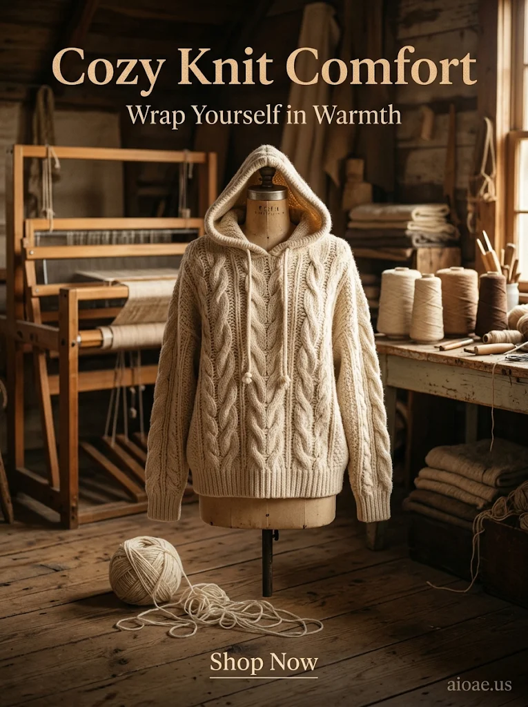

# 案例 200：舒適針織連帽衫 | Case 200: Cozy Knit Comfort



奶油針織 × 鄉村織布機：粗針絨線連帽衫立於人體模型，木織機、紗線捲與暖窗光織出冬日手作暖意。

Cream knit × rustic loom: a chunky cable-knit hoodie on a mannequin, wooden loom, yarn spools and warm window light weaving a wintry handmade warmth.

## 完整提示詞 / Full Prompt

```
SUBJECT: A cream-colored, chunky cable-knit hoodie with a hood and drawstrings, displayed on a mannequin in a cozy, rustic setting.

SCENE: The hoodie is displayed on a mannequin in the center of the frame, surrounded by a warm, inviting atmosphere. A wooden loom sits in the background, with spools of yarn in various shades of cream, beige, and brown arranged on a nearby table. A ball of yarn rests on the floor beside the mannequin, with a few strands unraveling and spilling onto the wooden floorboards. A soft, warm light filters through a nearby window, casting a gentle glow on the hoodie and highlighting its intricate cable-knit pattern. The background is a warm, earthy tone, with a subtle texture of wood and fabric adding depth to the scene.

STYLE & LIGHT: The style is warm, cozy, and rustic, with a focus on texture and detail. The lighting is soft and warm, with a golden hue that enhances the cream color of the hoodie and creates a sense of comfort and warmth.

CAMERA: A medium shot with a 50mm lens, capturing the hoodie and mannequin in sharp focus, with a shallow depth of field that blurs the background slightly.

ON-IMAGE TEXT: headline "Cozy Knit Comfort"; subheadline "Wrap Yourself in Warmth"; CTA "Shop Now".

WATERMARK: Add the exact text "aioae.us" in the bottom-right corner at 70% transparency, with enough contrast to remain visible.
```

## 適用模型 / Recommended Models

擅長服裝產品圖、針織質感與暖調室內光的模型：GPT Image（Image2）、Flux Pro、Midjourney（建議加 `--ar 3:4`）。

Models strong at fashion product shots, knit textures and warm interior light: GPT Image (Image2), Flux Pro, Midjourney (add `--ar 3:4`).

## 修改說明 / How to Adapt

- 換單品：把連帽衫換成粗針圍巾或毛衣開襟衫，SCENE 的人台展示與繩索描寫改成對應的針織品。
- 換色調：把奶油色換成燕麥灰或酒紅，STYLE & LIGHT 的配色與紗線捲描寫跟著改。
- 換文案：把 ON-IMAGE TEXT 的標題換成自家服飾品牌口號，副標與 CTA 同步改，構圖不用動。

- Change the item: swap the hoodie for a chunky scarf or knit cardigan, reworking the mannequin display and drawstring lines in SCENE into the matching knitwear.
- Change the palette: swap the cream for oatmeal grey or burgundy, updating the palette and yarn-spool lines in STYLE & LIGHT.
- Change the copy: replace the headline in ON-IMAGE TEXT with your own fashion-brand slogan, updating the subheadline and CTA to match — the composition stays intact.

---
直達本案例 / Direct link: https://aioae.us/prompt?title=Cozy%20Knit%20Comfort
更多同類提示詞 / More prompts like this: [AIOAE 免費 AI 圖片提示詞庫](https://aioae.us/prompts)
