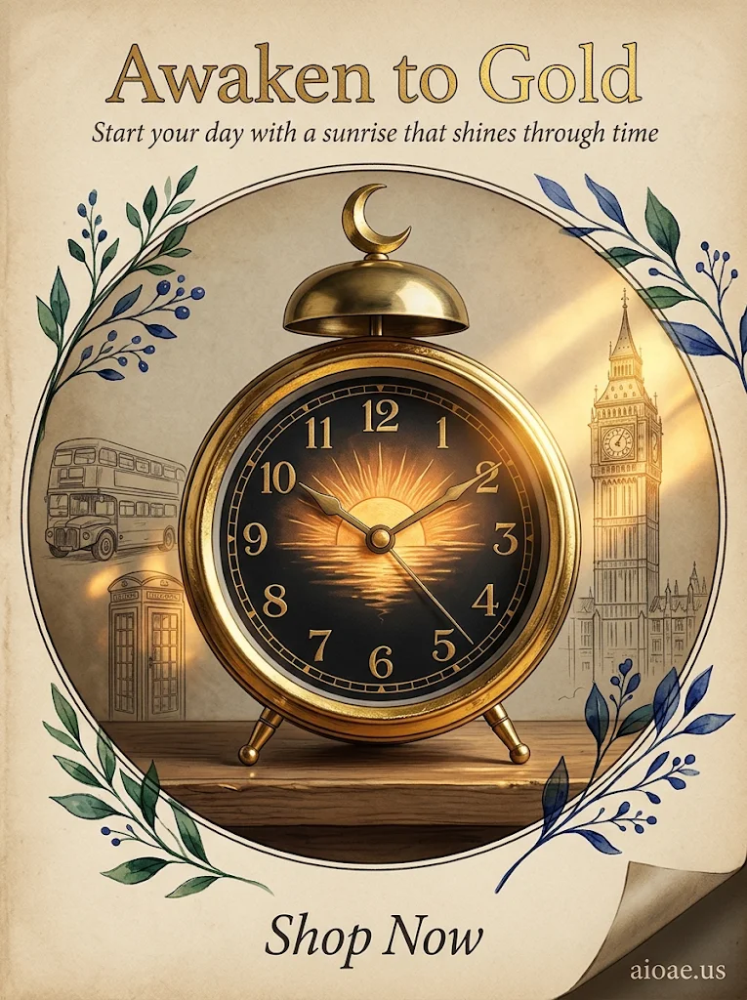

# 案例 201：金色喚醒：黃銅鬧鐘 | Case 201: Awaken to Gold



黃銅 × 倫敦日出：手工黃銅鬧鐘居於圓形紀念海報中央，雙層巴士與大笨鐘淡墨環繞，日出琥珀光自錶盤綻放。

Brass × London sunrise: a hand-crafted brass alarm clock at the center of a circular souvenir poster, double-decker bus and Big Ben in faint ink around it, amber sunrise radiating from the dial.

## 完整提示詞 / Full Prompt

```
SUBJECT: A hand-crafted analog alarm clock with a polished brass body, gold leaf detailing, a matte black face, and a brass moon-bell, positioned on a vintage wooden shelf tilted toward the viewer, centered in a circular composition.

SCENE: The clock sits in the middle of a circular frame that mimics a London souvenir poster. Botanical sprigs in fine translucent ink break the circle's edge. A muted parchment-like background bears faint ink sketches of a double-decker bus, a red telephone box, and a towering clock tower. Inside the clock's gilded frame a sunrise radiates soft amber light, illuminating the brass face and casting golden highlights onto the inked skyline. The warm glow gently backlights the parchment, enhancing the ink textures and creating subtle directional shadows across the brass and gold trim.

STYLE & LIGHT: Warm, nostalgic tones of gold, lapis blue, deep green, and amber light, with a vintage, hand-painted feel reminiscent of Tanjavur gold and classic London souvenir posters.

CAMERA: A slight low-angle 35mm lens perspective compresses the background elements into a cohesive vignette, emphasizing the clock's center where the sunrise unfolds.

ON-IMAGE TEXT: headline "Awaken to Gold"; subheadline "Start your day with a sunrise that shines through time"; CTA "Shop Now".

WATERMARK: Add the exact text "aioae.us" in the bottom-right corner at 70% transparency, with enough contrast to remain visible.
```

## 適用模型 / Recommended Models

擅長復古海報、倫敦風景插畫與金箔質感的模型：GPT Image（Image2）、Flux Pro、Midjourney（建議加 `--ar 3:4`）。

Models strong at vintage posters, London scenic illustration and gold-leaf texture: GPT Image (Image2), Flux Pro, Midjourney (add `--ar 3:4`).

## 修改說明 / How to Adapt

- 換城市：把倫敦換成巴黎或京都，SCENE 的雙層巴士與電話亭描寫改成對應的地標速寫，圓形構圖保留。
- 換產品：把鬧鐘換成懷錶或座鐘，SCENE 的黃銅鐘身與月形鈴描寫改成對應的鐘錶形態。
- 換文案：把 ON-IMAGE TEXT 的標題換成自家品牌口號，副標與 CTA 同步改，構圖不用動。

- Change the city: swap London for Paris or Kyoto, reworking the double-decker bus and telephone-box lines in SCENE into the matching landmark sketches while keeping the circular composition.
- Change the product: swap the alarm clock for a pocket watch or mantel clock, reworking the brass body and moon-bell lines in SCENE into the matching timepiece form.
- Change the copy: replace the headline in ON-IMAGE TEXT with your own brand slogan, updating the subheadline and CTA to match — the composition stays intact.

---
直達本案例 / Direct link: https://aioae.us/prompt?title=Awaken%20to%20Gold
更多同類提示詞 / More prompts like this: [AIOAE 免費 AI 圖片提示詞庫](https://aioae.us/prompts)
