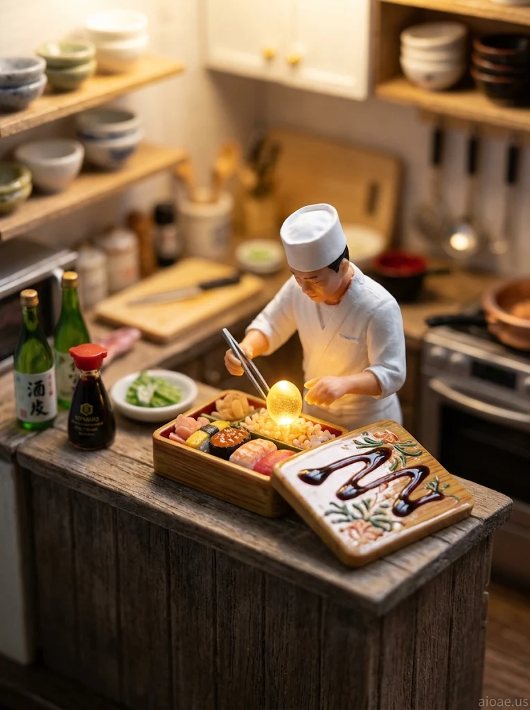

# 案例 202：迷你壽司師傅便當盒 | Case 202: Miniature Sushi Chef Bento Box



迷你食玩 × 發光米粒：袖珍壽司師傅在暖光廚房擺弄便當，一粒米膨脹成金色光球，照亮醬油緞帶與便當蓋花紋。

Miniature food replica × glowing rice grain: a tiny sushi chef arranges a bento box in a warm kitchen as one grain of rice swells into a golden orb, lighting the soy-sauce ribbons and lid garnish.

## 完整提示詞 / Full Prompt

```
SUBJECT: Miniature food replica diorama, tiny sushi chef working on a bento box, warm kitchen light

SCENE: A miniature food replica diorama shows a tiny sushi chef in a white coat and hat, working on a bento box in a cozy kitchen; as he arranges the miniature ingredients, one grain of rice begins to swell, transforming into a small, glowing orb that casts a warm, golden light across the scene and subtly illuminates the soy-sauce ribbons and garnish patterns on the bento lid.

STYLE & LIGHT: A miniature food replica with the visual texture of polished plastic models and soft, warm kitchen light.

CAMERA: Shot on a vertical frame, the focus zone centers on the bento box and chef in the mid-frame, with a shallow depth of field that keeps the chef and bento in sharp detail while the kitchen background softly blurs.

WATERMARK: Add the exact text "aioae.us" in the bottom-right corner at 70% transparency, with enough contrast to remain visible.
```

## 適用模型 / Recommended Models

擅長微縮模型、食玩質感與暖調廚房光的模型：GPT Image（Image2）、Flux Pro、Midjourney（建議加 `--ar 3:4`）。

Models strong at miniature models, food-replica texture and warm kitchen light: GPT Image (Image2), Flux Pro, Midjourney (add `--ar 3:4`).

## 修改說明 / How to Adapt

- 換料理：把壽司便當換成迷你拉麵或甜點工坊，SCENE 的便當食材與醬油緞帶描寫改成對應的料理細節。
- 換發光物：把發光米粒換成發光湯匙或茶杯，SCENE 的米粒膨脹描寫改成對應的微縮奇蹟。
- 換景深：把淺景深改成全景深微縮移軸效果，CAMERA 的對焦描寫跟著改，廚房背景的柔焦換成模型感。

- Change the dish: swap the sushi bento for a miniature ramen stall or dessert workshop, reworking the bento ingredients and soy-sauce ribbon lines in SCENE into the matching dish details.
- Change the glowing object: swap the glowing rice grain for a glowing spoon or teacup, reworking the swelling-grain line in SCENE into the matching miniature wonder.
- Change the depth: swap the shallow depth of field for a full-depth tilt-shift miniature look, updating the focus lines in CAMERA so the kitchen reads as a scale model.

---
直達本案例 / Direct link: https://aioae.us/prompt?title=Miniature%20Sushi%20Chef%20Bento%20Box
更多同類提示詞 / More prompts like this: [AIOAE 免費 AI 圖片提示詞庫](https://aioae.us/prompts)
