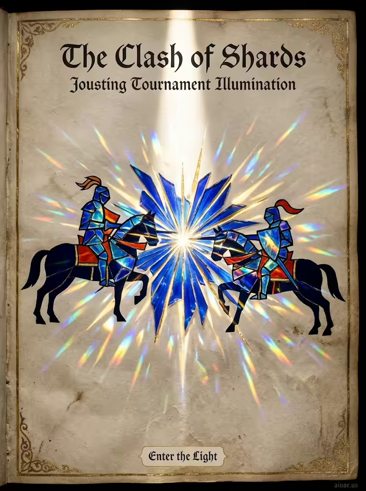

# 案例 203：碎片之戰：彩繪玻璃騎士 | Case 203: The Clash of Shards



中世紀泥金手抄本 × 彩繪玻璃騎士：兩名玻璃碎片騎士策馬對衝，頂光在中心炸出鈷藍與金色的星芒，羊皮紙上光影碎裂流轉。

Medieval illuminated manuscript × stained-glass knights: two shard knights charge at each other as a top light bursts into a cobalt-and-gold starburst, fractured light rippling across ivory vellum.

## 完整提示詞 / Full Prompt

```
SUBJECT: Two abstract knight forms made of jagged stained-glass shards on ivory vellum, each mounted on a horse silhouette charging from opposite edges

SCENE: A top-down view of a rectangular ivory vellum page shows the two stained-glass knights racing horizontally in profile toward the center. A single sharp spotlight from above strikes the midpoint, exploding into a starburst of cobalt and gold that fractures across the glass armor, casting colorful, fractured reflections that ripple over the fibrous vellum surface. The background remains flat and silent, its textured parchment catching the kaleidoscopic light while the edges are bordered by subtle gold leaf scrollwork.

STYLE & LIGHT: The image mimics a medieval illuminated manuscript with flat gold and mineral pigments, burnished gold-leaf accents, and a limited palette of cobalt, vermilion, gold and ivory, rendered in high-contrast lighting to emphasize the stained-glass translucency.

CAMERA: A fixed orthogonal camera positioned directly above the page captures the scene in a crisp, top-down perspective with sharp focus on the central light burst.

ON-IMAGE TEXT: headline "The Clash of Shards"; subheadline "Jousting Tournament Illumination"; CTA "Enter the Light".

WATERMARK: Add the exact text "aioae.us" in the bottom-right corner at 90% transparency (10% opacity), with enough contrast to remain visible.
```

## 適用模型 / Recommended Models

擅長中世紀手抄本、彩繪玻璃與高對比光影的模型：GPT Image（Image2）、Flux Pro、Midjourney（建議加 `--ar 3:4`）。

Models strong at medieval manuscripts, stained glass and high-contrast lighting: GPT Image (Image2), Flux Pro, Midjourney (add `--ar 3:4`).

## 修改說明 / How to Adapt

- 換對決：把雙騎士對衝換成騎士與巨龍對峙，SCENE 的馬匹剪影與星芒描寫改成對應的對決構圖。
- 換配色：把鈷藍與金換成緋紅與銀，STYLE & LIGHT 的礦物顏料配色描寫跟著改，泥金手抄本質感保留。
- 換文案：把 ON-IMAGE TEXT 的標題換成自家活動口號，副標與 CTA 同步改，構圖不用動。

- Change the duel: swap the twin-knight charge for a knight facing a dragon, reworking the horse silhouettes and starburst lines in SCENE into the matching standoff.
- Change the palette: swap the cobalt and gold for vermilion and silver, updating the mineral-pigment palette lines in STYLE & LIGHT while keeping the illuminated-manuscript texture.
- Change the copy: replace the headline in ON-IMAGE TEXT with your own event slogan, updating the subheadline and CTA to match — the composition stays intact.

---
直達本案例 / Direct link: https://aioae.us/prompt?title=The%20Clash%20of%20Shards
更多同類提示詞 / More prompts like this: [AIOAE 免費 AI 圖片提示詞庫](https://aioae.us/prompts)
