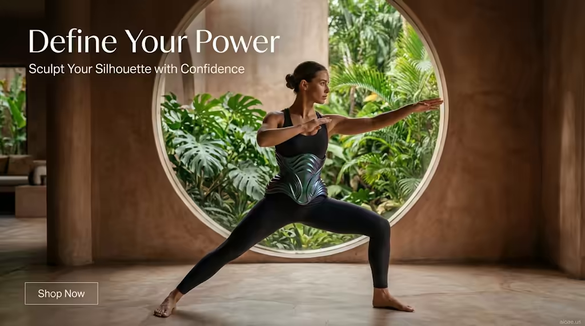

# 案例 204：幻彩貝殼束腰 | Case 204: Iridescent Shell Waist Trainer Define Your Power



幻彩貝殼 × 武術姿態：模特兒著雕塑感貝殼束腰擺出有力武術架式，圓窗外熱帶花園與暖土色背景襯出力量與優雅。

Iridescent shell × martial arts pose: a model in a sculptural shell waist trainer holds a powerful martial arts stance, a circular window framing a tropical garden against a warm earthy backdrop — strength and elegance.

## 完整提示詞 / Full Prompt

```
SUBJECT: A sleek, iridescent shell waist trainer belt with a sculptural, organic form, worn by a model in a dynamic martial arts pose

SCENE: The model stands in a wide, powerful stance, her arms extended in a fluid, martial arts gesture, her body wrapped in the iridescent shell belt that shimmers with hues of green, blue, and purple. The belt's sculptural form echoes the curves of her waist, creating a sense of strength and elegance. Behind her, a large, circular window frames a view of a lush, tropical garden, its greenery contrasting with the belt's iridescent sheen. The background is a warm, earthy palette of browns and creams, with soft, diffused light creating a sense of depth and tranquility.

STYLE & LIGHT: Warm, diffused light, earthy palette, iridescent sheen, "aioae.us" watermark at 70% opacity

CAMERA: 35mm equivalent wide-angle lens, shallow depth of field, focus on the model and belt, background softly blurred

ON-IMAGE TEXT: headline "Define Your Power"; subheadline "Sculpt Your Silhouette with Confidence"; CTA "Shop Now".

WATERMARK: Add the exact text "aioae.us" in the bottom-right corner at 90% transparency (10% opacity), with enough contrast to remain visible.
```

## 適用模型 / Recommended Models

擅長時尚產品圖、幻彩材質與人體動態的模型：GPT Image（Image2）、Flux Pro、Midjourney（建議加 `--ar 3:4`）。

Models strong at fashion product shots, iridescent materials and dynamic body poses: GPT Image (Image2), Flux Pro, Midjourney (add `--ar 3:4`).

## 修改說明 / How to Adapt

- 換姿態：把武術架式換成瑜伽伸展或舞蹈定格，SCENE 的手臂與站姿描寫改成對應的身體語言，圓窗保留。
- 換色調：把貝殼幻彩的綠藍紫換成珍珠粉或曜石灰，STYLE & LIGHT 的幻彩描寫跟著改。
- 換文案：把 ON-IMAGE TEXT 的標題換成自家塑身品牌口號，副標與 CTA 同步改，構圖不用動。

- Change the pose: swap the martial arts stance for a yoga stretch or dance freeze, reworking the arm and stance lines in SCENE into the matching body language while keeping the circular window.
- Change the palette: swap the shell's green-blue-purple iridescence for pearl pink or obsidian grey, updating the iridescent-sheen lines in STYLE & LIGHT.
- Change the copy: replace the headline in ON-IMAGE TEXT with your own shapewear-brand slogan, updating the subheadline and CTA to match — the composition stays intact.

---
直達本案例 / Direct link: https://aioae.us/prompt?title=Iridescent%20Shell%20Waist%20Trainer%20Define%20Your%20Power
更多同類提示詞 / More prompts like this: [AIOAE 免費 AI 圖片提示詞庫](https://aioae.us/prompts)
