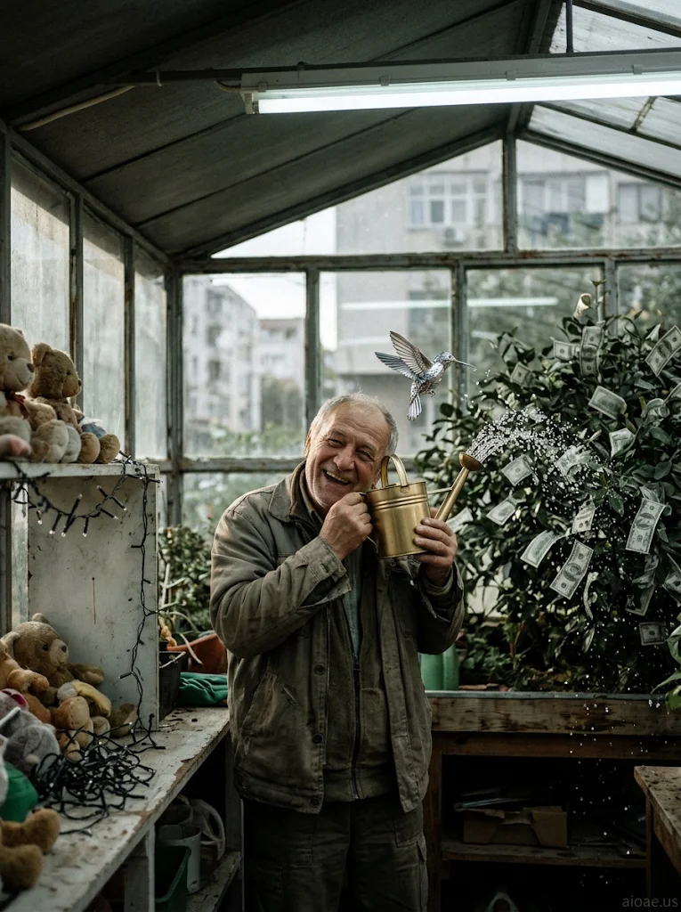

# 案例 205：澆灌鈔票灌木 | Case 205: Watering Money Bush



羅馬尼亞新浪潮電影感 × 鈔票灌木：白髮老人把金水壺貼在臉頰、笑著澆灌長滿百元鈔票的灌木，鍍鉻蜂鳥懸停壺口，溫室裡的絨毛玩具與彩燈在前景柔焦。

Romanian New Wave film grain × money-leaf bush: a laughing elderly man presses a golden watering can to his cheek as he waters a bush sprouting hundred-dollar bills, a chrome hummingbird hovering above the can, plush toys and fairy lights soft in the foreground.

## 完整提示詞 / Full Prompt

```
SUBJECT: A joyful elderly man waters a lush bush sprouting hundred-dollar bills in a sunny city garden, laughing as money grows like leaves.

SCENE: In the sunny city garden, the elderly man, still laughing, holds the golden watering can against his cheek, his hands hugging it like a plush toy. A tiny chrome hummingbird, its wings beating rapidly, hovers just above the can, reflecting a silver shimmer onto the hundred-dollar leaf bush. The bird's metallic feathers catch the sunlight, casting a glittering reflection that ripples across the money leaves, while the water from the can splashes onto the hummingbird, creating a tiny splash that glints like a coin.

STYLE & LIGHT: The image is rendered in muted, grainy Romanian New Wave film style, with flat, unflattering ceiling‑tube lighting and a slightly off‑center composition.

CAMERA: A low‑angle medium shot captures the man's upper body and the money‑leaf bush, keeping the plush toys and fairy lights in a soft‑focused foreground.

WATERMARK: Add the exact text "aioae.us" in the bottom-right corner at 90% transparency (10% opacity), with enough contrast to remain visible.
```

## 適用模型 / Recommended Models

擅長寫實人像、電影感顆粒與超現實場景的模型：GPT Image（Image2）、Flux Pro、Midjourney（建議加 `--ar 3:4`）。

Models strong at realistic portraits, film grain and surreal scenes: GPT Image (Image2), Flux Pro, Midjourney (add `--ar 3:4`).

## 修改說明 / How to Adapt

- 換澆灌物：把鈔票灌木換成金幣花叢或珠寶樹，SCENE 的鈔票葉片與蜂鳥描寫改成對應的財富意象，金水壺保留。
- 換風格：把羅馬尼亞新浪潮膠片感換成暖調紀實攝影或明亮廣告風，STYLE & LIGHT 的燈光與顆粒描寫跟著改。
- 換主角：把老人換成小孩或園丁夫婦，SUBJECT 的年齡與神情描寫改成對應的人物，澆水動作與灌木不變。

- Change what grows: swap the money-leaf bush for a gold-coin flowerbed or a jewel tree, reworking the bill-leaf and hummingbird lines in SCENE into the matching wealth imagery while keeping the golden watering can.
- Change the style: swap the Romanian New Wave film grain for warm documentary photography or a bright advertising look, updating the lighting and grain lines in STYLE & LIGHT.
- Change the gardener: swap the elderly man for a child or a gardener couple, reworking the age and expression lines in SUBJECT while keeping the watering gesture and the bush.

---
直達本案例 / Direct link: https://aioae.us/prompt?title=Watering%20Money%20Bush
更多同類提示詞 / More prompts like this: [AIOAE 免費 AI 圖片提示詞庫](https://aioae.us/prompts)
