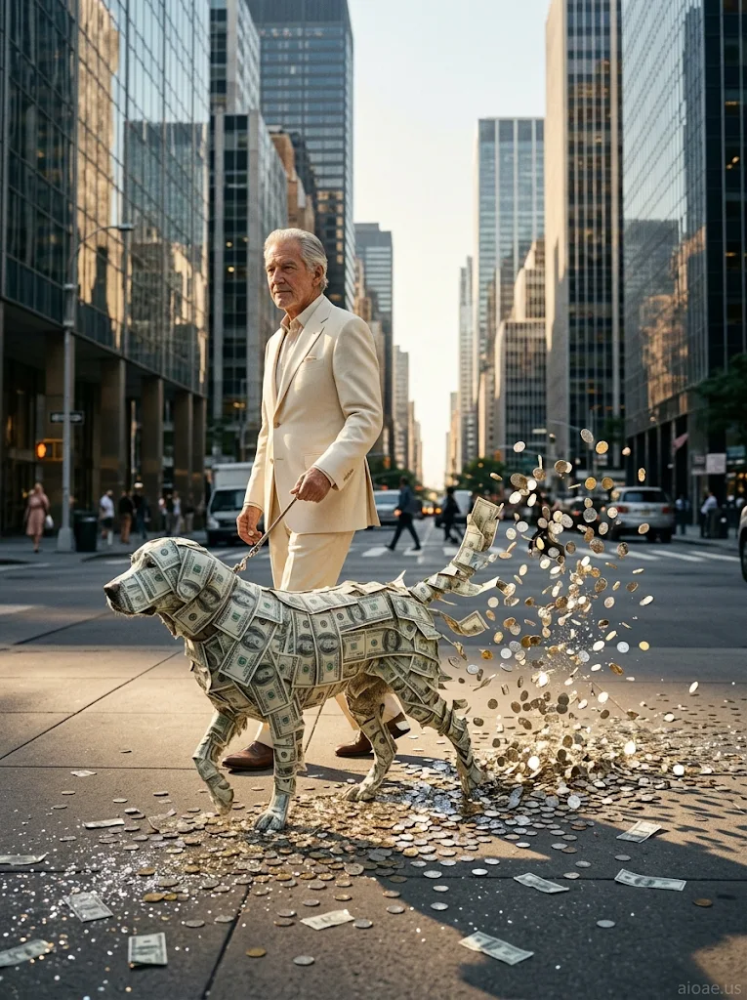

# 案例 206：遛鈔票狗 | Case 206: Money Dog Walk



暖電影光 × 鈔票狗：奶油西裝老人牽著百元鈔票摺成的狗漫步陽光大道，狗身鈔票撕裂捲曲、化作金幣噴泉灑落路面，玻璃高樓映著硬幣的光。

Warm cinematic light × bill-dog: an elegant elderly man in a cream suit walks a dog fashioned from hundred-dollar bills down a sunny avenue, the bills ripping and curling into a shimmering fountain of coins, glass towers reflecting the light.

## 完整提示詞 / Full Prompt

```
SUBJECT: An elegant elderly man in a cream suit walking a dog made of hundred-dollar bills on a leash down a sunny city street

SCENE: The man strides down a bright, sun‑lit avenue, his hand steady on a leash that tethers a dog entirely fashioned from crisp hundred‑dollar bills. As he walks, the bills begin to rip and curl, turning the canine into a shimmering fountain of coins that pours onto the pavement, leaving a glittering trail of currency in his wake. The warm afternoon light bathes the street, contrasting with the cool, metallic glow of the falling coins, while glass towers in the background reflect the coin‑fountain's light.

STYLE & LIGHT: Warm, cinematic lighting with a subtle metallic shimmer, realistic textures and a hint of surreal transformation

CAMERA: Wide‑angle portrait shot from slightly below, capturing the man in the foreground, the bill‑dog in mid‑fountain, and the distant skyline in the background

WATERMARK: Add the exact text "aioae.us" in the bottom-right corner at 90% transparency (10% opacity), with enough contrast to remain visible.
```

## 適用模型 / Recommended Models

擅長寫實街景、暖調電影光與超現實變形的模型：GPT Image（Image2）、Flux Pro、Midjourney（建議加 `--ar 3:4`）。

Models strong at realistic street scenes, warm cinematic light and surreal transformation: GPT Image (Image2), Flux Pro, Midjourney (add `--ar 3:4`).

## 修改說明 / How to Adapt

- 換動物：把鈔票狗換成鈔票貓或金幣鳥，SCENE 的犬身鈔票與金幣噴泉描寫改成對應的動物形態，牽繩與街道保留。
- 換時間：把午後暖陽換成黃昏霓虹或清晨薄霧，STYLE & LIGHT 的光色與金屬反光描寫跟著改。
- 換視角：把低角度廣角改成跟拍特寫，CAMERA 的鏡頭與景深描寫跟著改，狗與金幣軌跡仍是焦點。

- Change the animal: swap the bill-dog for a bill-cat or a coin-bird, reworking the canine bill-body and coin-fountain lines in SCENE into the matching animal form while keeping the leash and the street.
- Change the hour: swap the warm afternoon light for dusk neon or early-morning mist, updating the light colour and metallic-glow lines in STYLE & LIGHT.
- Change the angle: swap the low wide-angle shot for a tracking close-up, updating the lens and depth-of-field lines in CAMERA while keeping the dog and the coin trail in focus.

---
直達本案例 / Direct link: https://aioae.us/prompt?title=Money%20Dog%20Walk
更多同類提示詞 / More prompts like this: [AIOAE 免費 AI 圖片提示詞庫](https://aioae.us/prompts)
