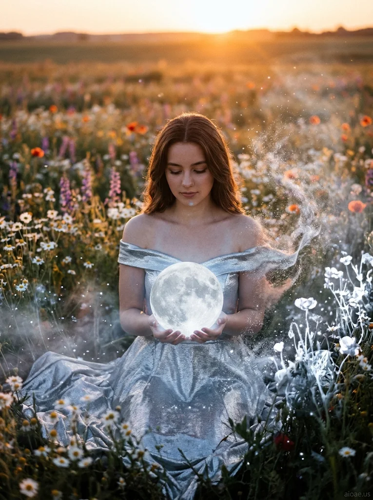

# 案例 207：銀裙捧月少女 | Case 207: Silver Gown Moon Maiden



黃昏野花田 × 銀色月光：年輕女子一襲銀色露肩長裙、手捧發光滿月，裙擺化作銀霧升騰，野花染成銀白，暖陽餘暉與清冷月光交融成夢境。

Wildflower dusk × silver moonlight: a young woman in a shimmering silver off-shoulder gown holds a glowing full moon in both hands as her dress unravels into silver mist, wildflowers turning luminous silver where dusk amber meets cool moonlight.

## 完整提示詞 / Full Prompt

```
SUBJECT: A young woman in a shimmering silver off‑shoulder gown holds a glowing full moon in both hands.

SCENE: At dusk, she stands in a sun‑kissed wildflower field; the moon’s pale light spills onto her face and petals. As she lifts the orb, silver fabric of her dress unravels into fine mist that rises and dissolves, turning nearby wildflowers into luminous silver and deepening the moon’s glow into a gentle twilight. The warm amber of the setting sun and the cool, ethereal moonlight blend, creating a dreamy, ethereal atmosphere.

STYLE & LIGHT: Warm amber sunset light meets cool moonlit glow, with silver mist reflecting both hues onto petals and the woman’s gown.

CAMERA: Eye‑level medium close‑up, framing the woman centrally with the wildflower field extending into a soft background, capturing the interplay of light and mist.

WATERMARK: Add the exact text "aioae.us" in the bottom-right corner at 90% transparency (10% opacity), with enough contrast to remain visible.
```

## 適用模型 / Recommended Models

擅長寫實人像、夢幻光影與柔霧質感的模型：GPT Image（Image2）、Flux Pro、Midjourney（建議加 `--ar 3:4`）。

Models strong at realistic portraits, dreamlike light and soft mist textures: GPT Image (Image2), Flux Pro, Midjourney (add `--ar 3:4`).

## 修改說明 / How to Adapt

- 換光源：把手捧滿月換成捧著星團或螢火蟲燈，SCENE 的月光與銀霧描寫改成對應的光暈，野花田保留。
- 換時段：把黃昏換成午夜藍調或清晨薄霧，STYLE & LIGHT 的暖陽與月光配比描寫跟著改。
- 換裙擺：把銀霧裙擺換成花瓣飄散或星塵拖尾，SCENE 的布料化霧描寫改成對應的飄散效果，捧月姿勢不變。

- Change the light: swap the held full moon for a cluster of stars or a firefly lantern, reworking the moonlight and silver-mist lines in SCENE into the matching glow while keeping the wildflower field.
- Change the hour: swap dusk for midnight blue or early-morning mist, updating the amber-and-moonlight balance lines in STYLE & LIGHT.
- Change the gown: swap the mist-dissolving skirt for scattering petals or a stardust trail, reworking the fabric-to-mist lines in SCENE into the matching drifting effect while keeping the moon-holding pose.

---
直達本案例 / Direct link: https://aioae.us/prompt?title=Silver%20Gown%20Moon%20Maiden
更多同類提示詞 / More prompts like this: [AIOAE 免費 AI 圖片提示詞庫](https://aioae.us/prompts)
