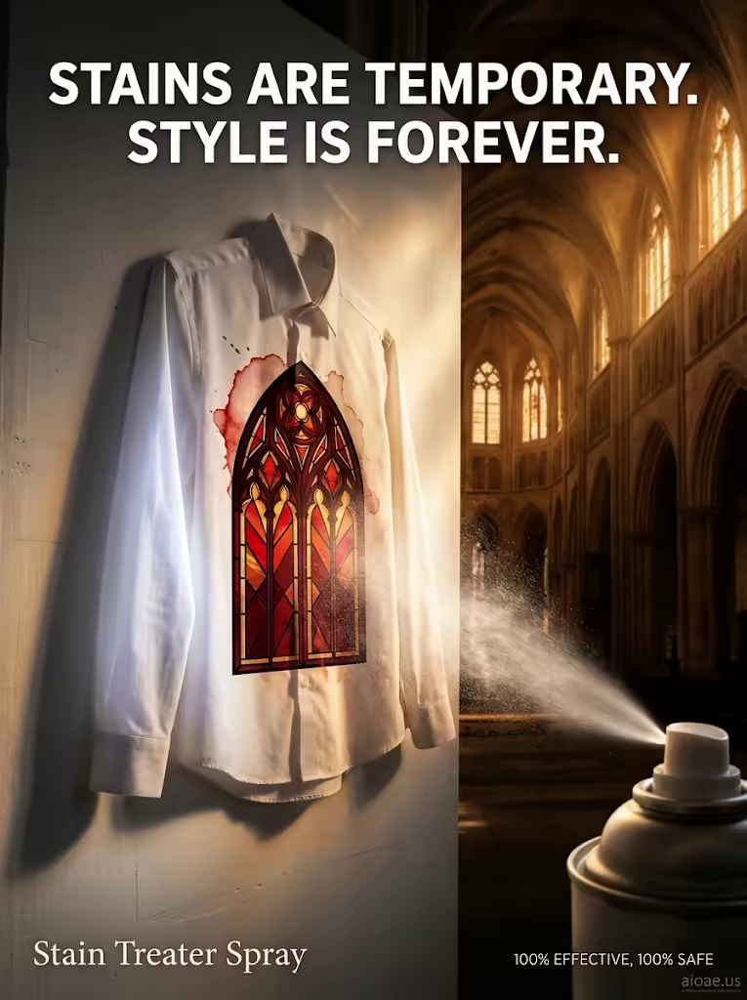

# 案例 208：去漬噴霧：污漬短暫，風格永恆 | Case 208: Stain Treater Spray Stains Are Temporary Style Is Forever



哥德教堂 × 白襯衫彩繪玻璃：咖啡漬在白襯衫上化作尖拱彩繪玻璃，去漬噴霧的發光霧氣自右下角斜灑，暖金教堂光透窗而入。

Gothic cathedral × stained-glass shirt: a red coffee stain blooms into a pointed-arch stained-glass pattern on a white shirt as luminous spray mist arcs in from the lower right, warm golden cathedral light filtering through the windows.

## 完整提示詞 / Full Prompt

```
SUBJECT: A men's white shirt with a red coffee stain, hung on a plain wall as if it were a stained glass window, with the stain turning into a gothic stained glass pattern, sharp and geometric, while its sleeve glows with a soft, white light. From the bottom right, the Stain Treater Sp

SCENE: In a gothic cathedral, with a plain white wall as the backdrop, a men's white shirt with a red coffee stain hangs on the wall as if it were a stained glass window, with the stain turning into a gothic stained glass pattern, sharp and geometric, while its sleeve glows with a soft, white light. From the bottom right, the Stain Treater Spray can, held unseen, releases a luminous mist that arcs toward the stain, transforming the red stain into a vibrant gothic pattern, and the cathedral's warm, golden light filters through the window, casting a warm glow on the shirt and the wall.

TEXT: At the top of the poster, in large, bold, white letters, "STAINS ARE TEMPORARY. STYLE IS FOREVER." appears, with a smaller line of text reading "Stain Treater Spray" in a smaller, more delicate font, positioned near the bottom of the poster, with a small, elegant font reading "100% EFFECTIVE, 100% SAFE" at the bottom right corner.

WATERMARK: Add the exact text "aioae.us" in the bottom-right corner at 70% transparency (30% opacity), with enough contrast to remain readable.
```

## 適用模型 / Recommended Models

擅長產品海報、哥德建築與暖金光影的模型：GPT Image（Image2）、Flux Pro、Midjourney（建議加 `--ar 3:4`）。

Models strong at product posters, gothic architecture and warm golden light: GPT Image (Image2), Flux Pro, Midjourney (add `--ar 3:4`).

## 修改說明 / How to Adapt

- 換污漬：把咖啡漬換成紅酒漬或墨水漬，SUBJECT 與 SCENE 的漬痕顏色與彩繪玻璃圖案描寫跟著改，教堂背景保留。
- 換場景：把哥德教堂換成現代洗衣房或明亮浴室，SCENE 的牆面與光線描寫改成對應的室內，襯衫懸掛構圖不變。
- 換文案：把 TEXT 的標語換成自家清潔品牌口號，副標與角落小字同步改，構圖不用動。

- Change the stain: swap the coffee stain for red wine or ink, updating the stain colour and stained-glass pattern lines in SUBJECT and SCENE while keeping the cathedral backdrop.
- Change the setting: swap the gothic cathedral for a modern laundry room or bright bathroom, reworking the wall and light lines in SCENE into the matching interior while keeping the hanging-shirt composition.
- Change the copy: replace the headline in TEXT with your own cleaning-brand slogan, updating the sub-lines to match — the composition stays intact.

---
直達本案例 / Direct link: https://aioae.us/prompt?title=Stain%20Treater%20Spray%20Stains%20Are%20Temporary%20Style%20Is%20Forever
更多同類提示詞 / More prompts like this: [AIOAE 免費 AI 圖片提示詞庫](https://aioae.us/prompts)
