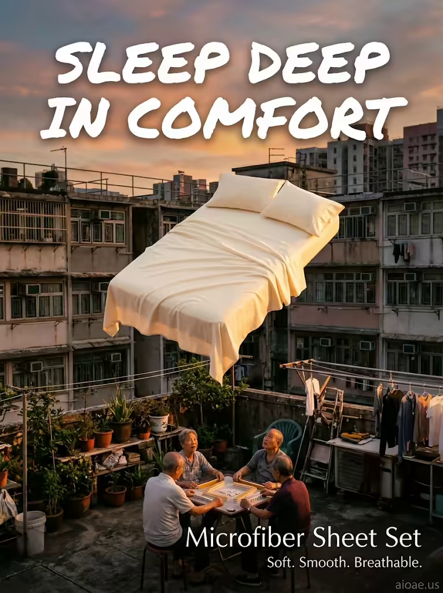

# 案例 209：超細纖維床單組：深睡舒適 | Case 209: Microfiber Sheet Set Sleep Deep in Comfort



香港天台 × 漂浮床單：象牙白床單組 45 度傾斜漂浮在屋邨天台上空，樓下長者圍坐打麻將抬頭驚望，晚霞橙光灑滿天台。

Hong Kong rooftop × floating sheet set: a glowing ivory sheet set tilts at 45 degrees above a public-housing rooftop as elderly mahjong players look up in surprise, late-afternoon orange light washing the courtyard.

## 完整提示詞 / Full Prompt

```
SUBJECT: A complete microfiber sheet set, calm, glowing ivory, floating somewhere it doesn't belong — a single complete sheet set floating against the sky over a Hong Kong courtyard, lifted from outside, so the viewer sees the roofline along the side, with the set tilting at a 45‑degree angle toward gravity, revealing its texture, in the center.

SCENE: In a rooftop courtyard on the 5th floor of a Hong Kong public estate, where several elderly residents are playing mahjong on a rooftop, the warm orange light of a late afternoon sunset falls across the courtyard. The sheet set floats above the rooftop, and the mahjong players look up in surprise, while the other residents watch from the rooftop balcony.

TEXT: At the top of the poster, in large, bold, white letters, "SLEEP DEEP IN COMFORT" appears, with a smaller line of text reading "Microfiber Sheet Set" in a smaller, more delicate font, positioned near the bottom of the poster, with a small, elegant font reading "Soft. Smooth. Breathable." at the bottom right corner.

WATERMARK: Add the exact text "aioae.us" in the bottom-right corner at 70% transparency (30% opacity), with enough contrast to remain readable.
```

## 適用模型 / Recommended Models

擅長產品海報、超現實生活場景與暖調夕陽的模型：GPT Image（Image2）、Flux Pro、Midjourney（建議加 `--ar 3:4`）。

Models strong at product posters, surreal lifestyle scenes and warm sunset light: GPT Image (Image2), Flux Pro, Midjourney (add `--ar 3:4`).

## 修改說明 / How to Adapt

- 換產品：把床單組換成羽絨被或枕頭組，SUBJECT 的漂浮物與質感描寫改成對應的寢具，天台麻將場景保留。
- 換城市：把香港屋邨天台換成台北老公寓頂樓或曼谷街區天台，SCENE 的建築與居民描寫改成對應的城市風貌。
- 換文案：把 TEXT 的標語換成自家寢具品牌口號，副標與角落小字同步改，構圖不用動。

- Change the product: swap the sheet set for a duvet or pillow set, reworking the floating-object and texture lines in SUBJECT into the matching bedding while keeping the rooftop mahjong scene.
- Change the city: swap the Hong Kong estate rooftop for a Taipei apartment rooftop or a Bangkok neighbourhood rooftop, reworking the buildings and residents in SCENE into the matching cityscape.
- Change the copy: replace the headline in TEXT with your own bedding-brand slogan, updating the sub-lines to match — the composition stays intact.

---
直達本案例 / Direct link: https://aioae.us/prompt?title=Microfiber%20Sheet%20Set%20Sleep%20Deep%20in%20Comfort
更多同類提示詞 / More prompts like this: [AIOAE 免費 AI 圖片提示詞庫](https://aioae.us/prompts)
