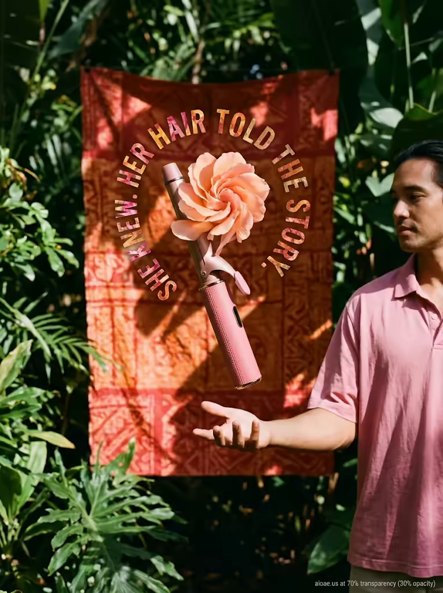

# 案例 210：無線便攜捲髮棒：她的頭髮會說故事 | Case 210: Cordless Portable Hair Curler She Knew Her Hair Told the Story



熱帶花園 × 粉紅捲髮棒：粉紅皮革捲髮棒懸浮半空、捲成陽光花瓣螺旋，紅橙卡帕布上花瓣拼出「SHE KNEW. HER HAIR TOLD THE STORY.」，粉紅 Polo 衫男子伸手輕托。

Tropical garden × pink hair curler: a pink-leather-wrapped cordless curler floats in mid-air, its clip folding into a spiral of sunlit petals over red-and-orange kapa cloth spelling 'SHE KNEW. HER HAIR TOLD THE STORY.', a man in a pink polo shirt holding it loosely.

## 完整提示詞 / Full Prompt

```
SUBJECT: A cordless portable hair curler, pink‑leather wrapped, floating free in mid‑air, its clip and heating rod folding into a soft spiral of sunlit petals that cast a soft shadow onto a backdrop of red and orange kapa cloth.

SCENE: In a warm tropical garden, rich in colors and plants, a man in a loose pink polo shirt holds the curler loosely in his hand.

TEXT: "SHE KNEW. HER HAIR TOLD THE STORY." The text is designed to look like it's composed of petals and cloth and is arranged in a vertical curve over the curler.

Visual idea: A cordless portable hair curler, pink‑leather wrapped, floating free in mid‑air, its clip and heating rod folding into a soft spiral of sunlit petals that cast a soft shadow onto a backdrop of red and orange kapa cloth.

WATERMARK: Add the exact text "aioae.us" in the bottom-right corner at 70% transparency (30% opacity), with enough contrast to remain readable.
```

## 適用模型 / Recommended Models

擅長美妝產品海報、熱帶植物與布料質感的模型：GPT Image（Image2）、Flux Pro、Midjourney（建議加 `--ar 3:4`）。

Models strong at beauty product posters, tropical plants and fabric textures: GPT Image (Image2), Flux Pro, Midjourney (add `--ar 3:4`).

## 修改說明 / How to Adapt

- 換產品：把捲髮棒換成直髮器或吹風機，SUBJECT 的夾板與加熱棒描寫改成對應的美髮工具，花瓣螺旋保留。
- 換布料：把紅橙卡帕布換成蠟染布或絲綢，SUBJECT 與 TEXT 的布料底色與花瓣字描寫跟著改。
- 換文案：把 TEXT 的標語換成自家美髮品牌口號，花瓣字的排列方式保留，構圖不用動。

- Change the product: swap the curler for a hair straightener or dryer, reworking the clip and heating-rod lines in SUBJECT into the matching styling tool while keeping the petal spiral.
- Change the cloth: swap the red-and-orange kapa cloth for batik or silk, updating the cloth backdrop and petal-letter lines in SUBJECT and TEXT.
- Change the copy: replace the slogan in TEXT with your own hair-care brand line, keeping the petal-letter arrangement — the composition stays intact.

---
直達本案例 / Direct link: https://aioae.us/prompt?title=Cordless%20Portable%20Hair%20Curler%20She%20Knew%20Her%20Hair%20Told%20the%20Story
更多同類提示詞 / More prompts like this: [AIOAE 免費 AI 圖片提示詞庫](https://aioae.us/prompts)
