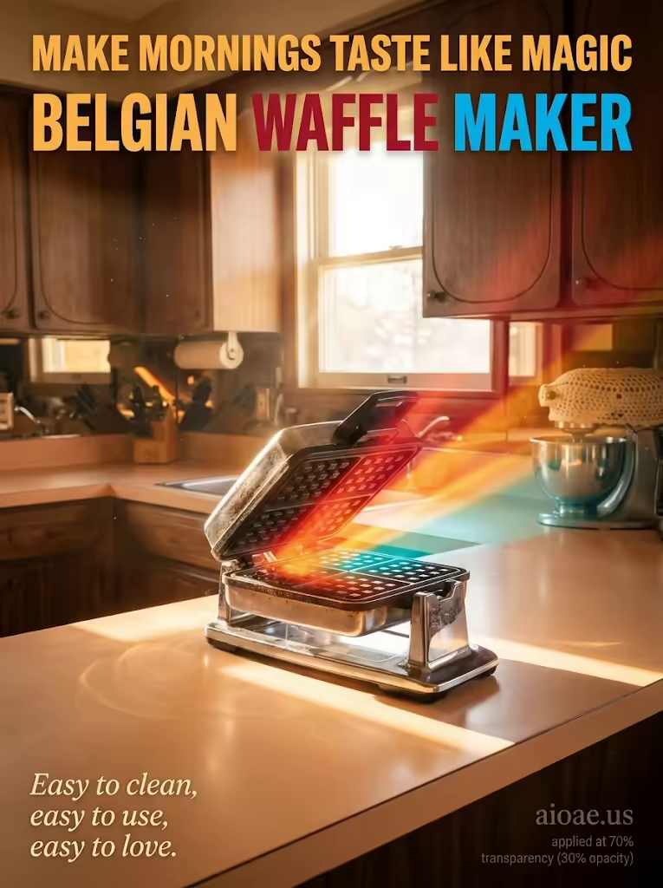

# 案例 211：比利時鬆餅機：讓早晨嚐起來像魔法 | Case 211: Belgian Waffle Maker Make Mornings Taste Like Magic



七〇年代廚房 × 鬆餅機稜鏡：杏色廚房裡鬆餅機熱板張開、折射出紅琥珀綠松石三色光，鉤針罩攪拌機與煙燻玻璃鏡面背板襯出復古暖調。

1970s kitchen × waffle-maker prism: in a sunlit retro kitchen the waffle maker's hot plates open into a prism of red, amber and turquoise rays, a crochet-covered stand mixer and smoke-glass backsplash completing the vintage warmth.

## 完整提示詞 / Full Prompt

```
SUBJECT: A Belgian waffle maker, unmistakable and grounded in reality, face‑on tilted and coated in lightly toasted orange light, its hot plates opening into a precise prism that emits rich rays of red, amber, and turquoise.

SCENE: In a sunlit 1970s kitchen studio, pale apricot formica counters, rounded walnut cabinets, a smoke‑glass mirrored backsplash, and a chrome stand mixer wearing a crochet cover, with the light breaking into distinct rays that fall across the waffle maker's surface.

TEXT: In bold, vibrant capital letters, "MAKE MORNINGS TASTE LIKE MAGIC" appears at the top of the poster, with the word "WAFFLE" highlighted in a deep red, and the word "MAKER" in a bright blue, appearing against the backdrop of the kitchen. A smaller, elegant font reads "Easy to clean, easy to use, easy to love." at the bottom left corner.

WATERMARK: Add the exact text "aioae.us" in the bottom-right corner at 70% transparency (30% opacity), with enough contrast to remain readable.
```

## 適用模型 / Recommended Models

擅長產品海報、復古廚房與暖調光影的模型：GPT Image（Image2）、Flux Pro、Midjourney（建議加 `--ar 3:4`）。

Models strong at product posters, retro kitchens and warm lighting: GPT Image (Image2), Flux Pro, Midjourney (add `--ar 3:4`).

## 修改說明 / How to Adapt

- 換電器：把鬆餅機換成三明治機或烤麵包機，SUBJECT 的熱板與稜鏡光描寫改成對應的廚電形態，七〇年代廚房保留。
- 換年代：把七〇年代廚房換成五〇年代美式餐廳或現代極簡廚房，SCENE 的櫥櫃與背板描寫改成對應的時代風格。
- 換文案：把 TEXT 的標語換成自家廚電品牌口號，副標同步改，構圖不用動。

- Change the appliance: swap the waffle maker for a sandwich press or toaster, reworking the hot-plate and prism-light lines in SUBJECT into the matching appliance while keeping the 1970s kitchen.
- Change the era: swap the 1970s kitchen for a 1950s American diner or a modern minimalist kitchen, reworking the cabinet and backsplash lines in SCENE into the matching period style.
- Change the copy: replace the headline in TEXT with your own kitchen-appliance brand slogan, updating the sub-line to match — the composition stays intact.

---
直達本案例 / Direct link: https://aioae.us/prompt?title=Belgian%20Waffle%20Maker%20Make%20Mornings%20Taste%20Like%20Magic
更多同類提示詞 / More prompts like this: [AIOAE 免費 AI 圖片提示詞庫](https://aioae.us/prompts)
