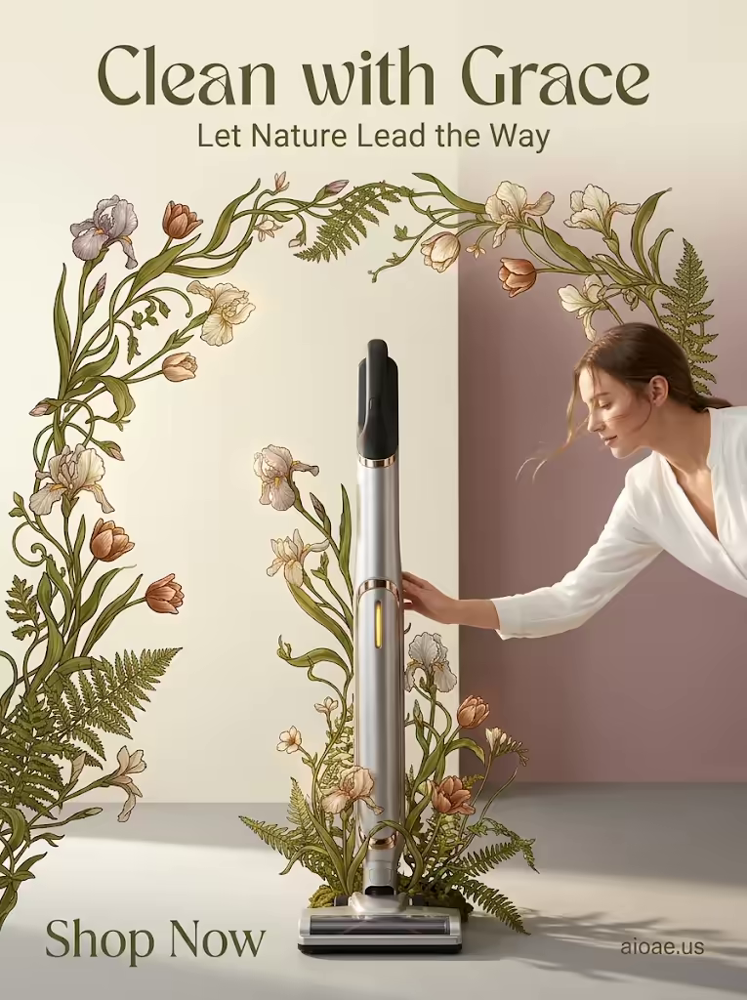

# 案例 212：無線直立吸塵器：優雅清潔 | Case 212: Cordless Stick Vacuum Clean with Grace



新藝術風 × 花卉拱門：銀色無線吸塵器立於淺灰地面，鳶尾鬱金香蕨類藤蔓自機身攀起成拱，白衣女子俯身輕扶，琥珀 LED 與花瓣柔光相映。

Art Nouveau × floral arch: a polished silver cordless stick vacuum stands on a light gray floor, iris, tulip and fern vines rising from its chassis into a decorative arch, a woman in a white blouse leaning in as the amber LED glows.

## 完整提示詞 / Full Prompt

```
SUBJECT: A polished silver cordless stick vacuum stands upright on a light gray floor, its matte black handle and amber LED glinting. A woman in a white blouse leans forward, her hand resting on the vacuum's side, a strand of hair caught by a gentle

SCENE: From a slightly elevated, wide-angle view, the vacuum's sleek body is framed by a sprawling floral canopy of iris, tulip, and fern vines that rise from its chassis. The vines twist into a decorative border, casting soft rim light on petals while backlighting the vacuum's silhouette. The pale cream wall behind is muted mauve, complementing the floral colors. The woman's relaxed posture and the glowing amber LED create a harmonious, nature-infused ritual of cleaning.

STYLE & LIGHT: Art Nouveau-inspired with warm, diffuse daylight, soft rim lighting on petals, and a muted palette of olive green, cream, copper and mauve.

CAMERA: Wide-angle lens, slightly tilted down to capture the full height of the floral arch and the elongated vacuum, with the woman positioned to the right for a balanced composition.

ON-IMAGE TEXT: headline "Clean with Grace"; subheadline "Let Nature Lead the Way"; CTA "Shop Now".

WATERMARK: Add the exact text "aioae.us" in the bottom-right corner at 90% transparency (10% opacity), with enough contrast to remain visible.
```

## 適用模型 / Recommended Models

擅長產品海報、新藝術裝飾風與柔和自然光的模型：GPT Image（Image2）、Flux Pro、Midjourney（建議加 `--ar 3:4`）。

Models strong at product posters, Art Nouveau decoration and soft natural light: GPT Image (Image2), Flux Pro, Midjourney (add `--ar 3:4`).

## 修改說明 / How to Adapt

- 換產品：把吸塵器換成拖把機或掃地機器人，SUBJECT 的機身與手柄描寫改成對應的清潔家電，花卉拱門保留。
- 換花卉：把鳶尾鬱金香蕨類換成玫瑰薰衣草，SCENE 的花卉拱門與配色描寫跟著改。
- 換文案：把 ON-IMAGE TEXT 的標語換成自家清潔品牌口號，副標與 CTA 同步改，構圖不用動。

- Change the product: swap the vacuum for a floor washer or robot vacuum, reworking the body and handle lines in SUBJECT into the matching cleaning appliance while keeping the floral arch.
- Change the flowers: swap the iris, tulip and fern for roses and lavender, updating the floral-arch and palette lines in SCENE.
- Change the copy: replace the headline in ON-IMAGE TEXT with your own cleaning-brand slogan, updating the subheadline and CTA to match — the composition stays intact.

---
直達本案例 / Direct link: https://aioae.us/prompt?title=Cordless%20Stick%20Vacuum%20Clean%20with%20Grace
更多同類提示詞 / More prompts like this: [AIOAE 免費 AI 圖片提示詞庫](https://aioae.us/prompts)
