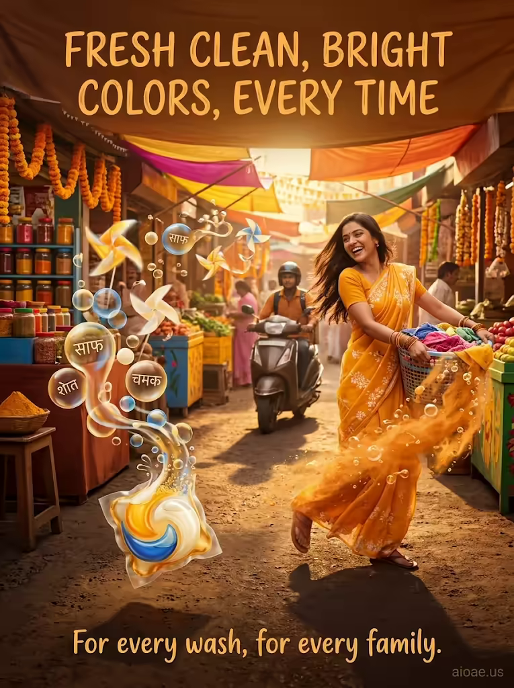

# 案例 213：洗衣凝珠：清新潔淨，亮色如新 | Case 213: Detergent Pack Fresh Clean Bright Colors Every Time



孟買香料市集 × 洗衣凝珠：藏紅花黃紗麗女子抱著洗衣籃在市集起舞，凝珠溶解出印地語泡泡風車，萬壽菊花環與香料攤染滿暖赭陽光。

Mumbai spice market × detergent pack: a young woman in a saffron-yellow sari dances with a laundry basket as a dissolving detergent pack releases Hindi-labelled bubble pinwheels, marigold garlands and spice stalls glowing in warm ochre light.

## 完整提示詞 / Full Prompt

```
SUBJECT: An individual detergent pack, its film dissolving, releasing a slow cascade of saffron‑yellow, citrus‑blue, and soft‑ivory cleaning bubbles that stretch and curve into delicate pinwheels and windmill shapes, all forming an elegant, feminine dance.

SCENE: In a tiny sunlit Hindi‑masala market of Mumbai, where saffron‑marigold garlands are draped across colorful awnings, vendor stalls with colorful spice jars and brightly painted produce stands fill the lens with a lively, bustling scene. The marketplace is surrounded by a warm ochre glow, and in front of a large open window, a young woman in a saffron‑yellow cotton sari with delicate white floral patterns dances with a laundry basket full of freshly washed clothes, laughing. Behind her, a delivery boy on a scooter rides by, casting a gentle shadow on the packed earth floor.

TEXT: A large Hindi‑inspired header, "FRESH CLEAN, BRIGHT COLORS, EVERY TIME," in elegant, rounded, orange‑yellow text overlays the top of the poster, with smaller Hindi‑inspired text at the bottom that reads, "For every wash, for every family." The text is designed to look like it's been carefully handwritten with a brush, adding a warm, personal touch.

MUTATION DETAIL:
- OBJECT: The detergent pack, when dissolving, releases tiny, colorful cleaning bubbles that transform into delicate pinwheels and windmill shapes, each labeled with a different Hindi phrase, like "साफ़" (clean) and "चमक" (shine).
- CREATURE: The young woman's sari, as she dances, seems to twist into the bubbles, the fabric becoming a flowing, saffron‑colored cloud that lifts the laundry basket into the air.
- LIGHT: Golden, sunlit light filters through the market awnings, casting warm, vibrant shadows on the packed earth floor.
- COLOR PALETTE: Saffron‑yellow, citrus‑blue, soft‑ivory, warm ochre, and a rich, deep orange, with a hint of magenta to add a pop of color.
- CULTURAL DETAIL: The market is filled with Hindi‑masala stalls, saffron‑marigold garlands draped across colorful awnings, and brightly painted produce stands, creating a lively, bustling scene.

WATERMARK: Add the exact text "aioae.us" in the bottom-right corner at 70% transparency (30% opacity), with enough contrast to remain readable.
```

## 適用模型 / Recommended Models

擅長產品海報、印度文化場景與暖金陽光的模型：GPT Image（Image2）、Flux Pro、Midjourney（建議加 `--ar 3:4`）。

Models strong at product posters, Indian cultural scenes and warm golden sunlight: GPT Image (Image2), Flux Pro, Midjourney (add `--ar 3:4`).

## 修改說明 / How to Adapt

- 換市場：把孟買香料市集換成曼谷水上市場或摩洛哥香料攤，SCENE 與 MUTATION DETAIL 的市集描寫改成對應的地域風貌，紗麗舞者保留。
- 換產品：把洗衣凝珠換成洗衣片或柔順劑，SUBJECT 的溶解泡泡描寫改成對應的洗劑形態，印地語泡泡風車保留。
- 換文案：把 TEXT 的標語換成自家洗劑品牌口號，底部小字同步改，構圖不用動。

- Change the market: swap the Mumbai spice market for a Bangkok floating market or a Moroccan spice souk, reworking the market lines in SCENE and MUTATION DETAIL into the matching regional flavour while keeping the dancing woman.
- Change the product: swap the detergent pack for laundry sheets or fabric softener, reworking the dissolving-bubble lines in SUBJECT into the matching detergent form while keeping the Hindi bubble pinwheels.
- Change the copy: replace the headline in TEXT with your own laundry-brand slogan, updating the bottom line to match — the composition stays intact.

---
直達本案例 / Direct link: https://aioae.us/prompt?title=Detergent%20Pack%20Fresh%20Clean%20Bright%20Colors%20Every%20Time
更多同類提示詞 / More prompts like this: [AIOAE 免費 AI 圖片提示詞庫](https://aioae.us/prompts)
