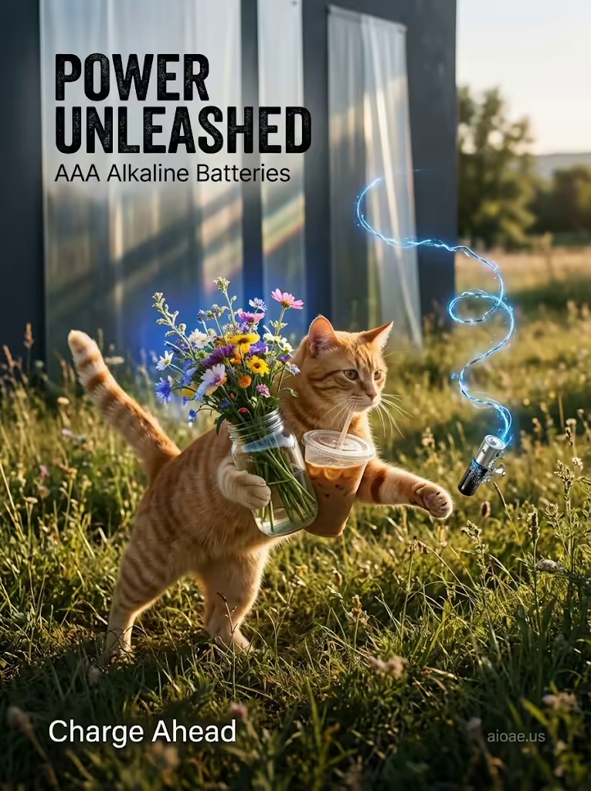

# 案例 214：AAA 鹼性電池：能量釋放 | Case 214: AAA Alkaline Batteries Power Unleashed



黃昏草地 × 橘貓與電池：橘貓叼著野花玻璃罐與冰咖啡大步前行，AAA 電池銀身熔成發光藍線盤旋升空，深色石墨牆透著折射光帶。

Meadow dusk × tabby cat and battery: an orange tabby strides through a late-afternoon meadow gripping a jar of wildflowers and an iced coffee as an AAA battery unravels into a glowing blue thread, a dark graphite wall refracting light behind it.

## 完整提示詞 / Full Prompt

```
SUBJECT: Orange tabby cat in mid-stride holding a clear glass jar of wildflowers, a plastic cup of iced coffee, and an AAA alkaline battery unraveling into a glowing blue thread

SCENE: A warm late-afternoon meadow bathed in soft, natural light. The cat's front paws grip the jar and cup while its right paw releases the battery, whose silver body melts into a shimmering blue thread that arcs upward and spirals toward the sky, illuminating the grass and the jar's petals. Behind the cat, a dark graphite wall is pierced by tall translucent sheets casting refracted bands across the meadow, adding depth to the softly blurred distant trees and horizon.

STYLE & LIGHT: Photorealistic with a subtle film-like grain, precise metal textures on the battery, and soft, glowing accents.

CAMERA: Low angle, centered on the cat, with the meadow stretching behind it and the graphite wall framing the scene.

MUTATION DETAIL: The battery's silver casing slowly melts into a glowing blue thread that winds upward, connecting to the cat's paw and the jar, creating a sense of energy and movement.

ON-IMAGE TEXT: Top text "POWER UNLEASHED" in bold black letters, with "AAA Alkaline Batteries" below it, and the bottom text "Charge Ahead" in white script.

WATERMARK: Add the exact text "aioae.us" in the bottom-right corner at 90% transparency (10% opacity), with enough contrast to remain readable.
```

## 適用模型 / Recommended Models

擅長產品海報、寫實動物與微距金屬質感的模型：GPT Image（Image2）、Flux Pro、Midjourney（建議加 `--ar 3:4`）。

Models strong at product posters, photorealistic animals and close-up metal textures: GPT Image (Image2), Flux Pro, Midjourney (add `--ar 3:4`).

## 修改說明 / How to Adapt

- 換動物：把橘貓換成柴犬或兔子，SUBJECT 的爪握物品與步態描寫改成對應的動物，電池藍線保留。
- 換物品：把 AAA 電池換成行動電源或充電線，SUBJECT 與 MUTATION DETAIL 的電池熔解描寫改成對應的供電意象。
- 換文案：把 ON-IMAGE TEXT 的標語換成自家電池品牌口號，副標與底部手寫字同步改，構圖不用動。

- Change the animal: swap the orange tabby for a Shiba Inu or a rabbit, reworking the paw-grip and stride lines in SUBJECT into the matching animal while keeping the glowing battery thread.
- Change the power source: swap the AAA battery for a power bank or charging cable, reworking the melting-battery lines in SUBJECT and MUTATION DETAIL into the matching power imagery.
- Change the copy: replace the headline in ON-IMAGE TEXT with your own battery-brand slogan, updating the sub-line and bottom script to match — the composition stays intact.

---
直達本案例 / Direct link: https://aioae.us/prompt?title=AAA%20Alkaline%20Batteries%20Power%20Unleashed
更多同類提示詞 / More prompts like this: [AIOAE 免費 AI 圖片提示詞庫](https://aioae.us/prompts)
