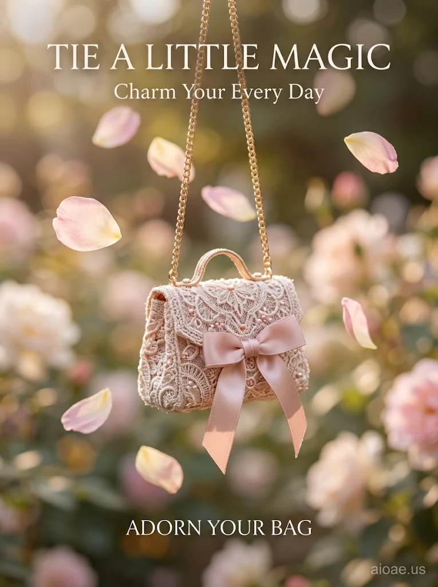

# 案例 215：繫上一點魔法：蕾絲蝴蝶結包包掛飾 | Case 215: Tie a Little Magic



夢幻花園 × 蕾絲小包：手縫蕾絲小包掛上金鍊、懸在粉嫩花瓣雨中，粉紅蝴蝶結與柔焦玫瑰襯出浪漫柔光。

Dreamy garden × lace satchel: a hand-stitched lace mini-bag with a blush bow hangs from a golden chain amid drifting petals, soft-focus roses framing a romantic glow.

## 完整提示詞 / Full Prompt

```
SUBJECT: A delicate lace bow bag charm, reimagined as a tiny, ornate, hand-stitched satchel, with intricate lace patterns and a soft, blush-pink bow.

SCENE: The charm hangs from a slender, golden chain, suspended in mid-air against a soft, dreamy background of pastel pinks and creams. Delicate, translucent petals drift gently around the charm, catching soft, diffused light. The background is a soft, blurred garden scene, with hints of blooming flowers and greenery.

STYLE & LIGHT: Elegant, romantic, with a focus on delicate textures and soft, pastel colors. The lighting is soft and diffused, emphasizing the charm's intricate lace and the gentle, romantic atmosphere.

CAMERA: A close-up, straight-on shot, capturing the charm in the center of the frame, with the petals and soft background providing depth.

ON-IMAGE TEXT: headline "Tie a Little Magic"; subheadline "Charm Your Every Day"; CTA "Adorn Your Bag".

WATERMARK: Add the exact text "aioae.us" in the bottom-right corner at 70% transparency, with enough contrast to remain visible.
```

## 適用模型 / Recommended Models

擅長產品海報、柔焦花園與粉彩質感的模型：GPT Image（Image2）、Flux Pro、Midjourney（建議加 `--ar 3:4`）。

Models strong at product posters, soft-focus gardens and pastel textures: GPT Image (Image2), Flux Pro, Midjourney (add `--ar 3:4`).

## 修改說明 / How to Adapt

- 換掛飾：把蕾絲蝴蝶結小包換成珍珠包或絨面小包，SUBJECT 的蕾絲與蝴蝶結描寫改成對應的材質，花瓣雨保留。
- 換花園：把玫瑰園換成薰衣草田或櫻花樹下，SCENE 的背景花卉與綠意描寫改成對應的場景，金鍊懸掛不變。
- 換文案：把 ON-IMAGE TEXT 的標語換成自家配飾品牌口號，副標與 CTA 同步改，構圖不用動。

- Change the charm: swap the lace bow satchel for a pearl bag or suede mini-bag, reworking the lace and bow lines in SUBJECT into the matching material while keeping the petal rain.
- Change the garden: swap the rose garden for a lavender field or cherry blossoms, reworking the background flowers and greenery in SCENE into the matching setting while keeping the golden chain.
- Change the copy: replace the headline in ON-IMAGE TEXT with your own accessories-brand slogan, updating the sub-line and CTA to match — the composition stays intact.

---
直達本案例 / Direct link: https://aioae.us/prompt?title=Tie%20a%20Little%20Magic
更多同類提示詞 / More prompts like this: [AIOAE 免費 AI 圖片提示詞庫](https://aioae.us/prompts)
