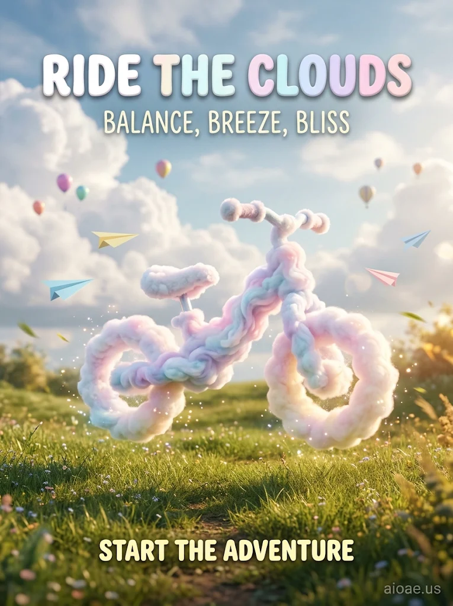

# 案例 216：乘雲而行：雲朵平衡車 | Case 216: Ride the Clouds



夏日草甸 × 雲朵單車：粉彩雲朵捲成兒童平衡車、漂浮在陽光草地上空，紙飛機與熱氣球點綴夢幻藍天。

Summer meadow × cloud bike: a kids' balance bike spun from pastel clouds floats above a sunlit meadow, paper planes and hot-air balloons drifting through a dreamy sky.

## 完整提示詞 / Full Prompt

```
SUBJECT: A cheerful kids' balance bike, reimagined as a whimsical, floating cloud, with soft, pastel-colored wheels that resemble fluffy, white clouds.

SCENE: The bike floats gently above a sunlit, grassy meadow, its wheels transformed into soft, billowing clouds. A gentle breeze carries colorful, paper airplanes through the air, while a soft, golden light bathes the scene in warmth. The background is a soft, dreamy sky with fluffy, white clouds and a few, distant, colorful balloons.

STYLE & LIGHT: Playful, bright, and whimsical, with a focus on soft, pastel colors and gentle, diffused light. The lighting is warm and inviting, emphasizing the bike's cheerful design and the dreamy, cloud-like atmosphere.

CAMERA: A low-angle, straight-on shot, capturing the bike in the center of the frame, with the meadow and sky providing a soft, dreamy backdrop.

ON-IMAGE TEXT: headline "Ride the Clouds"; subheadline "Balance, Breeze, Bliss"; CTA "Start the Adventure".

WATERMARK: Add the exact text "aioae.us" in the bottom-right corner at 70% transparency, with enough contrast to remain visible.
```

## 適用模型 / Recommended Models

擅長童趣產品海報、夢幻天空與粉彩質感的模型：GPT Image（Image2）、Flux Pro、Midjourney（建議加 `--ar 3:4`）。

Models strong at playful product posters, dreamy skies and pastel textures: GPT Image (Image2), Flux Pro, Midjourney (add `--ar 3:4`).

## 修改說明 / How to Adapt

- 換車款：把兒童平衡車換成三輪車或滑板車，SUBJECT 的雲朵車輪與車身描寫改成對應的車型，草甸天空保留。
- 換天氣：把晴空換成黃昏晚霞或雨後彩虹，SCENE 的光色與雲朵描寫跟著改，紙飛機保留。
- 換文案：把 ON-IMAGE TEXT 的標語換成自家童車品牌口號，副標與 CTA 同步改，構圖不用動。

- Change the ride: swap the kids' balance bike for a tricycle or scooter, reworking the cloud-wheel and frame lines in SUBJECT into the matching vehicle while keeping the meadow and sky.
- Change the weather: swap the clear sky for dusk amber or a post-rain rainbow, updating the light and cloud lines in SCENE while keeping the paper planes.
- Change the copy: replace the headline in ON-IMAGE TEXT with your own kids'-bike brand slogan, updating the sub-line and CTA to match — the composition stays intact.

---
直達本案例 / Direct link: https://aioae.us/prompt?title=Ride%20the%20Clouds
更多同類提示詞 / More prompts like this: [AIOAE 免費 AI 圖片提示詞庫](https://aioae.us/prompts)
