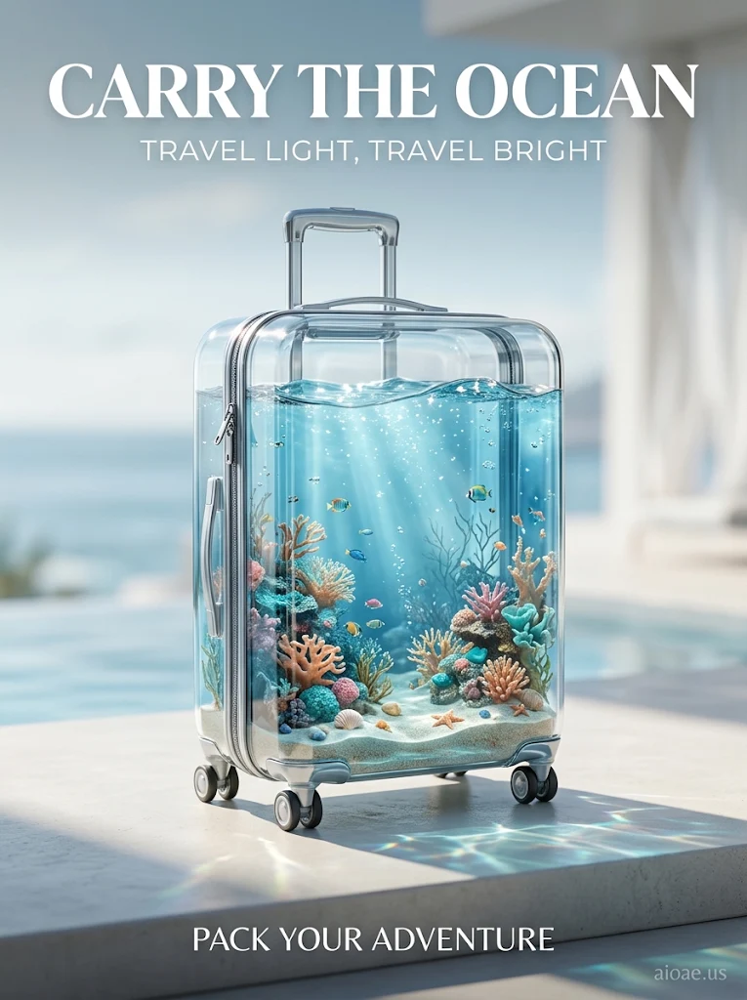

# 案例 217：攜帶海洋：透明海洋行李箱 | Case 217: Carry the Ocean



海岸極簡 × 透明行李箱：硬殼行李箱化作玻璃容器、內藏珊瑚小魚微型海洋，陽光在平台灑下水波光影。

Coastal minimalism × glass suitcase: a hard-shell case turns transparent, holding a miniature ocean of coral and tiny fish, sunlight casting watery reflections on the platform.

## 完整提示詞 / Full Prompt

```
SUBJECT: A sleek hard-shell luggage suitcase, reimagined as a translucent, glass-like vessel, with a shimmering, ocean-inspired interior.

SCENE: The suitcase stands on a sunlit, minimalist platform, its transparent shell revealing a miniature, vibrant ocean scene inside, complete with coral, seashells, and tiny, colorful fish. A soft, diffused light filters through the glass, casting gentle, watery reflections on the platform. The background is a soft, muted palette of blues and whites, suggesting a serene, coastal atmosphere.

STYLE & LIGHT: Clean, modern, with a focus on transparency and light. The lighting is soft and diffused, emphasizing the suitcase's sleek design and the vibrant, miniature ocean inside.

CAMERA: A straight-on, slightly elevated shot, capturing the suitcase in the center of the frame, with the ocean scene and soft background providing depth.

ON-IMAGE TEXT: headline "Carry the Ocean"; subheadline "Travel Light, Travel Bright"; CTA "Pack Your Adventure".

WATERMARK: Add the exact text "aioae.us" in the bottom-right corner at 70% transparency, with enough contrast to remain visible.
```

## 適用模型 / Recommended Models

擅長旅行產品海報、透明材質與水光質感的模型：GPT Image（Image2）、Flux Pro、Midjourney（建議加 `--ar 3:4`）。

Models strong at travel product posters, transparent materials and water-light textures: GPT Image (Image2), Flux Pro, Midjourney (add `--ar 3:4`).

## 修改說明 / How to Adapt

- 換箱內景：把微型海洋換成微型森林、雪山或沙漠綠洲，SCENE 的珊瑚小魚描寫改成對應的微縮景觀，透明箱身保留。
- 換箱型：把登機箱換成大行李箱或手提包，SUBJECT 的箱身與拉桿描寫改成對應的尺寸，海洋內景不變。
- 換文案：把 ON-IMAGE TEXT 的標語換成自家旅行品牌口號，副標與 CTA 同步改，構圖不用動。

- Change the world inside: swap the miniature ocean for a tiny forest, snowy peaks or a desert oasis, reworking the coral-and-fish lines in SCENE into the matching miniature landscape while keeping the transparent case.
- Change the case: swap the cabin suitcase for a large check-in case or a tote, reworking the shell and handle lines in SUBJECT into the matching size while keeping the ocean inside.
- Change the copy: replace the headline in ON-IMAGE TEXT with your own travel-brand slogan, updating the sub-line and CTA to match — the composition stays intact.

---
直達本案例 / Direct link: https://aioae.us/prompt?title=Carry%20the%20Ocean
更多同類提示詞 / More prompts like this: [AIOAE 免費 AI 圖片提示詞庫](https://aioae.us/prompts)
