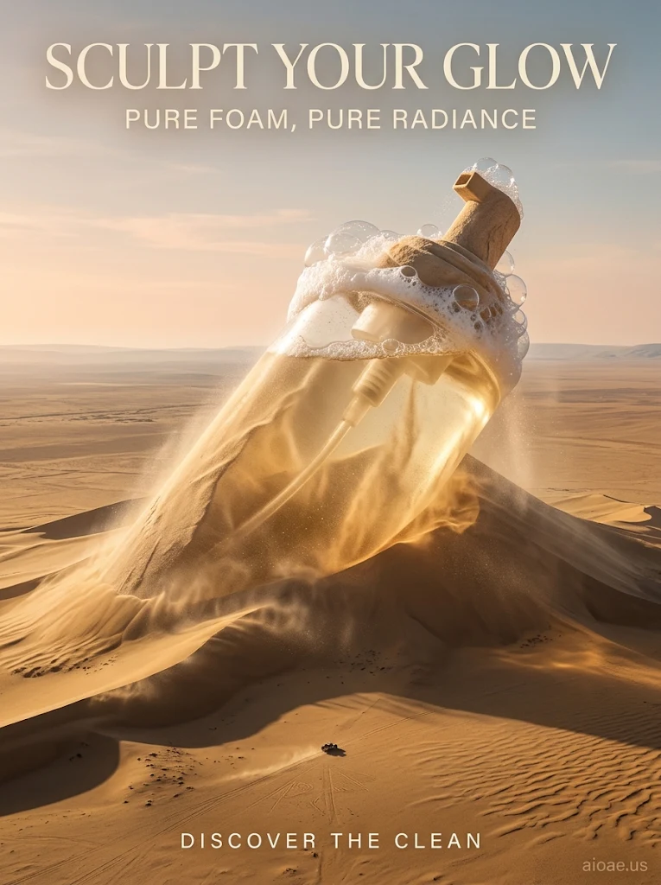

# 案例 218：雕塑你的光采：沙丘潔面泡沫 | Case 218: Sculpt Your Glow



納斯卡沙漠 × 瓶身沙丘：透明潔面泡沫瓶化作金色沙丘、頂著一圈海沫，暖陽斜照、細沙在風中成霧。

Nazca desert × bottle dune: a translucent foaming-cleanser bottle rises as a golden sand dune crowned with sea foam, warm light hazing the drifting sand.

## 完整提示詞 / Full Prompt

```
SUBJECT: A translucent bottle of foaming facial cleanser, reimagined as a towering sand dune, emerging from the Nazca desert floor, its peak crowned with a delicate ring of sea foam.

SCENE: A vast, golden desert stretches to the horizon, with the bottle-dune dominating the center, casting a long, soft shadow across the rippled sand. A gentle breeze lifts fine sand particles, creating a hazy, dreamlike atmosphere. The sky is a gradient of soft peach and pale blue, with a few wispy clouds.

STYLE & LIGHT: Surreal, minimalist, with a warm, golden-hour glow. Soft, diffused light emphasizes the translucency of the bottle and the delicate texture of the sand.

CAMERA: Low-angle, wide shot, capturing the full height of the bottle-dune against the expansive desert sky.

ON-IMAGE TEXT: headline "Sculpt Your Glow"; subheadline "Pure Foam, Pure Radiance"; CTA "Discover the Clean".

WATERMARK: Add the exact text "aioae.us" in the bottom-right corner at 70% transparency, with enough contrast to remain visible.
```

## 適用模型 / Recommended Models

擅長美妝產品海報、超現實場景與暖調夕陽的模型：GPT Image（Image2）、Flux Pro、Midjourney（建議加 `--ar 3:4`）。

Models strong at beauty product posters, surreal scenes and warm sunset light: GPT Image (Image2), Flux Pro, Midjourney (add `--ar 3:4`).

## 修改說明 / How to Adapt

- 換產品：把潔面泡沫換成防曬乳或香水瓶，SUBJECT 的瓶身與海沫描寫改成對應的美妝產品，沙丘構圖保留。
- 換沙漠：把納斯卡沙漠換成撒哈拉或白沙丘，SCENE 的沙色與天空漸層描寫跟著改，瓶身沙丘不變。
- 換文案：把 ON-IMAGE TEXT 的標語換成自家美妝品牌口號，副標與 CTA 同步改，構圖不用動。

- Change the product: swap the foaming cleanser for sunscreen or a perfume bottle, reworking the bottle and sea-foam lines in SUBJECT into the matching beauty product while keeping the dune composition.
- Change the desert: swap the Nazca desert for the Sahara or white dunes, updating the sand colour and sky gradient lines in SCENE while keeping the bottle-dune.
- Change the copy: replace the headline in ON-IMAGE TEXT with your own beauty-brand slogan, updating the sub-line and CTA to match — the composition stays intact.

---
直達本案例 / Direct link: https://aioae.us/prompt?title=Sculpt%20Your%20Glow
更多同類提示詞 / More prompts like this: [AIOAE 免費 AI 圖片提示詞庫](https://aioae.us/prompts)
