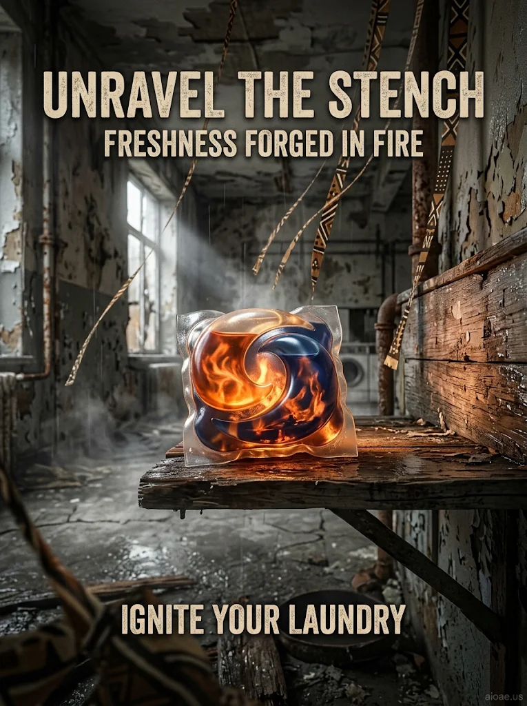

# 案例 219：揭開異味：洗衣凝珠暖爐 | Case 219: Unravel the Stench



廢棄洗衣房 × 發光凝珠：洗衣凝珠化作微型暖爐、橙藍液體在木架上燃亮，剝落牆面與博戈蘭花紋細線襯出冷暖對比。

Abandoned laundromat × glowing pod: a laundry pod burns like a tiny hearth on a weathered shelf, orange-blue liquid glowing against peeling paint and Bogolan-patterned threads.

## 完整提示詞 / Full Prompt

```
SUBJECT: A hero laundry pod, reimagined as a tiny glowing hearth, placed on a weathered wooden shelf inside an abandoned, rain-soaked laundromat.

SCENE: The pod sits at the center of the frame, its translucent surface revealing swirling orange and blue liquids that cast a warm, flickering light across the peeling paint and rusted pipes. Thin Bogolan-inspired patterned threads hang from the ceiling, swaying gently, while a faint mist rises from the cracked concrete floor. The background is a muted palette of grays and browns, with a single beam of cold light cutting through a broken window.

STYLE & LIGHT: A blend of moody, atmospheric realism and subtle folk-art textures. The lighting is dramatic, with the pod's warm glow contrasting against the cold, desaturated environment.

CAMERA: A low-angle, slightly tilted shot, focusing on the pod as the central light source, with the laundromat's decaying details framing the scene.

ON-IMAGE TEXT: headline "Unravel the Stench"; subheadline "Freshness Forged in Fire"; CTA "Ignite Your Laundry".

WATERMARK: Add the exact text "aioae.us" in the bottom-right corner at 70% transparency, with enough contrast to remain visible.
```

## 適用模型 / Recommended Models

擅長清潔產品海報、廢墟氛圍與冷暖對比光影的模型：GPT Image（Image2）、Flux Pro、Midjourney（建議加 `--ar 3:4`）。

Models strong at cleaning product posters, derelict atmospheres and warm-versus-cold light contrast: GPT Image (Image2), Flux Pro, Midjourney (add `--ar 3:4`).

## 修改說明 / How to Adapt

- 換產品：把洗衣凝珠換成洗衣液或柔軟精，SUBJECT 的凝珠與橙藍液體描寫改成對應的清潔產品，暖爐意象保留。
- 換場景：把廢棄洗衣房換成閣樓或地下室，SCENE 的牆面、水管與光束描寫改成對應的室內，木架與凝珠不變。
- 換文案：把 ON-IMAGE TEXT 的標語換成自家清潔品牌口號，副標與 CTA 同步改，構圖不用動。

- Change the product: swap the laundry pod for detergent or fabric softener, reworking the pod and orange-blue liquid lines in SUBJECT into the matching cleaning product while keeping the hearth idea.
- Change the setting: swap the abandoned laundromat for an attic or basement, reworking the walls, pipes and light-beam lines in SCENE into the matching interior while keeping the shelf and pod.
- Change the copy: replace the headline in ON-IMAGE TEXT with your own cleaning-brand slogan, updating the sub-line and CTA to match — the composition stays intact.

---
直達本案例 / Direct link: https://aioae.us/prompt?title=Unravel%20the%20Stench
更多同類提示詞 / More prompts like this: [AIOAE 免費 AI 圖片提示詞庫](https://aioae.us/prompts)
