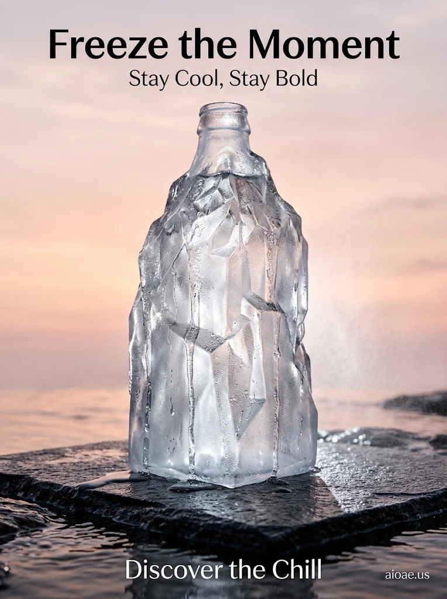

# 案例 220：凝結瞬間：冰塔水瓶 | Case 220: Freeze the Moment



蜜桃暮色 × 冰塔水瓶：結晶冰面水瓶立於石墨底座、冷凝水珠沿瓶身滑落，粉調天空與冷冽玻璃相映。

Peach dusk × ice-tower bottle: a crystalline bottle stands on a graphite slab, condensation dripping down its facets as pastel peach light meets frozen glass.

## 完整提示詞 / Full Prompt

```
SCENE: From a low, near-waterline viewpoint the ice-tower bottle dominates the vertical frame, its crystalline facets catching a hard side light from the left that throws an oversized, readable shadow across the graphite slab. The background is a soft pastel peach with subtle pink washes, while diffused back-light from the right enhances the ice's translucency. Condensation streams down the bottle's sides, forming slow, glittering drips that pool on the plinth's muted-gray surface.

STYLE & LIGHT: The composition blends soft peach-pink tones with the cool translucence of frozen glass, crisp graphite edges, and tightly controlled white highlights to emphasize thermal integrity.

CAMERA: Low-angle, near-waterline perspective with a slight tilt, framing the ice-tower bottle to fill most of the vertical space.

ON-IMAGE TEXT: headline "Freeze the Moment"; subheadline "Stay Cool, Stay Bold"; CTA "Discover the Chill".

WATERMARK: Add the exact text "aioae.us" in the bottom-right corner at 70% transparency, with enough contrast to remain visible.
```

## 適用模型 / Recommended Models

擅長飲品海報、冰面質感與冷暖對比光影的模型：GPT Image（Image2）、Flux Pro、Midjourney（建議加 `--ar 3:4`）。

Models strong at beverage posters, ice textures and warm-versus-cold light contrast: GPT Image (Image2), Flux Pro, Midjourney (add `--ar 3:4`).

## 修改說明 / How to Adapt

- 換瓶身：把水瓶換成香水瓶或保溫瓶，SCENE 的冰面結晶與冷凝水珠描寫改成對應的瓶型，石墨底座保留。
- 換時段：把暮色換成正午烈陽或午夜藍調，SCENE 與 STYLE & LIGHT 的天空粉調與背光描寫跟著改，冰塔構圖不變。
- 換文案：把 ON-IMAGE TEXT 的標語換成自家飲品品牌口號，副標與 CTA 同步改，構圖不用動。

- Change the bottle: swap the water bottle for a perfume bottle or thermos, reworking the ice-crystal and condensation lines in SCENE into the matching bottle while keeping the graphite slab.
- Change the hour: swap dusk for harsh midday sun or midnight blue, updating the peach sky and back-light lines in SCENE and STYLE & LIGHT while keeping the ice-tower composition.
- Change the copy: replace the headline in ON-IMAGE TEXT with your own beverage-brand slogan, updating the sub-line and CTA to match — the composition stays intact.

---
直達本案例 / Direct link: https://aioae.us/prompt?title=Freeze%20the%20Moment
更多同類提示詞 / More prompts like this: [AIOAE 免費 AI 圖片提示詞庫](https://aioae.us/prompts)
