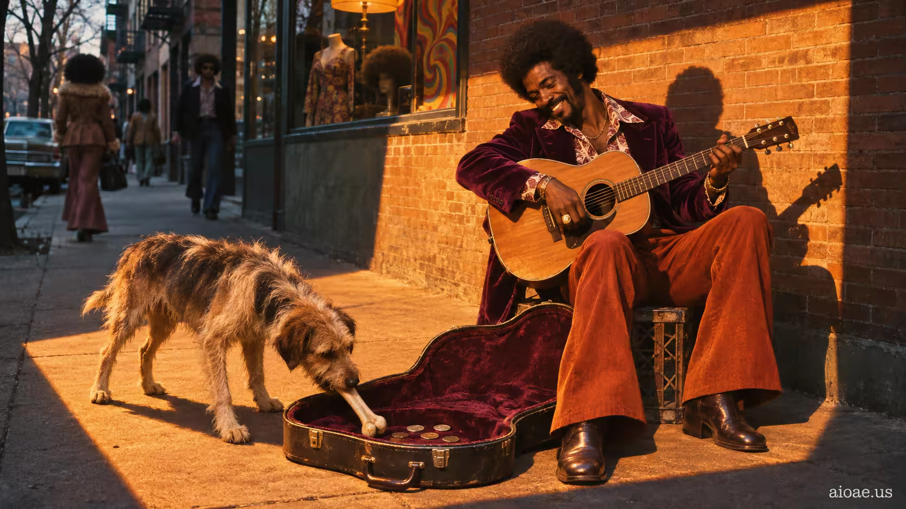

# 案例 221：狗狗用骨頭打賞街頭音樂家 | Case 221: A Dog Rewarding a Street Musician with a Bone



七〇年代街頭 × 街頭音樂家：留爆炸頭的吉他手靠磚牆彈唱，毛茸茸的狗叼著骨頭走向打開的琴盒，夕陽把整條街染成放克金黃。

1970s street × street musician: an afro-haired guitarist plays against a brick wall as a shaggy dog carries a bone toward his open case, funk-era golden light washing the street.

## 完整提示詞 / Full Prompt

```
SUBJECT & IDEA: A Dog Rewarding a Street Musician with a Bone. Preserve named subject, requested relationships, main action and format. Visual idea: Recombine the database mechanism (camera: Choose framing, focal length and depth of field that reinforce funk-era color.; camera: Maintain coherent perspective and subject readability.; concepts: Reinterpret the input through 1970s Blaxploitation Cinema, using bold fashion, street-level framing, and funk-era color as historically informed visual cues.; concepts: Express defiance and agency through one coherent, subject-derived cinematic idea without recreating a specific movie scene.; lighting: Create motivated illumination that supports street-level framing.; lighting: Maintain consistent shadow direction, readable silhouettes and controlled highlights.; materials: Use tacti) with visual_art as one bold, image-defining transformation. Apply it to the most visually prominent unlocked layer: subject-to-object relationship, material behavior, scale, spatial structure or a supporting element; preserve explicit subject and action locks; keep the named subject recognizable and obey every explicit identity, action, product and format lock. The change must be visually prominent and causally legible, not a minor decorative detail.

SCENE: one continuous believable setting suited to the subject and brief. Maintain clear foreground, midground and background with a single coherent physical logic. Maintain the original setting with coherent lighting, scale, and foreground/background continuity. Visible evidence: show a tangible material response, contact, reflections, shadows or a physically traceable visual consequence.

STYLE: coherent premium visual storytelling with readable subject geometry and motivated light. Lighting and color should respond to the actual setting rather than unrelated stock effects.

CAMERA: subject-first coherent perspective. Preserve the user-requested camera and crop; allow the selected mutation to alter apparent scale or perspective when that is its actual mechanism, and make the change physically legible.

WATERMARK: Add a small, subtle and readable "aioae.us" in the bottom-right corner.

AVOID: generic random genre backgrounds, contradictory lighting, product identity substitution, extra fingers, duplicate characters, disjointed composition, unintended copy and unsupported factual claims.
```

## 適用模型 / Recommended Models

擅長寫實街景、七〇年代電影感與暖調夕陽的模型：GPT Image（Image2）、Flux Pro、Midjourney（建議加 `--ar 3:4`）。

Models strong at realistic street scenes, 1970s cinematic feel and warm sunset light: GPT Image (Image2), Flux Pro, Midjourney (add `--ar 3:4`).

## 修改說明 / How to Adapt

- 換樂器：把吉他換成薩克斯風或小號，SUBJECT & IDEA 的樂器與演奏姿勢描寫改成對應的樂手，狗與琴盒保留。
- 換動物：把狗換成貓或浣熊，SUBJECT & IDEA 的動物與叼骨頭描寫改成對應的動物，打賞動作不變。
- 換年代：把七〇年代街頭換成九〇年代街頭或現代市集，Visual idea 的放克服裝與街景描寫改成對應的時代，音樂家與狗不變。

- Change the instrument: swap the guitar for a saxophone or trumpet, reworking the instrument and playing-pose lines in SUBJECT & IDEA into the matching musician while keeping the dog and the case.
- Change the animal: swap the dog for a cat or raccoon, reworking the animal and bone-carrying lines in SUBJECT & IDEA into the matching animal while keeping the tipping gesture.
- Change the era: swap the 1970s street for a 1990s street or a modern market, reworking the funk fashion and street lines in the Visual idea into the matching period while keeping the musician and the dog.

---
直達本案例 / Direct link: https://aioae.us/prompt?title=A%20Dog%20Rewarding%20a%20Street%20Musician%20with%20a%20Bone
更多同類提示詞 / More prompts like this: [AIOAE 免費 AI 圖片提示詞庫](https://aioae.us/prompts)
