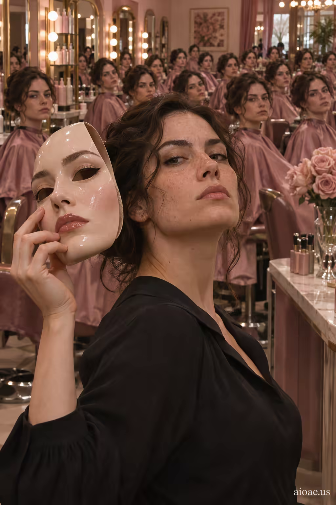

# 案例 222：女人摘下瓷器般的華麗面孔 | Case 222: A Woman Removes Her Glamorous Face Like a Porcelain Mask



粉紅美容院 × 瓷面具：女子在鏡前摘下光澤的瓷質臉龐，身後一排排長相相同的顧客靜靜注視，超現實與寫實人像交錯。

Pink beauty salon × porcelain mask: a woman lifts a glossy porcelain face from her own as rows of identical customers stare on, surrealism meeting realistic portraiture.

## 完整提示詞 / Full Prompt

```
SUBJECT & IDEA: A woman removes her glamorous face like a porcelain mask; dozens of identical customers stare at her from the beauty salon.. Preserve named subject, requested relationships, main action and format. Visual idea: Give A woman removes her glamorous face like a porcelain mask; dozens of identical customers stare at her from the beaut a visual_art visual treatment: three-quarter body orientation with the face still clearly readable. Make it the prominent idea in the most visually prominent unlocked layer: pose or body language, prop interaction, wardrobe only when unspecified, lighting, or scene relationship; preserve reference identity and explicit details, while keeping the requested subject, action, relationships and format intact.

CHARACTER: Portray the main subject as a clearly adult woman; default to Western/European-leaning everyday styling only when ethnicity and appearance are unspecified. Wardrobe, expression, posture and gaze should follow the requested scenario; do not introduce unrelated professions or costumes.

SCENE: one continuous believable setting suited to the subject and brief. Keep human-scale spatial continuity and recognizable natural surroundings. Keep the original setting continuous and stage the visual idea clearly. Visible evidence: Make the main visual change easy to see; use contact, material boundaries, shadows, reflections or spatial continuity to make it believable.

STYLE: credible portrait photography with natural skin texture, accurate hands, and a clear relationship between subject and camera. Lighting and color should respond to the actual setting rather than unrelated stock effects.

CAMERA: natural close or medium portrait framing, not an unrelated panoramic set. Preserve the user-requested camera and crop; allow the selected mutation to alter apparent scale or perspective when that is its actual mechanism, and make the change physically legible.

WATERMARK: Add a small, subtle and readable "aioae.us" in the bottom-right corner.

AVOID: generic random genre backgrounds, contradictory lighting, product identity substitution, extra fingers, duplicate characters, disjointed composition, unintended copy and unsupported factual claims.
```

## 適用模型 / Recommended Models

擅長寫實人像、超現實場景與柔和室內光的模型：GPT Image（Image2）、Flux Pro、Midjourney（建議加 `--ar 3:4`）。

Models strong at realistic portraits, surreal scenes and soft interior light: GPT Image (Image2), Flux Pro, Midjourney (add `--ar 3:4`).

## 修改說明 / How to Adapt

- 換面具：把瓷面具換成戲劇面具或金屬面具，SUBJECT & IDEA 的面具材質與光澤描寫改成對應的面具，美容院群像保留。
- 換場景：把美容院換成化妝間或畫廊，SCENE 的鏡子與顧客描寫改成對應的室內，摘面具的動作不變。
- 換主角：把女子換成男子或老人，CHARACTER 的性別年齡與造型描寫改成對應的人物，瓷面具與群像不變。

- Change the mask: swap the porcelain mask for a theatre mask or a metal mask, reworking the mask material and sheen lines in SUBJECT & IDEA into the matching mask while keeping the salon crowd.
- Change the setting: swap the beauty salon for a dressing room or gallery, reworking the mirrors and onlookers in SCENE into the matching interior while keeping the mask-removal gesture.
- Change the subject: swap the woman for a man or an elderly person, reworking the gender, age and styling lines in CHARACTER into the matching person while keeping the porcelain mask and the crowd.

---
直達本案例 / Direct link: https://aioae.us/prompt?title=A%20Woman%20Removes%20Her%20Glamorous%20Face%20Like%20a%20Porcelain%20Mask
更多同類提示詞 / More prompts like this: [AIOAE 免費 AI 圖片提示詞庫](https://aioae.us/prompts)
