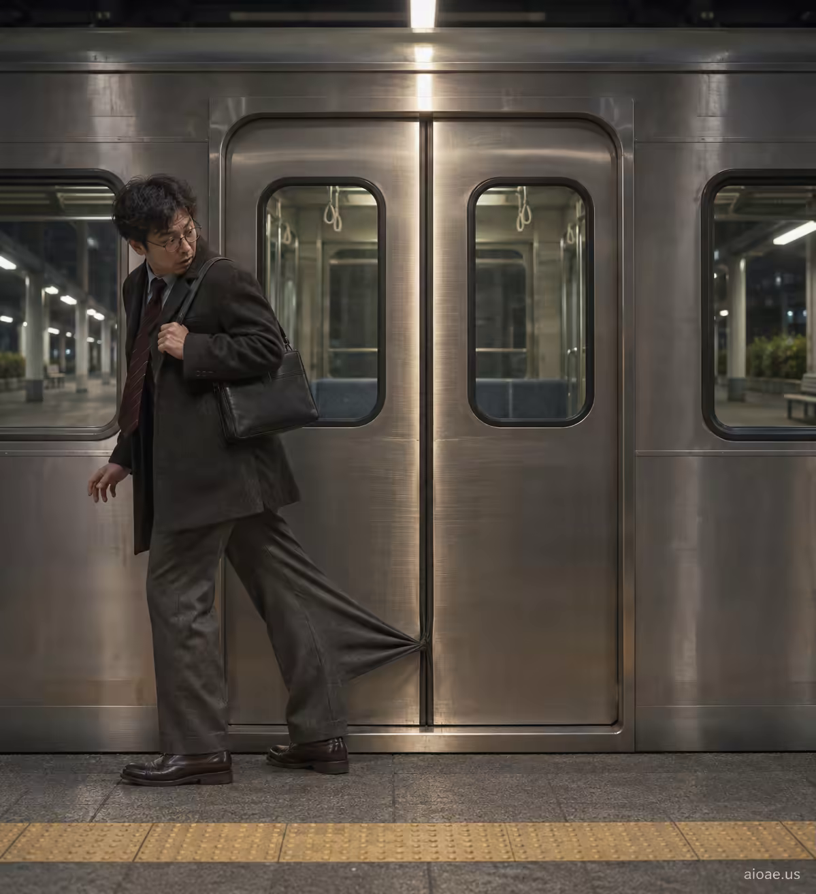

# 案例 223：卡在列車門裡的褲子 | Case 223: Trousers Caught in a Train Door



深夜月台 × 卡住的褲子：西裝男子回頭看著被列車門夾住的褲腳，不鏽鋼車身與黃色盲道線構成冷峻寫實一幕。

Late-night platform × trapped trousers: a suited man glances back at his trouser leg caught in the train doors, brushed steel and yellow tactile paving framing a deadpan realistic scene.

## 完整提示詞 / Full Prompt

```
SUBJECT & IDEA: Trousers Caught in a Train Door. Preserve named subject, requested relationships, main action and format.

SCENE: one continuous believable setting suited to the subject and brief. Maintain clear foreground, midground and background with a single coherent physical logic.

MUTATION RULES: angle. MAIN SUBJECT LOCK: Trousers Caught in a Train Door. SINGLE DATABASE-GROUNDED CREATIVE MUTATION: Adapt the database-selected idea (angle. Camera facing subject straight-on, eye-level, centered.; ["Frame the subject straight-on, eye-level and centered","Do not tilt, rotate or use a dutch angle"]) to visual_art; implement it only in one supporting atmospheric element reinforcing the named subject and connect its visual meaning to the protected subject.. Mutate one supporting atmospheric element reinforcing the named subject only. Evidence: show a tangible material response, contact, reflections, shadows or a physically traceable visual consequence. Staging: Maintain the original setting with coherent lighting, scale, and foreground/background continuity. Purpose: Express the user's requested topic (Trousers Caught in a Train Door); do not substitute the subject, action, product identity, venue or format. One transformation, one consistent physical logic; subject, format, original relationships, named products, setting and main action unchanged. No unsolicited portals, robots, random second worlds or subject replacement. No unrelated portal, no arbitrary second world and no subject replacement unless expressly requested.

STYLE: coherent premium visual storytelling with readable subject geometry and motivated light. Lighting and color should respond to the actual setting rather than unrelated stock effects.

CAMERA: subject-first coherent perspective. Preserve perspective and realistic scale.

WATERMARK: Add a small, subtle and readable "aioae.us" in the bottom-right corner.

AVOID: generic random genre backgrounds, contradictory lighting, product identity substitution, extra fingers, duplicate characters, disjointed composition, unintended copy and unsupported factual claims.
```

## 適用模型 / Recommended Models

擅長寫實街景、冷調金屬質感與夜間室內光的模型：GPT Image（Image2）、Flux Pro、Midjourney（建議加 `--ar 3:4`）。

Models strong at realistic street scenes, cool metallic textures and night interior light: GPT Image (Image2), Flux Pro, Midjourney (add `--ar 3:4`).

## 修改說明 / How to Adapt

- 換衣物：把褲子換成圍巾或外套下擺，SUBJECT & IDEA 的夾住物描寫改成對應的衣物，列車門與月台不變。
- 換車站：把地鐵月台換成高鐵站或電車站，SCENE 的車身與月台描寫改成對應的車站，夾褲子的瞬間保留。
- 換人物：把上班族換成學生或旅客，SUBJECT & IDEA 的人物造型描寫改成對應的身份，褲子被夾的動作不變。

- Change the garment: swap the trousers for a scarf or a coat hem, reworking the trapped-garment lines in SUBJECT & IDEA into the matching clothing while keeping the train doors and platform.
- Change the station: swap the metro platform for a high-speed rail or tram station, reworking the train body and platform lines in SCENE into the matching station while keeping the trapped-trouser moment.
- Change the commuter: swap the office worker for a student or traveller, reworking the character styling in SUBJECT & IDEA into the matching identity while keeping the trapped-trouser action.

---
直達本案例 / Direct link: https://aioae.us/prompt?title=Trousers%20Caught%20in%20a%20Train%20Door
更多同類提示詞 / More prompts like this: [AIOAE 免費 AI 圖片提示詞庫](https://aioae.us/prompts)
