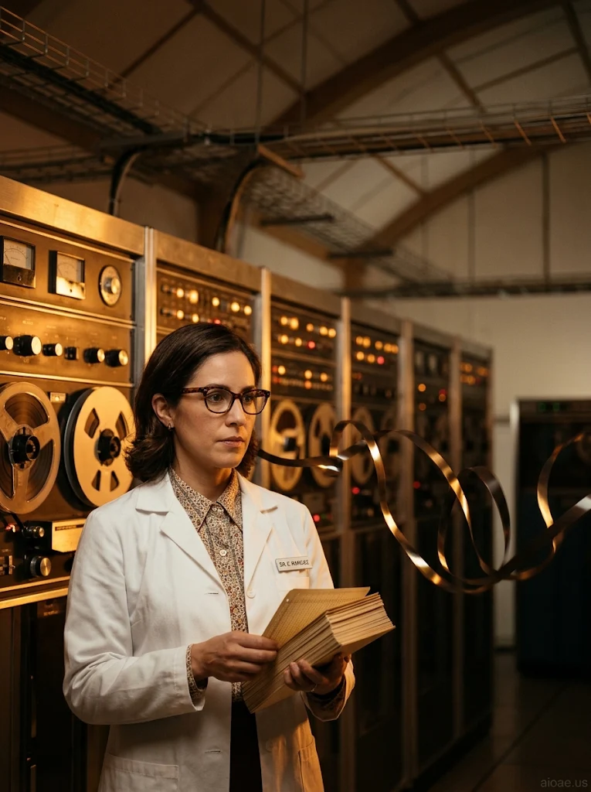

# 案例 225：類比電腦室裡的艾蓮娜博士 | Case 225: Dr Elena Marquez Analog Computer Room



復古科技 × 類比電腦室：白袍女博士手捧打孔卡、站在閃爍的磁帶機牆前，展開的磁帶在暖鎢絲燈光下蜿蜒，拱形天花板透出懷舊溫度。

Retro tech × analog computer room: a doctor in a white coat holds a stack of punch cards before a wall of blinking tape drives, the unfurling tape ribbon catching warm tungsten light under a vaulted ceiling.

## 完整提示詞 / Full Prompt

```
SCENE: In the analog computer room, Dr. Elena Marquez stands at the wall of blinking tape drives and reel-to-reel machines, holding a stack of punch cards as the tape ribbon unfurls from the machine and ripples across the room, casting warm tungsten light across the operator's face and the room's vaulted ceiling.

STYLE & LIGHT: Rendered in warm tungsten light with a shallow depth of field and a vintage analog computer room setting.

CAMERA: Shot from a medium close-up perspective that captures the operator and the wall of blinking tape drives.

WATERMARK: Add the exact text "aioae.us" in the bottom-right corner at 70% transparency (30% opacity), with enough contrast to remain visible.
```

## 適用模型 / Recommended Models

擅長寫實人像、復古室內與暖調燈光的模型：GPT Image（Image2）、Flux Pro、Midjourney（建議加 `--ar 3:4`）。

Models strong at realistic portraits, vintage interiors and warm tungsten light: GPT Image (Image2), Flux Pro, Midjourney (add `--ar 3:4`).

## 修改說明 / How to Adapt

- 換主角：把艾蓮娜博士換成男工程師或年輕研究員，SUBJECT 的人物描寫改成對應的身份與服裝，磁帶機牆保留。
- 換機器：把磁帶機換成打孔機、示波器牆或早期大型主機，SCENE 的機器描寫改成對應的設備，暖鎢絲燈光不變。
- 換氛圍：把暖鎢絲燈光換成冷藍螢光或黃昏斜陽，STYLE & LIGHT 的光色描寫跟著改，磁帶蜿蜒的動態保留。

- Change the lead: swap Dr. Elena Marquez for a male engineer or a young researcher, reworking the character lines in SCENE into the matching identity and outfit while keeping the tape-drive wall.
- Change the machines: swap the tape drives for card punches, an oscilloscope wall or an early mainframe, reworking the equipment lines in SCENE while keeping the warm tungsten light.
- Change the mood: swap the warm tungsten glow for cold blue fluorescents or low dusk sun, updating the light lines in STYLE & LIGHT while keeping the unfurling tape ribbon.

---
直達本案例 / Direct link: https://aioae.us/prompt?title=Dr%20Elena%20Marquez%20Analog%20Computer%20Room
更多同類提示詞 / More prompts like this: [AIOAE 免費 AI 圖片提示詞庫](https://aioae.us/prompts)
