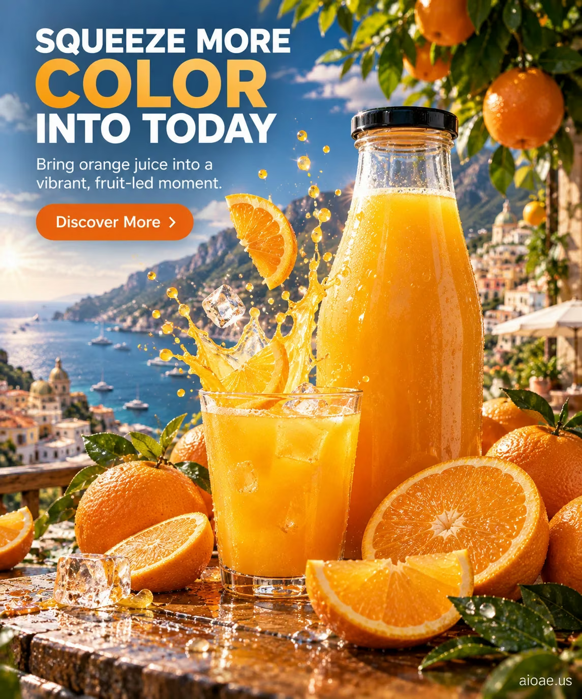

# 案例 24：柳橙汁廣告：為今天擠入更多色彩 | Case 24: Orange Juice Ad Squeeze More Color Into Today



陽光海岸的柳橙汁廣告：果汁飛濺、冰塊與鮮橙，色彩飽滿的夏日商業攝影。

An orange-juice ad on a sunny coast: juice splashes, ice cubes and fresh oranges — saturated summer commercial photography.

## 完整提示詞 / Full Prompt

```
SUBJECT & IDEA: Orange juice advertising poster. Preserve named subject, requested relationships, main action and format.

HERO PRODUCT VISIBILITY: Keep beverage unambiguously dominant, large and readable. Preserve the actual form factor, function, silhouette, product identity and stated materials. Do not replace the product with a generic futuristic object or shrink it behind scenery.

PRODUCT VALUE STRATEGY: Distinctive product value — Make the product benefit visually understandable before decorative spectacle. Visible proof: clear product-function relationship; one visible cause-and-effect cue. Do not invent measurements or factual specifications.

PRODUCT ATMOSPHERE: visually clear, emotionally appropriate and benefit-led. Make the product benefit tangible through its real use context.. Use coherent lighting, materials and color that support this product.

SCENE: a coherent commercial setting grounded in the named product and its intended use. Maintain clear foreground, midground and background with a single coherent physical logic.

MUTATION RULES: Subject-grounded visual evolution. MAIN SUBJECT LOCK: Orange juice advertising poster. Preserve: beverage. SINGLE DATABASE-GROUNDED CREATIVE MUTATION: Make one concrete subject-related visual change using supporting material texture, practical reflections and product-scale staging; the change must directly visually communicate Distinctive product value without altering the product form factor. Mutate secondary display elements immediately around the protected product only. Evidence: One coherent visible before/after material cue, contact, shadows or a physically traceable visual consequence. Staging: Preserve the original scene and the exact hero/action; no unrelated background or new main subject. Purpose: The existing subject and its meaning remain primary; visually communicate Distinctive product value without altering the product form factor. Explain product benefit Distinctive product value through observable cues (clear product-function relationship; one visible cause-and-effect cue); no unverifiable performance claims. One transformation, one consistent physical logic; subject, format, original relationships, named products, setting and main action unchanged. No unsolicited portals, robots, random second worlds or subject replacement. No unrelated portal, no arbitrary second world and no subject replacement unless expressly requested.

ON-IMAGE AD COPY: Exact headline "SQUEEZE MORE COLOR INTO TODAY"; exact subheadline "Bring orange juice into a vibrant, fruit-led moment."; exact CTA "Discover More". Keep the lettering legible and organized in negative space. Distinct typographic scale and hierarchy; no other invented brand, prices or specifications.

STYLE: coherent premium visual storytelling with readable subject geometry and motivated light. Lighting and color should respond to the actual setting rather than unrelated stock effects.

CAMERA: hero product dominates the frame, with legible details and controlled reflections. Preserve perspective and realistic scale.

WATERMARK: Add a small, subtle and readable "aioae.us" in the bottom-right corner.

AVOID: generic random genre backgrounds, contradictory lighting, product identity substitution, extra fingers, duplicate characters, disjointed composition, unintended copy and unsupported factual claims.
```

## 適用模型 / Recommended Models

適合需要精準渲染圖上英文文案的模型：GPT Image（Image2，本案例原生成模型）、Flux 1.1 Pro、Ideogram（海報文字專長）。

Works best on models that render on-image English copy accurately: GPT Image (Image2 — the original model used for this case), Flux 1.1 Pro, Ideogram (poster-text specialist).

## 修改說明 / How to Adapt

- 換文案：把 ON-IMAGE AD COPY 的 headline / subheadline / CTA 三行換成自己的品牌口號，其它段落不動。
- 換產品：把 SUBJECT & IDEA 與 MAIN SUBJECT LOCK 的「Orange juice」換成別的飲品（如檸檬茶），保留產品可視性與場景約束。
- 去水印：刪掉 WATERMARK 段落，或把 "aioae.us" 換成自己的網域。

- Swap the copy: replace the headline / subheadline / CTA lines in ON-IMAGE AD COPY with your own brand slogans; leave everything else untouched.
- Swap the product: change "Orange juice" in SUBJECT & IDEA and MAIN SUBJECT LOCK to another beverage (e.g. lemon tea) while keeping the product-visibility and scene constraints.
- Remove the watermark: delete the WATERMARK paragraph, or replace "aioae.us" with your own domain.

---
直達本案例 / This case on AIOAE: https://aioae.us/prompt?title=Orange%20Juice%20Ad%20Squeeze%20More%20Color%20Into%20Today
更多同類提示詞 / More prompts like this: https://aioae.us/prompts
