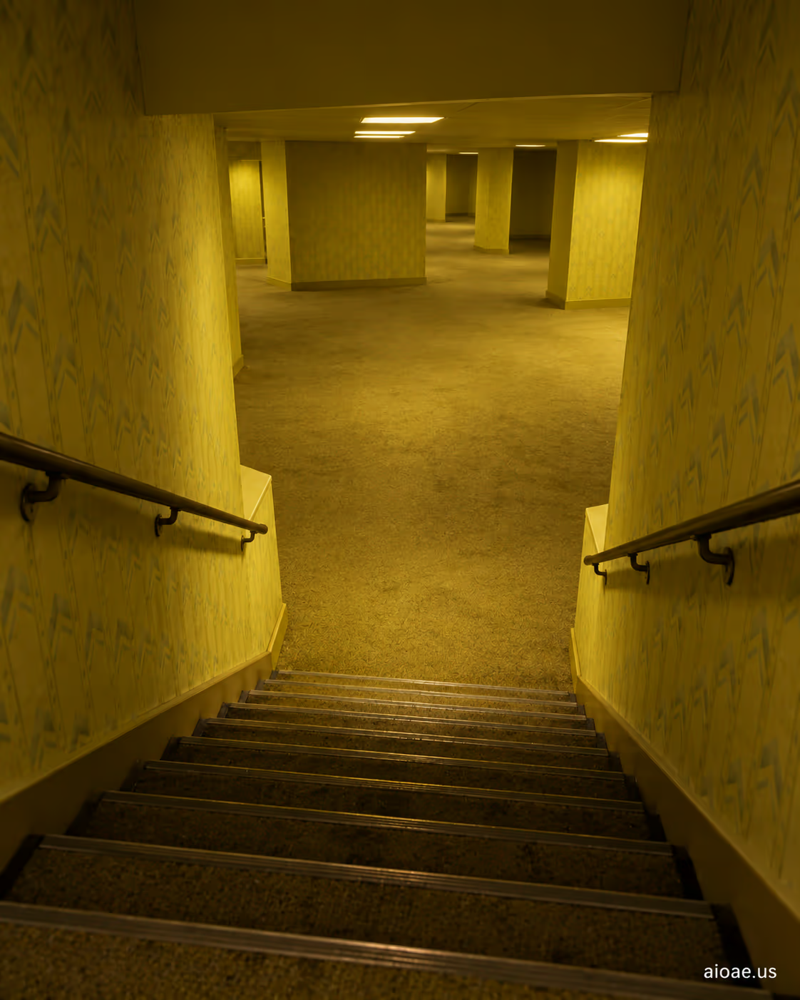

# 案例 25：通往後室的樓梯 | Case 25: A Staircase Leading Into the Backrooms



後室（Backrooms）閾限空間恐怖風：一條樓梯通向無盡黃色房間的深處，熒光燈的冷白與牆紙的髒黃交織，孤獨感與不安感拉滿的電影級構圖。

Backrooms liminal-space horror: a staircase descends into the endless yellow rooms, fluorescent cold white against grimy yellow wallpaper — a cinematic composition of loneliness and unease.

## 完整提示詞 / Full Prompt

```
SUBJECT & IDEA: A Staircase Leading Into the Backrooms. Preserve named subject, requested relationships, main action and format.

SCENE: one continuous believable setting suited to the subject and brief. Maintain clear foreground, midground and background with a single coherent physical logic.

MUTATION RULES: Subject-grounded visual evolution. MAIN SUBJECT LOCK: A Staircase Leading Into the Backrooms. SINGLE DATABASE-GROUNDED CREATIVE MUTATION: Make one concrete subject-related visual change using the existing light, material response and surroundings; the change must directly reinforce visual_art through a subject-relevant supporting detail. Mutate a supporting element within the original composition only. Evidence: One coherent visible before/after material cue, contact, shadows or directional light explains the change. Staging: Preserve the original scene and the exact hero/action; no unrelated background or new main subject. Purpose: The existing subject and its meaning remain primary; reinforce visual_art through a subject-relevant supporting detail. One transformation, one consistent physical logic; subject, format, original relationships, named products, setting and main action unchanged. No unsolicited portals, robots, random second worlds or subject replacement. No unrelated portal, no arbitrary second world and no subject replacement unless expressly requested.

STYLE: coherent premium visual storytelling with readable subject geometry and motivated light. Lighting and color should respond to the actual setting rather than unrelated stock effects.

CAMERA: subject-first coherent perspective. Preserve perspective and realistic scale.

WATERMARK: Add a small, subtle and readable "aioae.us" in the bottom-right corner.

AVOID: generic random genre backgrounds, contradictory lighting, product identity substitution, extra fingers, duplicate characters, disjointed composition, unintended copy and unsupported factual claims.
```

## 適用模型 / Recommended Models

擅長寫實恐怖氛圍與電影感的模型：GPT Image（Image2）、Flux Pro、Midjourney（加 `--ar 4:5` 更有沉浸感）。

Models strong at realistic horror atmosphere and cinematic feel: GPT Image (Image2), Flux Pro, Midjourney (add `--ar 4:5` for immersion).

## 修改說明 / How to Adapt

- 換場景：把 SUBJECT & IDEA 和 MAIN SUBJECT LOCK 的「A Staircase Leading Into the Backrooms」換成其他後室場景（如電梯井、停車場），全圖自動跟著變。
- 加重恐懼：在 STYLE 段追加「dim flickering fluorescent light, heavy film grain」，不安感翻倍。
- 換時代感：在 CAMERA 或 STYLE 裡加入「1990s surveillance camera still」，可做成監控畫面質感。

- Change the scene: swap "A Staircase Leading Into the Backrooms" in SUBJECT & IDEA and MAIN SUBJECT LOCK for another Backrooms setting (e.g. elevator shaft, parking garage).
- Dial up the dread: append "dim flickering fluorescent light, heavy film grain" to STYLE for a stronger unease.
- Change the era: add "1990s surveillance camera still" to CAMERA or STYLE for a CCTV-still look.

---
直達本案例 / Direct link: https://aioae.us/prompt?title=A%20Staircase%20Leading%20Into%20the%20Backrooms
更多同類提示詞 / More prompts like this: [AIOAE 免費 AI 圖片提示詞庫](https://aioae.us/prompts)
