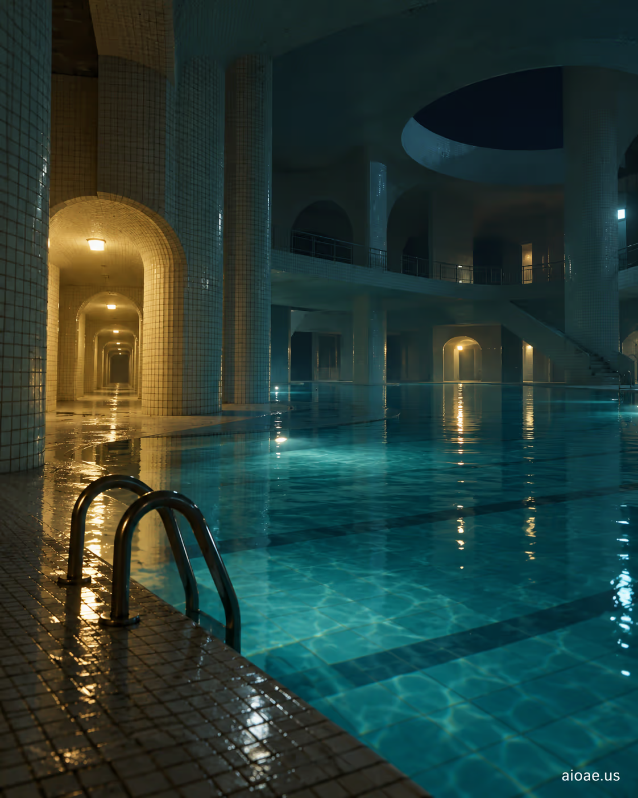

# 案例 26：午夜被遺棄的室內泳池群 | Case 26: Abandoned Indoor Poolrooms at Midnight



池室（Poolrooms）閾限美學：午夜時分被遺棄的室內泳池群，水面倒映著蒼白的燈光，瓷磚牆壁延伸到看不見的盡頭，寧靜中透著詭異。

Poolrooms liminal aesthetic: abandoned indoor poolrooms at midnight, pale light reflected on still water, tiled walls stretching beyond sight — serene yet uncanny.

## 完整提示詞 / Full Prompt

```
SUBJECT & IDEA: Abandoned Indoor Poolrooms at Midnight. Preserve named subject, requested relationships, main action and format.

SCENE: one continuous believable setting suited to the subject and brief. Maintain clear foreground, midground and background with a single coherent physical logic.

MUTATION RULES: Subject-grounded visual evolution. MAIN SUBJECT LOCK: Abandoned Indoor Poolrooms at Midnight. SINGLE DATABASE-GROUNDED CREATIVE MUTATION: Make one concrete subject-related visual change using the existing light, material response and surroundings; the change must directly reinforce visual_art through a subject-relevant supporting detail. Mutate a supporting element within the original composition only. Evidence: One coherent visible before/after material cue, contact, shadows or directional light explains the change. Staging: Preserve the original scene and the exact hero/action; no unrelated background or new main subject. Purpose: The existing subject and its meaning remain primary; reinforce visual_art through a subject-relevant supporting detail. One transformation, one consistent physical logic; subject, format, original relationships, named products, setting and main action unchanged. No unsolicited portals, robots, random second worlds or subject replacement. No unrelated portal, no arbitrary second world and no subject replacement unless expressly requested.

STYLE: coherent premium visual storytelling with readable subject geometry and motivated light. Lighting and color should respond to the actual setting rather than unrelated stock effects.

CAMERA: subject-first coherent perspective. Preserve perspective and realistic scale.

WATERMARK: Add a small, subtle and readable "aioae.us" in the bottom-right corner.

AVOID: generic random genre backgrounds, contradictory lighting, product identity substitution, extra fingers, duplicate characters, disjointed composition, unintended copy and unsupported factual claims.
```

## 適用模型 / Recommended Models

擅長寫實水面質感與空間縱深的模型：GPT Image（Image2）、Flux Pro、Midjourney（加 `--ar 16:9` 展現泳池群的延伸感）。

Models strong at realistic water texture and spatial depth: GPT Image (Image2), Flux Pro, Midjourney (add `--ar 16:9` for the pools' endless stretch).

## 修改說明 / How to Adapt

- 換時段：把 SUBJECT 的「at Midnight」改成「at Dawn」，光線自動變成冷藍色晨光，氣氛完全不同。
- 加人物：刪掉 AVOID 裡的「duplicate characters」並在 SCENE 追加「a lone swimmer in the far pool」，畫面多一個敘事錨點。
- 換色調：在 STYLE 段追加「teal and chlorine-green palette」，水面的化學感更強。

- Change the hour: swap "at Midnight" for "at Dawn" in SUBJECT and the light turns cold blue morning — a totally different mood.
- Add a figure: remove "duplicate characters" from AVOID and add "a lone swimmer in the far pool" to SCENE for a narrative anchor.
- Change the palette: append "teal and chlorine-green palette" to STYLE for a stronger chemical-water feel.

---
直達本案例 / Direct link: https://aioae.us/prompt?title=Abandoned%20Indoor%20Poolrooms%20at%20Midnight
更多同類提示詞 / More prompts like this: [AIOAE 免費 AI 圖片提示詞庫](https://aioae.us/prompts)
