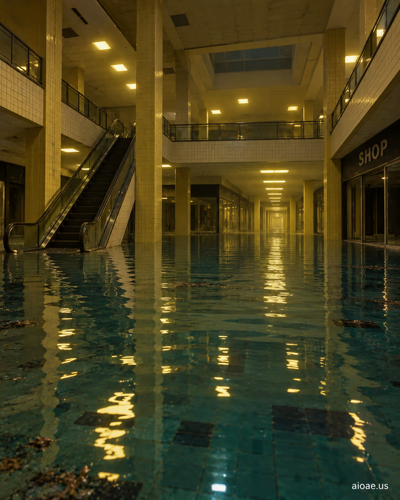

# 案例 27：淹水的後室購物中心 | Case 27: A Flooded Backrooms Shopping Mall



後室洪水版閾限恐怖：被水淹沒的購物中心中庭，倒塌的櫥窗與漂浮的雜物在黃色燈光下晃動，商業空間的死寂比怪物更嚇人。

Flooded-Backrooms liminal horror: a shopping mall atrium swallowed by water, collapsed storefronts and floating debris swaying under yellow light — the dead silence of retail space is scarier than any monster.

## 完整提示詞 / Full Prompt

```
SUBJECT & IDEA: A Flooded Backrooms Shopping Mall. Preserve named subject, requested relationships, main action and format.

SCENE: one continuous believable setting suited to the subject and brief. Maintain clear foreground, midground and background with a single coherent physical logic.

MUTATION RULES: Subject-grounded visual evolution. MAIN SUBJECT LOCK: A Flooded Backrooms Shopping Mall. SINGLE DATABASE-GROUNDED CREATIVE MUTATION: Make one concrete subject-related visual change using the existing light, material response and surroundings; the change must directly reinforce visual_art through a subject-relevant supporting detail. Mutate a supporting element within the original composition only. Evidence: One coherent visible before/after material cue, contact, shadows or directional light explains the change. Staging: Preserve the original scene and the exact hero/action; no unrelated background or new main subject. Purpose: The existing subject and its meaning remain primary; reinforce visual_art through a subject-relevant supporting detail. One transformation, one consistent physical logic; subject, format, original relationships, named products, setting and main action unchanged. No unsolicited portals, robots, random second worlds or subject replacement. No unrelated portal, no arbitrary second world and no subject replacement unless expressly requested.

STYLE: coherent premium visual storytelling with readable subject geometry and motivated light. Lighting and color should respond to the actual setting rather than unrelated stock effects.

CAMERA: subject-first coherent perspective. Preserve perspective and realistic scale.

WATERMARK: Add a small, subtle and readable "aioae.us" in the bottom-right corner.

AVOID: generic random genre backgrounds, contradictory lighting, product identity substitution, extra fingers, duplicate characters, disjointed composition, unintended copy and unsupported factual claims.
```

## 適用模型 / Recommended Models

擅長寫實水面反射與大型空間的模型：GPT Image（Image2）、Flux Pro、Midjourney（水面倒影建議加 `--ar 3:4`）。

Models strong at realistic water reflections and large spaces: GPT Image (Image2), Flux Pro, Midjourney (add `--ar 3:4` for the reflection composition).

## 修改說明 / How to Adapt

- 換水位：把 SUBJECT 的「Flooded」改成「Drained」並在 SCENE 追加「muddy floor, fallen ceiling tiles」，同一商場可做前後對比組圖。
- 加恐怖元素：在 STYLE 追加「a dark silhouette reflected in the water」，水面倒影裡藏一個黑影。
- 換視角：在 CAMERA 追加「high-angle from the second-floor railing」，俯拍淹水的中庭更有壓迫感。

- Change the water level: swap "Flooded" for "Drained" and add "muddy floor, fallen ceiling tiles" to SCENE — the same mall becomes a before/after diptych.
- Add horror: append "a dark silhouette reflected in the water" to STYLE — a black shape hidden in the reflection.
- Change the angle: add "high-angle from the second-floor railing" to CAMERA — looking down at the flooded atrium feels more oppressive.

---
直達本案例 / Direct link: https://aioae.us/prompt?title=A%20Flooded%20Backrooms%20Shopping%20Mall
更多同類提示詞 / More prompts like this: [AIOAE 免費 AI 圖片提示詞庫](https://aioae.us/prompts)
