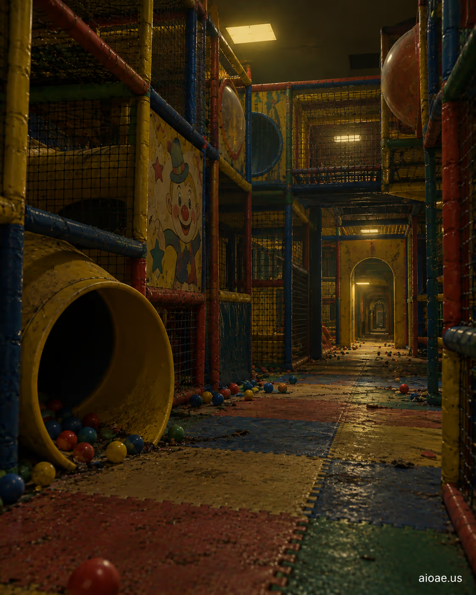

# 案例 28：被遺忘的兒童遊樂迷宮 | Case 28: A Forgotten Children's Play Maze



童年陰影式恐怖：被遺忘的兒童遊樂迷宮，褪色的塑膠滑梯與球池在昏暗燈光下扭曲變形，歡樂的記憶變成不安的夢魘。

Childhood-shadows horror: a forgotten children's play maze, faded plastic slides and ball pits warped under dim light — happy memories turned into an uneasy nightmare.

## 完整提示詞 / Full Prompt

```
SUBJECT & IDEA: A Forgotten Children's Play Maze. Preserve named subject, requested relationships, main action and format.

SCENE: one continuous believable setting suited to the subject and brief. Maintain clear foreground, midground and background with a single coherent physical logic.

MUTATION RULES: pun and reinterpretation. MAIN SUBJECT LOCK: A Forgotten Children's Play Maze. SINGLE DATABASE-GROUNDED CREATIVE MUTATION: Adapt the database-selected idea (Express the idea through semantic reinterpretation rather than literal depiction Support the concept with clear crop.) to visual_art; implement it only in one supporting physical element that reinforces the named central subject and connect its visual meaning to the protected subject.. Mutate one supporting physical element that reinforces the named central subject only. Evidence: clear crop. Staging: Maintain the original setting with coherent lighting, scale, and foreground/background continuity. Purpose: Express the user's requested topic (A Forgotten Children's Play Maze); do not substitute the subject, action, product identity, venue or format. One transformation, one consistent physical logic; subject, format, original relationships, named products, setting and main action unchanged. No unsolicited portals, robots, random second worlds or subject replacement. No unrelated portal, no arbitrary second world and no subject replacement unless expressly requested.

STYLE: coherent premium visual storytelling with readable subject geometry and motivated light. Lighting and color should respond to the actual setting rather than unrelated stock effects.

CAMERA: subject-first coherent perspective. Preserve perspective and realistic scale.

WATERMARK: Add a small, subtle and readable "aioae.us" in the bottom-right corner.

AVOID: generic random genre backgrounds, contradictory lighting, product identity substitution, extra fingers, duplicate characters, disjointed composition, unintended copy and unsupported factual claims.
```

## 適用模型 / Recommended Models

擅長陳舊材質與懷舊色調的模型：GPT Image（Image2）、Flux Pro、Midjourney（加 `--style raw` 避免過度美化）。

Models strong at worn materials and nostalgic tones: GPT Image (Image2), Flux Pro, Midjourney (add `--style raw` to avoid over-beautifying).

## 修改說明 / How to Adapt

- 換設施：把 SUBJECT 的「Children's Play Maze」換成「Carousel」或「Ferris Wheel」，同一恐怖模板套用不同遊樂設施。
- 加重年代感：在 STYLE 追加「sun-bleached plastic, peeling paint, dust-covered」，陳舊感直接拉滿。
- 換光線：在 CAMERA 或 STYLE 追加「single emergency exit sign glowing red」，紅色出口燈是恐怖片經典光源。

- Change the facility: swap "Children's Play Maze" for "Carousel" or "Ferris Wheel" in SUBJECT — the same horror template, different ride.
- Age it up: append "sun-bleached plastic, peeling paint, dust-covered" to STYLE for full decay.
- Change the light: add "single emergency exit sign glowing red" to CAMERA or STYLE — the red exit sign is a horror classic.

---
直達本案例 / Direct link: https://aioae.us/prompt?title=A%20Forgotten%20Children%27s%20Play%20Maze
更多同類提示詞 / More prompts like this: [AIOAE 免費 AI 圖片提示詞庫](https://aioae.us/prompts)
