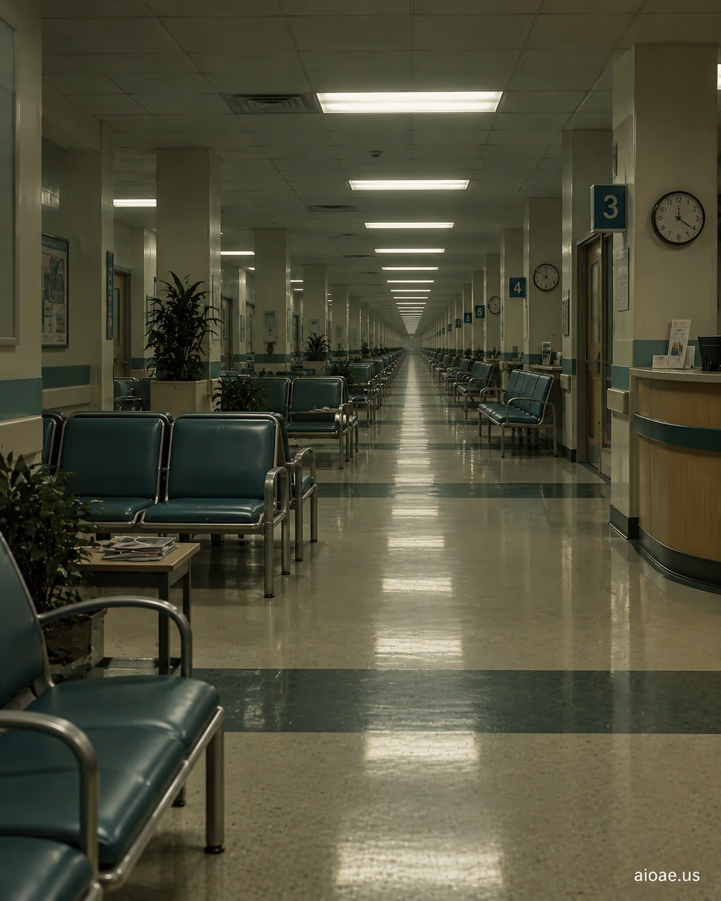

# 案例 29：無盡的醫院候診室 | Case 29: The Endless Hospital Waiting Room



醫療閾限恐怖：無盡延伸的醫院候診室，一排排空椅子在慘白燈光下重複到地平線，等待本身就是最漫長的驚悚。

Medical liminal horror: an endless hospital waiting room, rows of empty chairs repeating to the horizon under ghastly light — the waiting itself is the longest thriller.

## 完整提示詞 / Full Prompt

```
SUBJECT & IDEA: The Endless Hospital Waiting Room. Preserve named subject, requested relationships, main action and format.

SCENE: one continuous believable setting suited to the subject and brief. Maintain clear foreground, midground and background with a single coherent physical logic.

MUTATION RULES: Subject-grounded visual evolution. MAIN SUBJECT LOCK: The Endless Hospital Waiting Room. SINGLE DATABASE-GROUNDED CREATIVE MUTATION: Make one concrete subject-related visual change using the existing light, material response and surroundings; the change must directly reinforce visual_art through a subject-relevant supporting detail. Mutate a supporting element within the original composition only. Evidence: One coherent visible before/after material cue, contact, shadows or directional light explains the change. Staging: Preserve the original scene and the exact hero/action; no unrelated background or new main subject. Purpose: The existing subject and its meaning remain primary; reinforce visual_art through a subject-relevant supporting detail. One transformation, one consistent physical logic; subject, format, original relationships, named products, setting and main action unchanged. No unsolicited portals, robots, random second worlds or subject replacement. No unrelated portal, no arbitrary second world and no subject replacement unless expressly requested.

STYLE: coherent premium visual storytelling with readable subject geometry and motivated light. Lighting and color should respond to the actual setting rather than unrelated stock effects.

CAMERA: subject-first coherent perspective. Preserve perspective and realistic scale.

WATERMARK: Add a small, subtle and readable "aioae.us" in the bottom-right corner.

AVOID: generic random genre backgrounds, contradictory lighting, product identity substitution, extra fingers, duplicate characters, disjointed composition, unintended copy and unsupported factual claims.
```

## 適用模型 / Recommended Models

擅長重複透視與冷色調空間的模型：GPT Image（Image2）、Flux Pro、Midjourney（加 `--ar 16:9` 表現無盡延伸）。

Models strong at repeating perspective and cold-toned spaces: GPT Image (Image2), Flux Pro, Midjourney (add `--ar 16:9` for the endless stretch).

## 修改說明 / How to Adapt

- 換機構：把 SUBJECT 的「Hospital Waiting Room」換成「Airport Terminal」或「DMV Office」，都是排隊地獄的經典場景。
- 加等待者：在 SCENE 追加「a single patient sitting far away, back to camera」，一個背影讓空蕩更有故事。
- 換叫號牌：在 STYLE 追加「a flickering number display showing 'A000'"，叫號牌的紅光是點睛之筆。

- Change the institution: swap "Hospital Waiting Room" for "Airport Terminal" or "DMV Office" in SUBJECT — all classics of queue hell.
- Add a waiter: append "a single patient sitting far away, back to camera" to SCENE — one back-view makes the emptiness tell a story.
- Add a ticket display: append "a flickering number display showing 'A000'" to STYLE — the ticket board's red glow is the finishing touch.

---
直達本案例 / Direct link: https://aioae.us/prompt?title=The%20Endless%20Hospital%20Waiting%20Room
更多同類提示詞 / More prompts like this: [AIOAE 免費 AI 圖片提示詞庫](https://aioae.us/prompts)
