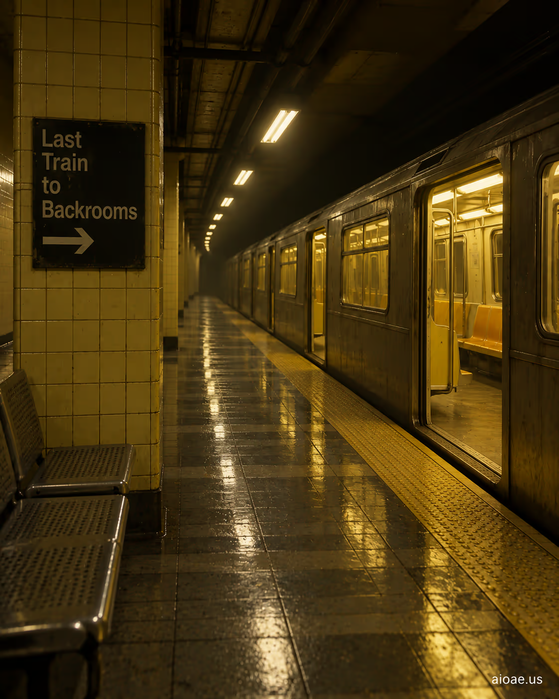

# 案例 30：開往後室的最後一班地鐵 | Case 30: The Last Subway Train to the Backrooms



都市傳說式恐怖：午夜最後一班地鐵駛入不屬於任何路線的站台，車廂燈光慘白、座位空無一人，下一站是後室。

Urban-legend horror: the last subway train of the night pulls into a station on no route, carriage lights ghastly, seats empty — next stop, the Backrooms.

## 完整提示詞 / Full Prompt

```
SUBJECT & IDEA: The Last Subway Train to the Backrooms. Preserve named subject, requested relationships, main action and format.

SCENE: one continuous believable setting suited to the subject and brief. Maintain clear foreground, midground and background with a single coherent physical logic.

MUTATION RULES: Subject-grounded visual evolution. MAIN SUBJECT LOCK: The Last Subway Train to the Backrooms. SINGLE DATABASE-GROUNDED CREATIVE MUTATION: Make one concrete subject-related visual change using the existing light, material response and surroundings; the change must directly reinforce visual_art through a subject-relevant supporting detail. Mutate a supporting element within the original composition only. Evidence: One coherent visible before/after material cue, contact, shadows or directional light explains the change. Staging: Preserve the original scene and the exact hero/action; no unrelated background or new main subject. Purpose: The existing subject and its meaning remain primary; reinforce visual_art through a subject-relevant supporting detail. One transformation, one consistent physical logic; subject, format, original relationships, named products, setting and main action unchanged. No unsolicited portals, robots, random second worlds or subject replacement. No unrelated portal, no arbitrary second world and no subject replacement unless expressly requested.

STYLE: coherent premium visual storytelling with readable subject geometry and motivated light. Lighting and color should respond to the actual setting rather than unrelated stock effects.

CAMERA: subject-first coherent perspective. Preserve perspective and realistic scale.

WATERMARK: Add a small, subtle and readable "aioae.us" in the bottom-right corner.

AVOID: generic random genre backgrounds, contradictory lighting, product identity substitution, extra fingers, duplicate characters, disjointed composition, unintended copy and unsupported factual claims.
```

## 適用模型 / Recommended Models

擅長交通工具內飾與夜間燈光的模型：GPT Image（Image2）、Flux Pro、Midjourney（車廂縱深構圖加 `--ar 16:9`）。

Models strong at vehicle interiors and night lighting: GPT Image (Image2), Flux Pro, Midjourney (add `--ar 16:9` for the carriage's depth).

## 修改說明 / How to Adapt

- 換交通工具：把 SUBJECT 的「Subway Train」換成「Night Bus」或「Elevator」，深夜密閉空間的恐怖模板通用。
- 加乘客：在 SCENE 追加「one passenger asleep at the far end, face hidden」，遠端睡著的乘客是經典恐怖伏筆。
- 換站牌：在 STYLE 追加「destination board flickering with unreadable text」，亂碼的終點站牌直接點題。

- Change the vehicle: swap "Subway Train" for "Night Bus" or "Elevator" in SUBJECT — the late-night enclosed-space horror template is universal.
- Add a passenger: append "one passenger asleep at the far end, face hidden" to SCENE — a sleeping figure at the far end is a classic horror setup.
- Change the sign: append "destination board flickering with unreadable text" to STYLE — a garbled destination board nails the theme.

---
直達本案例 / Direct link: https://aioae.us/prompt?title=The%20Last%20Subway%20Train%20to%20the%20Backrooms
更多同類提示詞 / More prompts like this: [AIOAE 免費 AI 圖片提示詞庫](https://aioae.us/prompts)
