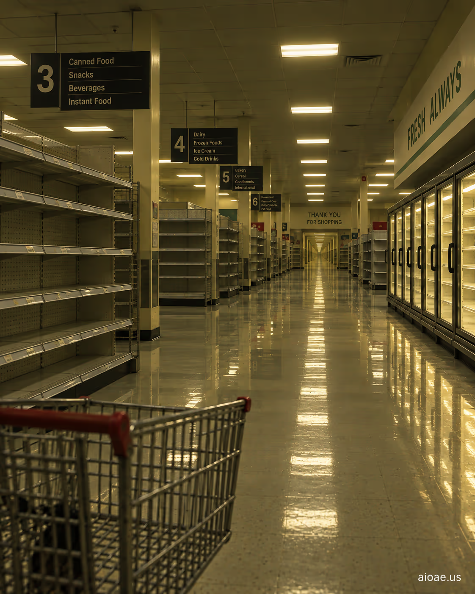

# 案例 31：永不打烊的空蕩超市 | Case 31: An Empty Supermarket That Never Closes



消費主義閾限恐怖：凌晨三點空無一人的超市，貨架整齊得可疑，燈光永遠亮著——沒有顧客，卻永不打烊。

Consumerism liminal horror: a supermarket empty at 3 AM, shelves suspiciously neat, lights forever on — no customers, yet never closed.

## 完整提示詞 / Full Prompt

```
SUBJECT & IDEA: An Empty Supermarket That Never Closes. Preserve named subject, requested relationships, main action and format.

SCENE: one continuous believable setting suited to the subject and brief. Maintain clear foreground, midground and background with a single coherent physical logic.

MUTATION RULES: subject rebuilt. MAIN SUBJECT LOCK: An Empty Supermarket That Never Closes. SINGLE DATABASE-GROUNDED CREATIVE MUTATION: Adapt the database-selected idea (Let the subject mutate into a form that visualizes the message more powerfully than literal depiction Support the concept with surface detail retention.) to visual_art; implement it only in one supporting physical element that reinforces the named central subject and connect its visual meaning to the protected subject.. Mutate one supporting physical element that reinforces the named central subject only. Evidence: surface detail retention. Staging: Maintain the original setting with coherent lighting, scale, and foreground/background continuity. Purpose: Express the user's requested topic (An Empty Supermarket That Never Closes); do not substitute the subject, action, product identity, venue or format. One transformation, one consistent physical logic; subject, format, original relationships, named products, setting and main action unchanged. No unsolicited portals, robots, random second worlds or subject replacement. No unrelated portal, no arbitrary second world and no subject replacement unless expressly requested.

STYLE: coherent premium visual storytelling with readable subject geometry and motivated light. Lighting and color should respond to the actual setting rather than unrelated stock effects.

CAMERA: subject-first coherent perspective. Preserve perspective and realistic scale.

WATERMARK: Add a small, subtle and readable "aioae.us" in the bottom-right corner.

AVOID: generic random genre backgrounds, contradictory lighting, product identity substitution, extra fingers, duplicate characters, disjointed composition, unintended copy and unsupported factual claims.
```

## 適用模型 / Recommended Models

擅長商業空間與整齊陳列的模型：GPT Image（Image2）、Flux Pro、Midjourney（長貨架構圖加 `--ar 16:9`）。

Models strong at retail spaces and neat shelving: GPT Image (Image2), Flux Pro, Midjourney (add `--ar 16:9` for the long-aisle composition).

## 修改說明 / How to Adapt

- 換商店：把 SUBJECT 的「Supermarket」換成「Convenience Store」或「Department Store」，模板直接套用。
- 加收銀員：在 SCENE 追加「an empty checkout lane with the belt still running」，無人卻運轉的收銀帶是神來之筆。
- 換貨架狀態：在 STYLE 追加「one aisle with all products knocked off the shelves」，一條被掃空的貨架打破整齊，製造敘事缺口。

- Change the store: swap "Supermarket" for "Convenience Store" or "Department Store" in SUBJECT — the template transfers directly.
- Add a cashier lane: append "an empty checkout lane with the belt still running" to SCENE — an unmanned but running checkout belt is a stroke of genius.
- Change the shelves: append "one aisle with all products knocked off the shelves" to STYLE — one ransacked aisle breaks the neatness and opens a narrative gap.

---
直達本案例 / Direct link: https://aioae.us/prompt?title=An%20Empty%20Supermarket%20That%20Never%20Closes
更多同類提示詞 / More prompts like this: [AIOAE 免費 AI 圖片提示詞庫](https://aioae.us/prompts)
