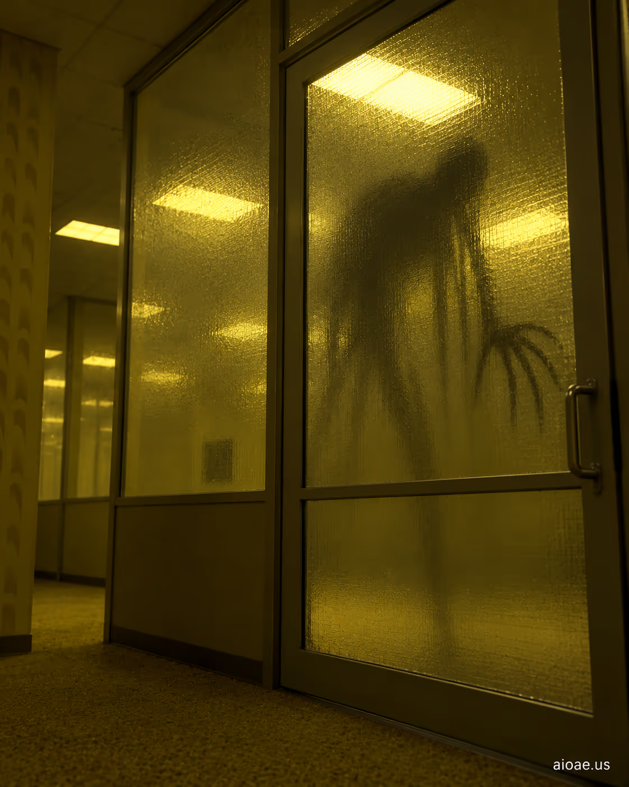

# 案例 32：磨砂玻璃後的後室實體 | Case 32: The Backrooms Entity Behind the Frosted Glass



實體現身式恐怖：磨砂玻璃後面站著一個模糊的人形輪廓——後室傳說中的「實體」終於露面，恐懼來自你看不清它。

Entity-reveal horror: a blurred humanoid silhouette stands behind frosted glass — the Backrooms' fabled "entity" finally appears, and the fear is that you can't quite see it.

## 完整提示詞 / Full Prompt

```
SUBJECT & IDEA: The Backrooms Entity Behind the Frosted Glass. Preserve named subject, requested relationships, main action and format.

SCENE: one continuous believable setting suited to the subject and brief. Maintain clear foreground, midground and background with a single coherent physical logic.

MUTATION RULES: Subject-grounded visual evolution. MAIN SUBJECT LOCK: The Backrooms Entity Behind the Frosted Glass. SINGLE DATABASE-GROUNDED CREATIVE MUTATION: Make one concrete subject-related visual change using the existing light, material response and surroundings; the change must directly reinforce visual_art through a subject-relevant supporting detail. Mutate a supporting element within the original composition only. Evidence: One coherent visible before/after material cue, contact, shadows or directional light explains the change. Staging: Preserve the original scene and the exact hero/action; no unrelated background or new main subject. Purpose: The existing subject and its meaning remain primary; reinforce visual_art through a subject-relevant supporting detail. One transformation, one consistent physical logic; subject, format, original relationships, named products, setting and main action unchanged. No unsolicited portals, robots, random second worlds or subject replacement. No unrelated portal, no arbitrary second world and no subject replacement unless expressly requested.

STYLE: coherent premium visual storytelling with readable subject geometry and motivated light. Lighting and color should respond to the actual setting rather than unrelated stock effects.

CAMERA: subject-first coherent perspective. Preserve perspective and realistic scale.

WATERMARK: Add a small, subtle and readable "aioae.us" in the bottom-right corner.

AVOID: generic random genre backgrounds, contradictory lighting, product identity substitution, extra fingers, duplicate characters, disjointed composition, unintended copy and unsupported factual claims.
```

## 適用模型 / Recommended Models

擅長剪影與半透明材質的模型：GPT Image（Image2）、Flux Pro、Midjourney（玻璃質感建議加 `--ar 4:5`）。

Models strong at silhouettes and translucent materials: GPT Image (Image2), Flux Pro, Midjourney (add `--ar 4:5` for the glass texture).

## 修改說明 / How to Adapt

- 換遮擋物：把 SUBJECT 的「Frosted Glass」換成「Shower Curtain」或「Thin Curtain」，半透明遮擋的恐怖模板通用。
- 加手：在 SCENE 追加「a handprint pressed against the glass from the other side」，玻璃另一側的手印是經典驚嚇點。
- 換清晰度：在 STYLE 追加「silhouette slightly clearer than expected, wrong proportions」，比預期更清晰、比例不對的輪廓最嚇人。

- Change the barrier: swap "Frosted Glass" for "Shower Curtain" or "Thin Curtain" in SUBJECT — the translucent-barrier horror template is universal.
- Add a hand: append "a handprint pressed against the glass from the other side" to SCENE — a handprint from the other side is the classic scare beat.
- Change the clarity: append "silhouette slightly clearer than expected, wrong proportions" to STYLE — a clearer-than-expected, wrongly-proportioned silhouette is the scariest.

---
直達本案例 / Direct link: https://aioae.us/prompt?title=The%20Backrooms%20Entity%20Behind%20the%20Frosted%20Glass
更多同類提示詞 / More prompts like this: [AIOAE 免費 AI 圖片提示詞庫](https://aioae.us/prompts)
