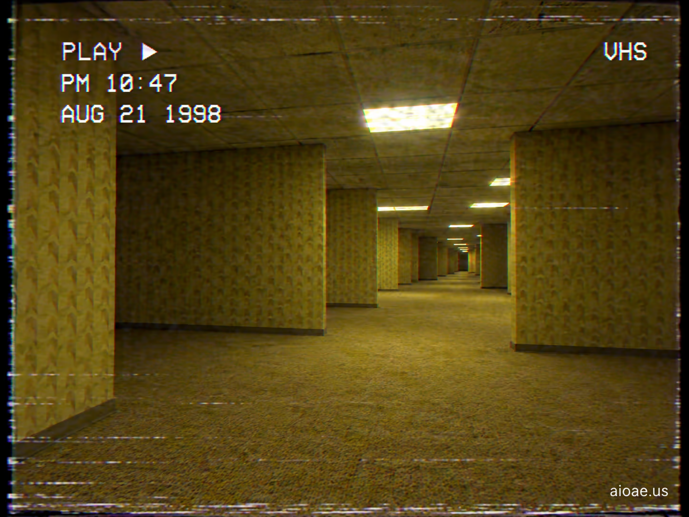

# 案例 33：1998 年 VHS 錄影帶中的後室 | Case 33: 1998 VHS Footage of the Backrooms



偽紀錄片式恐怖：1998 年的 VHS 錄影帶畫面，噪點、追蹤線與時間碼疊加在後室的黃色走廊上——這不是電影，這是「被發現的錄像」。

Found-footage horror: a 1998 VHS frame, noise, tracking lines and timecode over the Backrooms' yellow corridors — not a movie, but "recovered footage".

## 完整提示詞 / Full Prompt

```
SUBJECT & IDEA: 1998 VHS Footage of the Backrooms. Preserve named subject, requested relationships, main action and format.

SCENE: one continuous believable setting suited to the subject and brief. Maintain clear foreground, midground and background with a single coherent physical logic.

MUTATION RULES: Subject-grounded visual evolution. MAIN SUBJECT LOCK: 1998 VHS Footage of the Backrooms. SINGLE DATABASE-GROUNDED CREATIVE MUTATION: Make one concrete subject-related visual change using the existing light, material response and surroundings; the change must directly reinforce visual_art through a subject-relevant supporting detail. Mutate a supporting element within the original composition only. Evidence: One coherent visible before/after material cue, contact, shadows or directional light explains the change. Staging: Preserve the original scene and the exact hero/action; no unrelated background or new main subject. Purpose: The existing subject and its meaning remain primary; reinforce visual_art through a subject-relevant supporting detail. One transformation, one consistent physical logic; subject, format, original relationships, named products, setting and main action unchanged. No unsolicited portals, robots, random second worlds or subject replacement. No unrelated portal, no arbitrary second world and no subject replacement unless expressly requested.

STYLE: coherent premium visual storytelling with readable subject geometry and motivated light. Lighting and color should respond to the actual setting rather than unrelated stock effects.

CAMERA: subject-first coherent perspective. Preserve perspective and realistic scale.

WATERMARK: Add a small, subtle and readable "aioae.us" in the bottom-right corner.

AVOID: generic random genre backgrounds, contradictory lighting, product identity substitution, extra fingers, duplicate characters, disjointed composition, unintended copy and unsupported factual claims.
```

## 適用模型 / Recommended Models

擅長復古影像質感與噪點的模型：GPT Image（Image2）、Flux Pro、Midjourney（VHS 畫幅加 `--ar 4:3`）。

Models strong at retro footage texture and noise: GPT Image (Image2), Flux Pro, Midjourney (add `--ar 4:3` for the VHS frame).

## 修改說明 / How to Adapt

- 換年份：把 SUBJECT 的「1998」改成「1987」或「2003」，不同年代的錄像質感（Betacam / 早期 DV）各有味道。
- 加時間碼：在 STYLE 追加「white VHS timecode 'PM 02:47 OCT. 13 1998' in the corner」，角落的時間碼是偽紀錄片的靈魂。
- 換拍攝者視角：在 CAMERA 追加「shaky handheld camcorder, operator breathing audible」，手持晃動讓「被發現的錄像」更真實。

- Change the year: swap "1998" for "1987" or "2003" in SUBJECT — different eras' footage textures (Betacam / early DV) each have their own flavor.
- Add timecode: append "white VHS timecode 'PM 02:47 OCT. 13 1998' in the corner" to STYLE — the corner timecode is the soul of found footage.
- Change the shooter: add "shaky handheld camcorder, operator breathing audible" to CAMERA — handheld shake makes the "recovered footage" feel real.

---
直達本案例 / Direct link: https://aioae.us/prompt?title=1998%20VHS%20Footage%20of%20the%20Backrooms
更多同類提示詞 / More prompts like this: [AIOAE 免費 AI 圖片提示詞庫](https://aioae.us/prompts)
