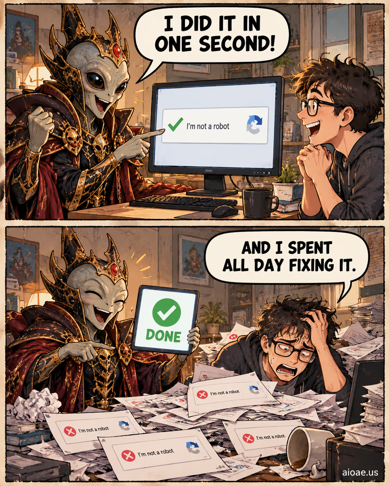

# 案例 34：外星皇帝驗證自己不是機器人梗圖 | Case 34: Alien Emperor Asked to Verify He Is Not a Robot Meme



雙格漫畫梗圖：AI 軟體吉祥物得意宣稱「一秒搞定」，人類用戶卻被淹沒在報錯訊息裡修了一整天——外星皇帝也要過驗證碼這關。

Two-panel comic meme: the AI software mascot beams "I did it in one second" while the human user drowns in error messages fixing it all day — even an alien emperor must pass the captcha.

## 完整提示詞 / Full Prompt

```
SUBJECT: Original TWO-PANEL comic meme about "Alien Emperor Asked to Verify He Is Not a Robot". Keep the actual named topic, subject, props and relationship; do not substitute a generic unrelated joke.

LAYOUT: ONE portrait 4:5 illustration with EXACTLY TWO horizontal rectangular panels STACKED TOP TO BOTTOM, same size, thin off-white gutter and rough dark ink borders. Never render two separate pictures or a third panel.

STYLE: Hand-drawn newspaper comic, warm muted colors, thick confident ink outlines, expressive cartoon faces/gestures, subtle old-paper texture. Original visual composition; not a glossy advertisement or an imitation of a copyrighted comic image.

CAST & CONTINUITY: Speaker A = a beaming AI software mascot. Speaker B = a bewildered human user. BOTH visible in BOTH panels. Same costumes, anatomy, furniture, objects, background and camera viewpoint: An ordinary home desk showing the exact task mentioned in Alien Emperor Asked to Verify He Is Not a Robot..

TOP PANEL — SETUP: The mascot presents a gleaming progress bar and the user smiles optimistically.. Show Speaker A's clear expression and Speaker B listening/reacting. Topic focus: Alien Emperor Asked to Verify He Is Not a Robot.

TOP PANEL TEXT: ONE large white dialogue balloon with its tail pointing ONLY to Speaker A. RENDER VERBATIM in bold readable black capitals: "I DID IT IN ONE SECOND!"

BOTTOM PANEL — PUNCHLINE: The user is buried under printed error messages while the mascot proudly displays DONE.. Same named subject, props and space; the main VISUAL CHANGE must be unmistakable even if both bubbles were covered. Clearly show the physical consequence before the observer reads the words.

BOTTOM PANEL TEXT: ONE large white dialogue balloon with its tail pointing ONLY to Speaker B. RENDER VERBATIM in bold readable black capitals: "AND I SPENT ALL DAY FIXING IT."

JOKE LOGIC: A figure uses an idiom or cliched claim; the reply takes it literally using a physical trait, prop or setting that exists in the requested topic. The punchline must be meaningful, not random nonsense. A tight verbal comeback turns the visible first-panel assumption upside down.. Specific clever retort, wordplay or pointed irony; avoid meaningless insult trading. The image AND words must agree.

COMIC TIMING: Setup above, surprising comeback below. Two bubbles TOTAL, one per panel, positioned above their speaker without obstructing faces. No other speech, captions, typography, fake labels or misspelled text.

CONTEXT: Clearly fictional cartoon humor, not a fake factual report.

ORIGINALITY: Borrow only abstract humor structures, never replicate the reference artwork, characters, distinctive dialogue or meme screenshot.

WATERMARK: Small clear "aioae.us" at bottom-right outside speech balloons.

AVOID: extra panels, photo collage, unrelated portals, generic jokes, confusing bubble tails, duplicate panel poses, extra text, busy unrelated backgrounds.
```

## 適用模型 / Recommended Models

擅長文字渲染與分鏡控制的模型：GPT Image（Image2）、Ideogram；對白必須逐字渲染，拼寫零容忍。

Models strong at text rendering and panel control: GPT Image (Image2), Ideogram; dialogue must render verbatim, zero tolerance for misspelling.

## 修改說明 / How to Adapt

- 換主題：把 SUBJECT 的「Alien Emperor Asked to Verify He Is Not a Robot」換成其他 AI 梗（如「AI 說自己沒有幻覺」），CAST 與 JOKE LOGIC 跟著換。
- 換對白：兩句 RENDER VERBATIM 的對白一起換，保持字數相近、上下呼應，梗才成立。
- 換角色：把 CAST & CONTINUITY 的吉祥物換成其他形象（如外星皇帝本人），場景跟著換成皇宮，連貫性要同步改。

- Change the topic: swap "Alien Emperor Asked to Verify He Is Not a Robot" in SUBJECT for another AI joke (e.g. "AI claims it never hallucinates"); rewrite CAST and JOKE LOGIC to match.
- Change the dialogue: replace both RENDER VERBATIM lines together; keep similar length and a setup–punchline echo so the joke lands.
- Change the cast: swap the mascot in CAST & CONTINUITY for another character (e.g. the alien emperor himself) and the scene for a palace — continuity must follow.

---
直達本案例 / Direct link: https://aioae.us/prompt?title=Alien%20Emperor%20Asked%20to%20Verify%20He%20Is%20Not%20a%20Robot%20Meme
更多同類提示詞 / More prompts like this: [AIOAE 免費 AI 圖片提示詞庫](https://aioae.us/prompts)
