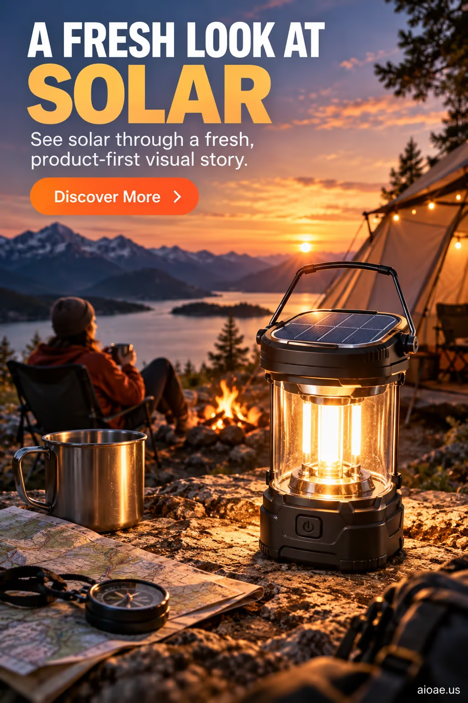

# 案例 35：太陽能露營燈產品海報 | Case 35: Solar Camping Lantern Product Poster



電商產品廣告風：太陽能露營燈主體特寫，黃昏營地＋湖泊山景，燈光明暗對比強烈，大字標題廣告排版。

E-commerce product-ad style: hero shot of a solar camping lantern against a dusk campsite with lake and mountains, strong light contrast, bold headline ad layout.

## 完整提示詞 / Full Prompt

```
SUBJECT & IDEA: Solar Camping Lantern Product Poster. Preserve named subject, requested relationships, main action and format.

HERO PRODUCT VISIBILITY: Keep solar unambiguously dominant, large and readable. Preserve the actual form factor, function, silhouette, product identity and stated materials. Do not replace the product with a generic futuristic object or shrink it behind scenery.

PRODUCT VALUE STRATEGY: Distinctive product value — Make the product benefit visually understandable before decorative spectacle. Visible proof: clear product-function relationship; one visible cause-and-effect cue. Do not invent measurements or factual specifications.

PRODUCT ATMOSPHERE: visually clear, emotionally appropriate and benefit-led. Make the product benefit tangible through its real use context.. Use coherent lighting, materials and color that support this product.

SCENE: a coherent commercial setting grounded in the named product and its intended use. Maintain clear foreground, midground and background with a single coherent physical logic.

MUTATION RULES: Subject-grounded visual evolution. MAIN SUBJECT LOCK: Solar Camping Lantern Product Poster. Preserve: solar. SINGLE DATABASE-GROUNDED CREATIVE MUTATION: Make one concrete subject-related visual change using supporting material texture, practical reflections and product-scale staging; the change must directly visually communicate Distinctive product value without altering the product form factor. Mutate secondary display elements immediately around the protected product only. Evidence: One coherent visible before/after material cue, contact, shadows or directional light explains the change. Staging: Preserve the original scene and the exact hero/action; no unrelated background or new main subject. Purpose: The existing subject and its meaning remain primary; visually communicate Distinctive product value without altering the product form factor. Explain product benefit Distinctive product value through observable cues (clear product-function relationship; one visible cause-and-effect cue); no unverifiable performance claims. One transformation, one consistent physical logic; subject, format, original relationships, named products, setting and main action unchanged. No unsolicited portals, robots, random second worlds or subject replacement. No unrelated portal, no arbitrary second world and no subject replacement unless expressly requested.

ON-IMAGE AD COPY: Exact headline "A FRESH LOOK AT SOLAR"; exact subheadline "See solar through a fresh, product-first visual story."; exact CTA "Discover More". Keep the lettering legible and organized in negative space. Distinct typographic scale and hierarchy; no other invented brand, prices or specifications.

STYLE: coherent premium visual storytelling with readable subject geometry and motivated light. Lighting and color should respond to the actual setting rather than unrelated stock effects.

CAMERA: hero product dominates the frame, with legible details and controlled reflections. Preserve perspective and realistic scale.

WATERMARK: Add a small, subtle and readable "aioae.us" in the bottom-right corner.

AVOID: generic random genre backgrounds, contradictory lighting, product identity substitution, extra fingers, duplicate characters, disjointed composition, unintended copy and unsupported factual claims.
```

## 適用模型 / Recommended Models

適用於擅長圖文混排與產品特寫的模型：GPT Image（Image2，原版模型）、Flux Pro、Recraft V3（排版文案精準）。

Works best on models that handle text-in-image and product close-ups: GPT Image (Image2, the original model), Flux Pro, Recraft V3 (accurate typography layout).

## 修改說明 / How to Adapt

- 換產品：把 SUBJECT & IDEA 與 MAIN SUBJECT LOCK 的產品名換掉，PRESERVE 關鍵詞同步替換，構圖不用動。
- 換廣告文案：改 ON-IMAGE AD COPY 的 headline / subheadline / CTA，原樣貼出就能換字。
- 換場景：改 SCENE 段的商業場景描述（如露營地換成陽台、沙灘或城市街景）。

- Swap the product: replace the product name in SUBJECT & IDEA and MAIN SUBJECT LOCK, and update the PRESERVE keyword to match — the composition stays intact.
- Swap the ad copy: edit headline / subheadline / CTA in ON-IMAGE AD COPY and paste verbatim to change the text.
- Swap the scene: rewrite the SCENE paragraph’s commercial setting (e.g. campsite to balcony, beach or city street).

---
直達本案例 / Direct link to this case: [Solar Camping Lantern Product Poster](https://aioae.us/prompt?title=Solar%20Camping%20Lantern%20Product%20Poster)

更多同類提示詞 / More prompts like this: [AIOAE 免費 AI 圖片提示詞庫](https://aioae.us/prompts)
