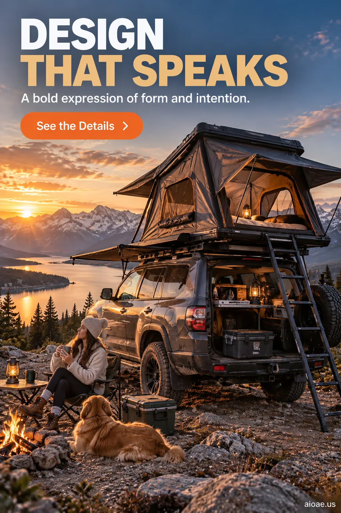

# 案例 37：車頂帳篷冒險海報 | Case 37: Car Roof Tent Adventure Poster



戶外冒險廣告風：SUV 車頂帳篷全景，日落湖泊＋篝火露營氛圍，大字「DESIGN THAT SPEAKS」文案設計。

Outdoor-adventure ad style: full view of an SUV rooftop tent at sunset over a lake with a campfire, large “DESIGN THAT SPEAKS” typography.

## 完整提示詞 / Full Prompt

```
SUBJECT & IDEA: Car Roof Tent Adventure Poster. Preserve named subject, requested relationships, main action and format.

HERO PRODUCT VISIBILITY: Keep automotive unambiguously dominant, large and readable. Preserve the actual form factor, function, silhouette, product identity and stated materials. Do not replace the product with a generic futuristic object or shrink it behind scenery.

PRODUCT VALUE STRATEGY: Distinctive product value — Make the product benefit visually understandable before decorative spectacle. Visible proof: clear product-function relationship; one visible cause-and-effect cue. Do not invent measurements or factual specifications.

PRODUCT ATMOSPHERE: visually clear, emotionally appropriate and benefit-led. Make the product benefit tangible through its real use context.. Use coherent lighting, materials and color that support this product.

SCENE: a coherent commercial setting grounded in the named product and its intended use. Maintain clear foreground, midground and background with a single coherent physical logic.

MUTATION RULES: subject rebuilt. MAIN SUBJECT LOCK: Car Roof Tent Adventure Poster. Preserve: automotive. SINGLE DATABASE-GROUNDED CREATIVE MUTATION: Adapt the database-selected idea (Let the subject mutate into a form that visualizes the message more powerfully than literal depiction Support the concept with surface detail retention.) to advertising_poster; implement it only in supporting display structures, environmental materials and reflections surrounding the protected hero product and connect its visual meaning to the protected subject.. Mutate supporting display structures, environmental materials and reflections surrounding the protected hero product only. Evidence: surface detail retention. Staging: Maintain the original setting with coherent lighting, scale, and foreground/background continuity. Purpose: Express the user’s requested topic (Car Roof Tent Adventure Poster); do not substitute the subject, action, product identity, venue or format. Explain product benefit Distinctive product value through observable cues (clear product-function relationship; one visible cause-and-effect cue); no unverifiable performance claims. One transformation, one consistent physical logic; subject, format, original relationships, named products, setting and main action unchanged. No unsolicited portals, robots, random second worlds or subject replacement. No unrelated portal, no arbitrary second world and no subject replacement unless expressly requested.

ON-IMAGE AD COPY: Exact headline "DESIGN THAT SPEAKS"; exact subheadline "A bold expression of form and intention."; exact CTA "See the Details". Keep the lettering legible and organized in negative space. Distinct typographic scale and hierarchy; no other invented brand, prices or specifications.

STYLE: coherent premium visual storytelling with readable subject geometry and motivated light. Lighting and color should respond to the actual setting rather than unrelated stock effects.

CAMERA: hero product dominates the frame, with legible details and controlled reflections. Preserve perspective and realistic scale.

WATERMARK: Add a small, subtle and readable "aioae.us" in the bottom-right corner.

AVOID: generic random genre backgrounds, contradictory lighting, product identity substitution, extra fingers, duplicate characters, disjointed composition, unintended copy and unsupported factual claims.
```

## 適用模型 / Recommended Models

適用於擅長圖文混排與產品特寫的模型：GPT Image（Image2，原版模型）、Flux Pro、Recraft V3（排版文案精準）。

Works best on models that handle text-in-image and product close-ups: GPT Image (Image2, the original model), Flux Pro, Recraft V3 (accurate typography layout).

## 修改說明 / How to Adapt

- 換產品：把 SUBJECT & IDEA 與 MAIN SUBJECT LOCK 的產品名換掉，PRESERVE 關鍵詞同步替換，構圖不用動。
- 換廣告文案：改 ON-IMAGE AD COPY 的 headline / subheadline / CTA，原樣貼出就能換字。
- 換場景：改 SCENE 段的商業場景描述（如露營地換成陽台、沙灘或城市街景）。

- Swap the product: replace the product name in SUBJECT & IDEA and MAIN SUBJECT LOCK, and update the PRESERVE keyword to match — the composition stays intact.
- Swap the ad copy: edit headline / subheadline / CTA in ON-IMAGE AD COPY and paste verbatim to change the text.
- Swap the scene: rewrite the SCENE paragraph’s commercial setting (e.g. campsite to balcony, beach or city street).

---
直達本案例 / Direct link to this case: [Car Roof Tent Adventure Poster](https://aioae.us/prompt?title=Car%20Roof%20Tent%20Adventure%20Poster)

更多同類提示詞 / More prompts like this: [AIOAE 免費 AI 圖片提示詞庫](https://aioae.us/prompts)
