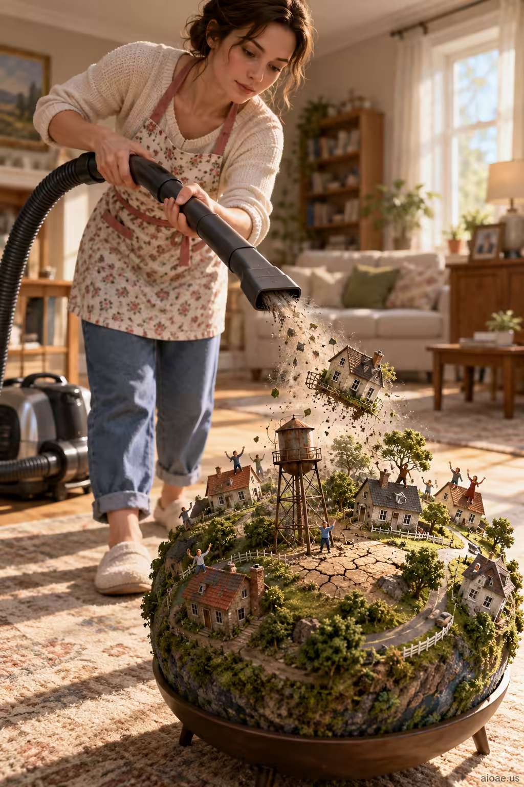

# 案例 45：微型星球吸塵記 | Case 45: Vacuuming a Tiny Planet



電影級超現實幽默：一位居家主婦用吸塵器吸走一顆微型宜居星球上的小房子，屋頂上居民拼命揮手——日常家務與宇宙尺度碰撞，荒誕又一氣呵成。

Cinematic surreal humor: a housewife vacuums miniature houses off a tiny inhabited planet while its residents wave desperately from the rooftops — domestic routine colliding with cosmic scale, absurd yet visually coherent.

## 完整提示詞 / Full Prompt

```
SUBJECT & IDEA: A housewife vacuums miniature houses from a tiny inhabited planet while its residents wave desperately from rooftops.. Preserve named subject, requested relationships, main action and format.

SCENE: one continuous believable setting suited to the subject and brief. Maintain clear foreground, midground and background with a single coherent physical logic.

MUTATION RULES: framing. MAIN SUBJECT LOCK: A housewife vacuums miniature houses from a tiny inhabited planet while its residents wave desperately from rooftops.. SINGLE DATABASE-GROUNDED CREATIVE MUTATION: Adapt the database-selected idea (Transfer this camera/composition principle to a supporting visual element only; preserve the user's requested camera and crop: low wide vertical shot near the cracked ground, a towering structure dominating the center and a tiny walking figure at its base for scale) to visual_art; implement it only in one supporting physical element that reinforces the named central subject and connect its visual meaning to the protected subject.. Mutate one supporting physical element that reinforces the named central subject only. Evidence: show a tangible material response, contact, reflections, shadows or a physically traceable visual consequence. Staging: Maintain the original setting with coherent lighting, scale, and foreground/background continuity. Purpose: Express the user’s requested topic (A housewife vacuums miniature houses from a tiny inhabited planet while its residents wave desperately from rooftops.); do not substitute the subject, action, product identity, venue or format. One transformation, one consistent physical logic; subject, format, original relationships, named products, setting and main action unchanged. No unsolicited portals, robots, random second worlds or subject replacement. No unrelated portal, no arbitrary second world and no subject replacement unless expressly requested.

STYLE: coherent premium visual storytelling with readable subject geometry and motivated light. Lighting and color should respond to the actual setting rather than unrelated stock effects.

CAMERA: subject-first coherent perspective. Preserve perspective and realistic scale.

WATERMARK: Add a small, subtle and readable "aioae.us" in the bottom-right corner.

AVOID: generic random genre backgrounds, contradictory lighting, product identity substitution, extra fingers, duplicate characters, disjointed composition, unintended copy and unsupported factual claims.
```

## 適用模型 / Recommended Models

本批提示詞來自提示詞庫 Image2 分類（Cinematic 風格），最適合 GPT Image（Image2）、Flux Pro、Midjourney 等擅長電影感與超現實構圖的模型；建議先原樣生成一張確認構圖，再按「修改說明」調整。

These prompts come from the library's Image2 category (Cinematic style) and work best on GPT Image (Image2), Flux Pro, Midjourney and other models strong at cinematic, surreal composition. Generate once as-is to check the composition, then adapt with the notes below.

## 修改說明 / How to Adapt

- 換主體：把 SUBJECT & IDEA 段的「主婦＋吸塵器＋微型星球」換成其他日常家務（如園丁澆水、司機洗車），尺度碰撞的結構照用。
- 換機位：改 MUTATION RULES 裡的構圖要求（低角度廣角豎拍）為高空俯拍或特寫，荒誕感會完全不同。
- 去水印或改風格：刪掉 WATERMARK 行即不加角標；把 STYLE 改成定格動畫或繪本風可做兒童版。

- Swap the subject: replace the SUBJECT & IDEA line's housewife/vacuum/tiny-planet with another household chore (gardener watering, driver washing a car) — the scale-collision structure still works.
- Change the framing: rewrite the composition requirement inside MUTATION RULES (low wide vertical shot) as an aerial view or close-up for a totally different absurdity.
- Drop the watermark or restyle: remove the WATERMARK line to skip the corner mark; change STYLE to stop-motion or picture-book for a kids' version.

---
直達本案例 / Direct link to this case: [Vacuuming a Tiny Planet](https://aioae.us/prompt?title=Vacuuming%20a%20Tiny%20Planet)

更多同類提示詞 / More prompts like this: [AIOAE 免費 AI 圖片提示詞庫](https://aioae.us/prompts)
