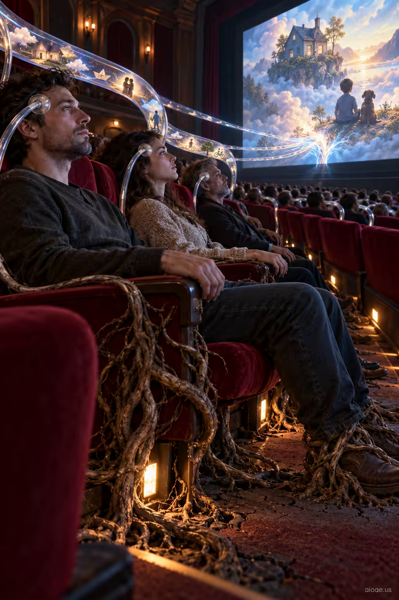

# 案例 46：紮根的觀眾把夢送上銀幕 | Case 46: Rooted Viewers Send Dreams to the Screen



陰鬱科幻寓言：電影院座椅在觀眾身旁生根，透明管道把他們的夢抽向銀幕——探討觀看與被觀看，氛圍詭譎迷人。

Dark sci-fi allegory: cinema seats sprout roots around absorbed viewers while transparent tubes drain their dreams into the screen — a haunting meditation on watching and being watched.

## 完整提示詞 / Full Prompt

```
SUBJECT & IDEA: Cinema seats sprout roots around absorbed viewers while transparent tubes drain their dreams into the screen.. Preserve named subject, requested relationships, main action and format.

SCENE: one continuous believable setting suited to the subject and brief. Maintain clear foreground, midground and background with a single coherent physical logic.

MUTATION RULES: Subject-grounded visual evolution. MAIN SUBJECT LOCK: Cinema seats sprout roots around absorbed viewers while transparent tubes drain their dreams into the screen.. SINGLE DATABASE-GROUNDED CREATIVE MUTATION: Make one concrete subject-related visual change using the existing light, material response and surroundings; the change must directly reinforce visual_art through a subject-relevant supporting detail. Mutate a supporting element within the original composition only. Evidence: One coherent visible before/after material cue, contact, shadows or directional light explains the change. Staging: Preserve the original scene and the exact hero/action; no unrelated background or new main subject. Purpose: The existing subject and its meaning remain primary; reinforce visual_art through a subject-relevant supporting detail. One transformation, one consistent physical logic; subject, format, original relationships, named products, setting and main action unchanged. No unsolicited portals, robots, random second worlds or subject replacement. No unrelated portal, no arbitrary second world and no subject replacement unless expressly requested.

STYLE: coherent premium visual storytelling with readable subject geometry and motivated light. Lighting and color should respond to the actual setting rather than unrelated stock effects.

CAMERA: subject-first coherent perspective. Preserve perspective and realistic scale.

WATERMARK: Add a small, subtle and readable "aioae.us" in the bottom-right corner.

AVOID: generic random genre backgrounds, contradictory lighting, product identity substitution, extra fingers, duplicate characters, disjointed composition, unintended copy and unsupported factual claims.
```

## 適用模型 / Recommended Models

本批提示詞來自提示詞庫 Image2 分類（Cinematic 風格），最適合 GPT Image（Image2）、Flux Pro、Midjourney 等擅長電影感與超現實構圖的模型；建議先原樣生成一張確認構圖，再按「修改說明」調整。

These prompts come from the library's Image2 category (Cinematic style) and work best on GPT Image (Image2), Flux Pro, Midjourney and other models strong at cinematic, surreal composition. Generate once as-is to check the composition, then adapt with the notes below.

## 修改說明 / How to Adapt

- 換隱喻：把 SUBJECT & IDEA 的「座椅生根＋管道抽夢」換成圖書館書頁纏繞讀者、或健身房器械吸收汗水，結構照用。
- 改氛圍：把 STYLE 的 premium visual storytelling 改成冷藍色調恐怖片或暖色懷舊膠片風。
- 加人物細節：如需特寫人物，在 CHARACTER 段（本模板無）前加一段指定年齡服裝，或改 SCENE 強調前排某一座位。

- Swap the metaphor: replace the SUBJECT & IDEA line's rooting seats and dream-draining tubes with library pages entangling readers, or gym machines absorbing sweat — the structure still works.
- Change the mood: rewrite STYLE from premium visual storytelling into cold-blue horror or warm nostalgic film tones.
- Add character detail: specify an age/outfit for a foreground viewer in the SCENE paragraph, or emphasise one front-row seat.

---
直達本案例 / Direct link to this case: [Rooted Viewers Send Dreams to the Screen](https://aioae.us/prompt?title=Rooted%20Viewers%20Send%20Dreams%20to%20the%20Screen)

更多同類提示詞 / More prompts like this: [AIOAE 免費 AI 圖片提示詞庫](https://aioae.us/prompts)
