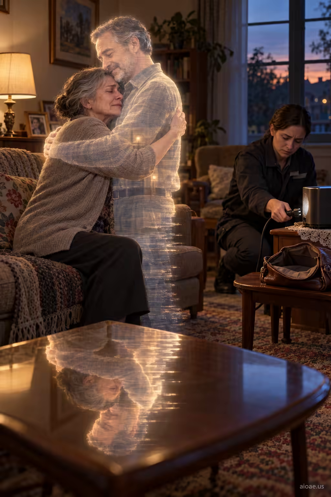

# 案例 47：最後的擁抱：消逝的投影 | Case 47: Last Embrace Fading Projection



催淚科幻情感片：一名寡婦擁抱丈夫正在消逝的全息投影，技術人員在一旁拔掉電源——溫情與冷酷並置，極具電影感。

Tear-jerking sci-fi drama: a widow embraces her husband's fading holographic projection while a technician unplugs it beside her — tenderness and cold detachment in one cinematic frame.

## 完整提示詞 / Full Prompt

```
SUBJECT & IDEA: A widow embraces her husband s glowing projection while a technician disconnects it beside her empty purse.. Preserve named subject, requested relationships, main action and format.

SCENE: one continuous believable setting suited to the subject and brief. Maintain clear foreground, midground and background with a single coherent physical logic.

MUTATION RULES: Subject-grounded visual evolution. MAIN SUBJECT LOCK: A widow embraces her husband s glowing projection while a technician disconnects it beside her empty purse.. SINGLE DATABASE-GROUNDED CREATIVE MUTATION: Make one concrete subject-related visual change using the existing light, material response and surroundings; the change must directly reinforce visual_art through a subject-relevant supporting detail. Mutate a supporting element within the original composition only. Evidence: One coherent visible before/after material cue, contact, shadows or directional light explains the change. Staging: Preserve the original scene and the exact hero/action; no unrelated background or new main subject. Purpose: The existing subject and its meaning remain primary; reinforce visual_art through a subject-relevant supporting detail. One transformation, one consistent physical logic; subject, format, original relationships, named products, setting and main action unchanged. No unsolicited portals, robots, random second worlds or subject replacement. No unrelated portal, no arbitrary second world and no subject replacement unless expressly requested.

STYLE: coherent premium visual storytelling with readable subject geometry and motivated light. Lighting and color should respond to the actual setting rather than unrelated stock effects.

CAMERA: subject-first coherent perspective. Preserve perspective and realistic scale.

WATERMARK: Add a small, subtle and readable "aioae.us" in the bottom-right corner.

AVOID: generic random genre backgrounds, contradictory lighting, product identity substitution, extra fingers, duplicate characters, disjointed composition, unintended copy and unsupported factual claims.
```

## 適用模型 / Recommended Models

本批提示詞來自提示詞庫 Image2 分類（Cinematic 風格），最適合 GPT Image（Image2）、Flux Pro、Midjourney 等擅長電影感與超現實構圖的模型；建議先原樣生成一張確認構圖，再按「修改說明」調整。

These prompts come from the library's Image2 category (Cinematic style) and work best on GPT Image (Image2), Flux Pro, Midjourney and other models strong at cinematic, surreal composition. Generate once as-is to check the composition, then adapt with the notes below.

## 修改說明 / How to Adapt

- 換人物關係：把 SUBJECT & IDEA 的「寡婦＋丈夫投影」換成母親與孩子的錄像、或老兵與戰友的照片，情感核心不變。
- 改光影：把 STYLE 裡的 motivated light 具體寫成「投影藍光照亮半張臉、背景幾乎全黑」，電影感更強。
- 換結局道具：把「技術人員拔電源」改成投影自行閃爍熄滅，更含蓄；或加一盞檯燈做前景。

- Swap the relationship: replace the SUBJECT & IDEA line's widow/husband projection with a mother and a child's video, or a veteran and a comrade's photo — the emotional core stays.
- Reshape the lighting: spell out motivated light in STYLE as projection-blue light on half a face with a near-black background for stronger cinema feel.
- Change the ending prop: swap the technician unplugging the device for the projection flickering out on its own; or add a desk lamp in the foreground.

---
直達本案例 / Direct link to this case: [Last Embrace Fading Projection](https://aioae.us/prompt?title=Last%20Embrace%20Fading%20Projection)

更多同類提示詞 / More prompts like this: [AIOAE 免費 AI 圖片提示詞庫](https://aioae.us/prompts)
