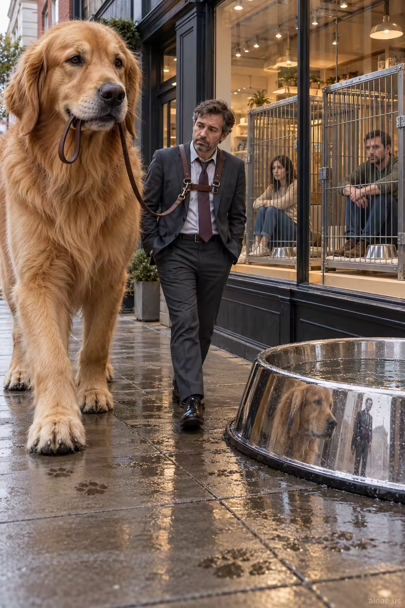

# 案例 48：狗遛人：身份顛倒 | Case 48: A Dog Walks Its Human



身份顛倒的社會諷刺：一隻巨型犬牽著西裝革履的人類散步，路過一家櫥窗裡關著「人」的商店——尺度與權力雙重反轉。

Role-reversal social satire: a giant dog walks a suited human on a leash, past a shop displaying people in cages — a double inversion of scale and power.

## 完整提示詞 / Full Prompt

```
SUBJECT & IDEA: A giant dog walks a suited human on a leash past a shop displaying people in cages.. Preserve named subject, requested relationships, main action and format.

CHARACTER: Preserve the specified adult person, gender, individual facial structure and role. Wardrobe, expression, posture and gaze should follow the requested scenario; do not introduce unrelated professions or costumes.

SCENE: one continuous believable setting suited to the subject and brief. Keep human-scale spatial continuity and recognizable natural surroundings.

MUTATION RULES: scale shift portrait. MAIN SUBJECT LOCK: A giant dog walks a suited human on a leash past a shop displaying people in cages.. SINGLE DATABASE-GROUNDED CREATIVE MUTATION: Adapt the database-selected idea (Let the conceptual meaning of the portrait emerge through a human portrait staged within a world where scale has fractured between intimate details and monumental objects.) to visual_art; implement it only in supporting props, lighting, surroundings and character-adjacent space without changing identity or requested posture and connect its visual meaning to the protected subject.. Mutate supporting props, lighting, surroundings and character-adjacent space without changing identity or requested posture only. Evidence: show a tangible material response, contact, reflections, shadows or a physically traceable visual consequence. Staging: Maintain the original setting with coherent lighting, scale, and foreground/background continuity. Purpose: Express the user’s requested topic (A giant dog walks a suited human on a leash past a shop displaying people in cages.); do not substitute the subject, action, product identity, venue or format. One transformation, one consistent physical logic; subject, format, original relationships, named products, setting and main action unchanged. No unsolicited portals, robots, random second worlds or subject replacement. No unrelated portal, no arbitrary second world and no subject replacement unless expressly requested.

STYLE: credible portrait photography with natural skin texture, accurate hands, and a clear relationship between subject and camera. Lighting and color should respond to the actual setting rather than unrelated stock effects.

CAMERA: natural close or medium portrait framing, not an unrelated panoramic set. Preserve perspective and realistic scale.

WATERMARK: Add a small, subtle and readable "aioae.us" in the bottom-right corner.

AVOID: generic random genre backgrounds, contradictory lighting, product identity substitution, extra fingers, duplicate characters, disjointed composition, unintended copy and unsupported factual claims.
```

## 適用模型 / Recommended Models

本批提示詞來自提示詞庫 Image2 分類（Cinematic 風格），最適合 GPT Image（Image2）、Flux Pro、Midjourney 等擅長電影感與超現實構圖的模型；建議先原樣生成一張確認構圖，再按「修改說明」調整。

These prompts come from the library's Image2 category (Cinematic style) and work best on GPT Image (Image2), Flux Pro, Midjourney and other models strong at cinematic, surreal composition. Generate once as-is to check the composition, then adapt with the notes below.

## 修改說明 / How to Adapt

- 換動物與人：把 SUBJECT & IDEA 的「巨犬＋西裝人」換成巨貓遛白領、或鸚鵡牽著主人，諷刺結構照用。
- 換場景：把商店櫥窗的「人」換成地鐵車廂裡的上班族，背景更貼近日常。
- 改寫實度：STYLE 已是 portrait photography，如需插畫風可改成扁平漫畫風，諷刺更輕快。

- Swap the pair: replace the SUBJECT & IDEA line's giant dog and suited human with a giant cat walking an office worker, or a parrot leading its owner — the satire structure still works.
- Change the setting: swap the shop window's caged people for commuters in a subway car, closer to everyday life.
- Adjust realism: STYLE is already portrait photography; switch to flat cartoon style for a lighter satirical tone.

---
直達本案例 / Direct link to this case: [A Dog Walks Its Human](https://aioae.us/prompt?title=A%20Dog%20Walks%20Its%20Human)

更多同類提示詞 / More prompts like this: [AIOAE 免費 AI 圖片提示詞庫](https://aioae.us/prompts)
