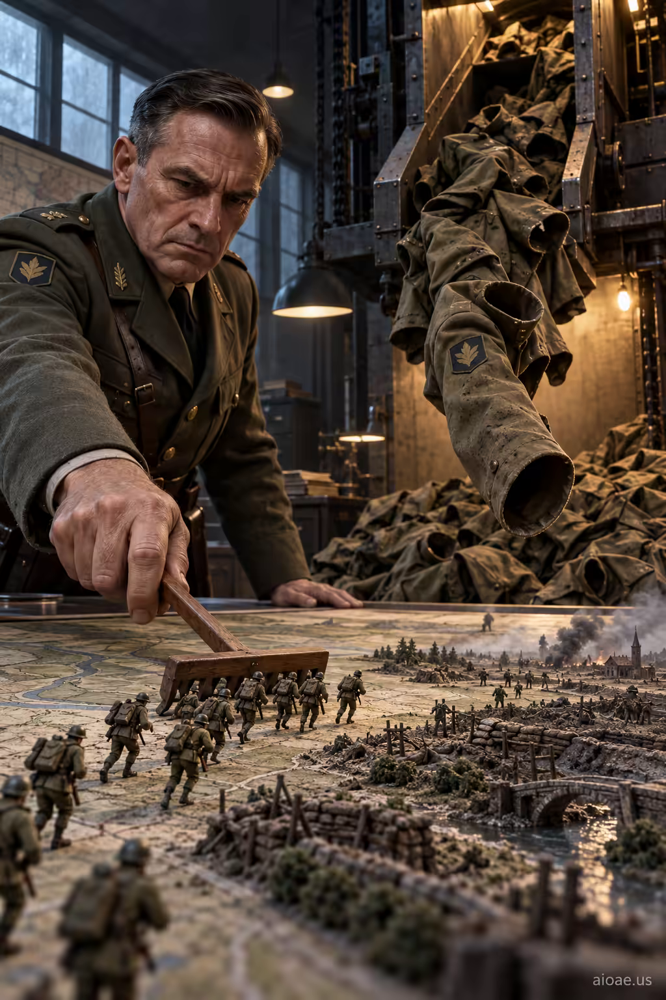

# 案例 49：微型士兵與落下的軍服 | Case 49: Miniature Soldiers and Falling Uniforms



戰爭寓言：一名將軍把微型士兵推上戰場，身後的機器不斷掉下空蕩的軍服——「相對大小本身就是驚嚇點」，反戰意味濃烈。

War allegory: a general pushes miniature soldiers into battle while a machine behind him drops matching empty uniforms — relative size itself is the shock, with a strong anti-war charge.

## 完整提示詞 / Full Prompt

```
SUBJECT & IDEA: A general pushes miniature soldiers into battle; matching empty uniforms fall from a machine behind him.. Preserve named subject, requested relationships, main action and format.

SCENE: one continuous believable setting suited to the subject and brief. Maintain clear foreground, midground and background with a single coherent physical logic.

MUTATION RULES: Scale Collision. MAIN SUBJECT LOCK: A general pushes miniature soldiers into battle; matching empty uniforms fall from a machine behind him.. SINGLE DATABASE-GROUNDED CREATIVE MUTATION: Adapt the database-selected idea (Background reveal: make relative size itself the surprising event in the image) to visual_art; implement it only in one supporting physical element that reinforces the named central subject and connect its visual meaning to the protected subject.. Mutate one supporting physical element that reinforces the named central subject only. Evidence: deliver one clear visual reveal that can be understood without explanatory clutter. Staging: keep the core subject immediately readable before the surprise is decoded. Purpose: Express the user’s requested topic (A general pushes miniature soldiers into battle; matching empty uniforms fall from a machine behind him.); do not substitute the subject, action, product identity, venue or format. One transformation, one consistent physical logic; subject, format, original relationships, named products, setting and main action unchanged. No unsolicited portals, robots, random second worlds or subject replacement. No unrelated portal, no arbitrary second world and no subject replacement unless expressly requested.

STYLE: coherent premium visual storytelling with readable subject geometry and motivated light. Lighting and color should respond to the actual setting rather than unrelated stock effects.

CAMERA: subject-first coherent perspective. Preserve perspective and realistic scale.

WATERMARK: Add a small, subtle and readable "aioae.us" in the bottom-right corner.

AVOID: generic random genre backgrounds, contradictory lighting, product identity substitution, extra fingers, duplicate characters, disjointed composition, unintended copy and unsupported factual claims.
```

## 適用模型 / Recommended Models

本批提示詞來自提示詞庫 Image2 分類（Cinematic 風格），最適合 GPT Image（Image2）、Flux Pro、Midjourney 等擅長電影感與超現實構圖的模型；建議先原樣生成一張確認構圖，再按「修改說明」調整。

These prompts come from the library's Image2 category (Cinematic style) and work best on GPT Image (Image2), Flux Pro, Midjourney and other models strong at cinematic, surreal composition. Generate once as-is to check the composition, then adapt with the notes below.

## 修改說明 / How to Adapt

- 換隱喻對象：把 SUBJECT & IDEA 的「將軍＋微型士兵」換成棋手推棋子、或老闆裁員文件，結構照用。
- 改時代：把軍服換成中世紀盔甲或未來機甲，SCENE 同步改成城堡或太空艙。
- 強化反轉：把「掉落的空軍服」具體寫成「如雪片般從傳送帶落下」，視覺衝擊更強。

- Swap the metaphor: replace the SUBJECT & IDEA line's general and miniature soldiers with a chess player pushing pieces, or a boss laying off staff — the structure still works.
- Change the era: swap the uniforms for medieval armor or future mechs, and update SCENE to a castle or a space capsule.
- Strengthen the reveal: describe the falling empty uniforms as dropping like snowflakes from a conveyor belt for stronger visual impact.

---
直達本案例 / Direct link to this case: [Miniature Soldiers and Falling Uniforms](https://aioae.us/prompt?title=Miniature%20Soldiers%20and%20Falling%20Uniforms)

更多同類提示詞 / More prompts like this: [AIOAE 免費 AI 圖片提示詞庫](https://aioae.us/prompts)
