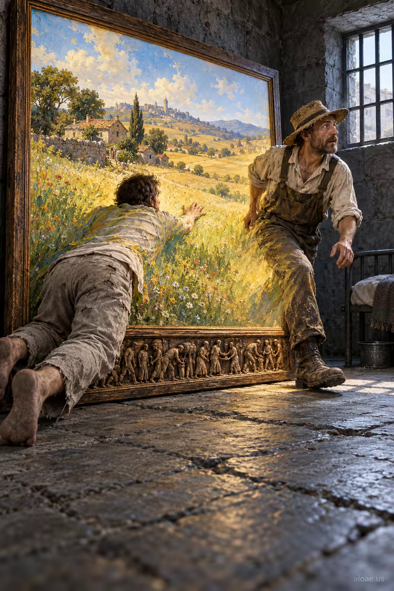

# 案例 50：囚犯入畫，農夫出牢 | Case 50: Prisoner Enters Painting Farmer Emerges



魔幻現實主義：一名囚犯爬進牆上的田園油畫，而畫中的農夫正從畫框走進牢房——兩個世界在畫框處交錯，詩意又詭異。

Magical realism: a prisoner crawls into a pastoral painting on the wall while the painted farmer steps out of the frame into his cell — two worlds crossing at the canvas edge, poetic and uncanny.

## 完整提示詞 / Full Prompt

```
SUBJECT & IDEA: A prisoner crawls through a painted countryside while the painted farmer emerges into his cell.. Preserve named subject, requested relationships, main action and format.

SCENE: one continuous believable setting suited to the subject and brief. Maintain clear foreground, midground and background with a single coherent physical logic.

MUTATION RULES: History Condensed into One Giant Artifact. MAIN SUBJECT LOCK: A prisoner crawls through a painted countryside while the painted farmer emerges into his cell.. SINGLE DATABASE-GROUNDED CREATIVE MUTATION: Adapt the database-selected idea (each historic moment is told through one oversized emblematic object (document, beach obstacle, footprint, wall fragment) with tiny period crowds acting out the event on and around it) to visual_art; implement it only in one supporting physical element that reinforces the named central subject and connect its visual meaning to the protected subject.. Mutate one supporting physical element that reinforces the named central subject only. Evidence: miniature crowds. Staging: Maintain the original setting with coherent lighting, scale, and foreground/background continuity. Purpose: Express the user’s requested topic (A prisoner crawls through a painted countryside while the painted farmer emerges into his cell.); do not substitute the subject, action, product identity, venue or format. One transformation, one consistent physical logic; subject, format, original relationships, named products, setting and main action unchanged. No unsolicited portals, robots, random second worlds or subject replacement. No unrelated portal, no arbitrary second world and no subject replacement unless expressly requested.

STYLE: coherent premium visual storytelling with readable subject geometry and motivated light. Lighting and color should respond to the actual setting rather than unrelated stock effects.

CAMERA: subject-first coherent perspective. Preserve perspective and realistic scale.

WATERMARK: Add a small, subtle and readable "aioae.us" in the bottom-right corner.

AVOID: generic random genre backgrounds, contradictory lighting, product identity substitution, extra fingers, duplicate characters, disjointed composition, unintended copy and unsupported factual claims.
```

## 適用模型 / Recommended Models

本批提示詞來自提示詞庫 Image2 分類（Cinematic 風格），最適合 GPT Image（Image2）、Flux Pro、Midjourney 等擅長電影感與超現實構圖的模型；建議先原樣生成一張確認構圖，再按「修改說明」調整。

These prompts come from the library's Image2 category (Cinematic style) and work best on GPT Image (Image2), Flux Pro, Midjourney and other models strong at cinematic, surreal composition. Generate once as-is to check the composition, then adapt with the notes below.

## 修改說明 / How to Adapt

- 換畫作內容：把 SUBJECT & IDEA 的「田園＋農夫」換成海景與漁夫、或城市夜景與上班族，交錯結構不變。
- 換畫框媒介：把油畫換成老照片、電視屏幕或手機屏，時代感隨之改變。
- 改色調：把牢房寫成冷灰、畫中世界寫成暖金，兩個世界的對比會更強烈。

- Swap the painting: replace the SUBJECT & IDEA line's countryside and farmer with a seascape and a fisherman, or a city nightscape and an office worker — the crossing structure stays.
- Change the medium: swap the oil painting for an old photograph, a TV screen or a phone display to shift the era.
- Reshape the palette: render the cell in cold grey and the painted world in warm gold for a stronger two-world contrast.

---
直達本案例 / Direct link to this case: [Prisoner Enters Painting Farmer Emerges](https://aioae.us/prompt?title=Prisoner%20Enters%20Painting%20Farmer%20Emerges)

更多同類提示詞 / More prompts like this: [AIOAE 免費 AI 圖片提示詞庫](https://aioae.us/prompts)
