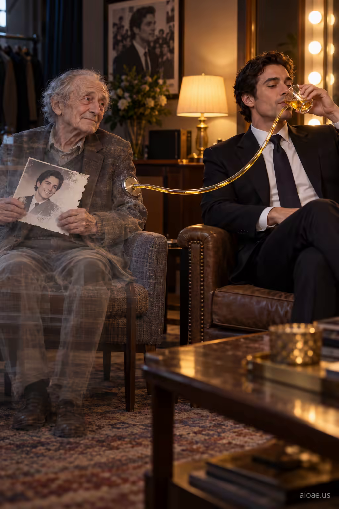

# 案例 51：金色液體與消逝的粉絲 | Case 51: Golden Tube Fading Fan



名利場寓言：年輕明星透過管子吸吮金色液體，管子的另一頭連著一位正在消逝的老粉絲——諷刺娛樂工業的吸血邏輯，畫面極具衝擊力。

Fame-industry allegory: a young celebrity drinks golden liquid through a tube connected to an elderly fan's visibly fading body — a biting image of the entertainment machine feeding on devotion.

## 完整提示詞 / Full Prompt

```
SUBJECT & IDEA: A young celebrity drinks golden liquid through a tube connected to an elderly fan s visibly fading body.. Preserve named subject, requested relationships, main action and format.

SCENE: one continuous believable setting suited to the subject and brief. Maintain clear foreground, midground and background with a single coherent physical logic.

MUTATION RULES: Subject-grounded visual evolution. MAIN SUBJECT LOCK: A young celebrity drinks golden liquid through a tube connected to an elderly fan s visibly fading body.. SINGLE DATABASE-GROUNDED CREATIVE MUTATION: Make one concrete subject-related visual change using the existing light, material response and surroundings; the change must directly reinforce visual_art through a subject-relevant supporting detail. Mutate a supporting element within the original composition only. Evidence: One coherent visible before/after material cue, contact, shadows or directional light explains the change. Staging: Preserve the original scene and the exact hero/action; no unrelated background or new main subject. Purpose: The existing subject and its meaning remain primary; reinforce visual_art through a subject-relevant supporting detail. One transformation, one consistent physical logic; subject, format, original relationships, named products, setting and main action unchanged. No unsolicited portals, robots, random second worlds or subject replacement. No unrelated portal, no arbitrary second world and no subject replacement unless expressly requested.

STYLE: coherent premium visual storytelling with readable subject geometry and motivated light. Lighting and color should respond to the actual setting rather than unrelated stock effects.

CAMERA: subject-first coherent perspective. Preserve perspective and realistic scale.

WATERMARK: Add a small, subtle and readable "aioae.us" in the bottom-right corner.

AVOID: generic random genre backgrounds, contradictory lighting, product identity substitution, extra fingers, duplicate characters, disjointed composition, unintended copy and unsupported factual claims.
```

## 適用模型 / Recommended Models

本批提示詞來自提示詞庫 Image2 分類（Cinematic 風格），最適合 GPT Image（Image2）、Flux Pro、Midjourney 等擅長電影感與超現實構圖的模型；建議先原樣生成一張確認構圖，再按「修改說明」調整。

These prompts come from the library's Image2 category (Cinematic style) and work best on GPT Image (Image2), Flux Pro, Midjourney and other models strong at cinematic, surreal composition. Generate once as-is to check the composition, then adapt with the notes below.

## 修改說明 / How to Adapt

- 換被汲取者：把 SUBJECT & IDEA 的「老粉絲」換成經紀人、或一群舉燈牌的粉絲剪影，批判對象隨之改變。
- 換液體：把金色液體換成票房數字流、或社交媒體點讚圖標，更貼合當下語境。
- 改構圖：把管子寫成從舞台燈光架垂下，明星在舞台中央，劇場感更強。

- Swap who's drained: replace the SUBJECT & IDEA line's elderly fan with an agent, or a crowd of light-stick-holding fan silhouettes, shifting the critique's target.
- Change the liquid: swap the golden liquid for streams of box-office numbers or social-media like icons for a more current context.
- Reshape the staging: hang the tube from stage lighting rigs with the celebrity center-stage for stronger theatricality.

---
直達本案例 / Direct link to this case: [Golden Tube Fading Fan](https://aioae.us/prompt?title=Golden%20Tube%20Fading%20Fan)

更多同類提示詞 / More prompts like this: [AIOAE 免費 AI 圖片提示詞庫](https://aioae.us/prompts)
