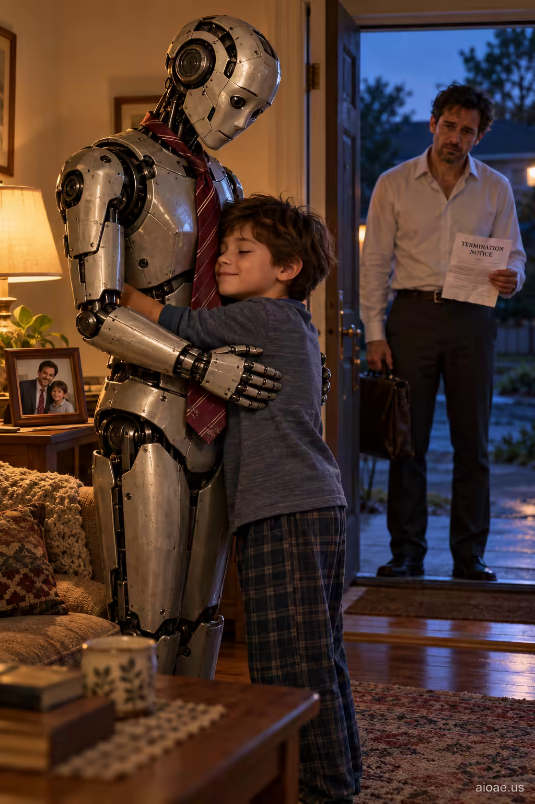

# 案例 53：他留下的那條領帶 | Case 53: The Tie He Left Behind



溫情科幻：小男孩抱著繫著父親領帶的機器人，真正的父親站在門外手裡拿著解僱通知——一條領帶串起親情與失業的雙重敘事。

Tender sci-fi: a boy hugs a robot wearing his father's tie while his real father stands outside holding a termination notice — one tie threads together family love and job loss.

## 完整提示詞 / Full Prompt

```
SUBJECT & IDEA: A boy hugs a robot wearing his fathers tie while his real father stands outside holding a termination notice.. Preserve named subject, requested relationships, main action and format.

SCENE: one continuous believable setting suited to the subject and brief. Maintain clear foreground, midground and background with a single coherent physical logic.

MUTATION RULES: Subject-grounded visual evolution. MAIN SUBJECT LOCK: A boy hugs a robot wearing his fathers tie while his real father stands outside holding a termination notice.. SINGLE DATABASE-GROUNDED CREATIVE MUTATION: Make one concrete subject-related visual change using natural gaze, tactile props and motivated lighting; the change must directly reinforce visual_art through a subject-relevant supporting detail. Mutate a supporting element within the original composition only. Evidence: One coherent visible before/after material cue, contact, shadows or directional light explains the change. Staging: Preserve the original scene and the exact hero/action; no unrelated background or new main subject. Purpose: The existing subject and its meaning remain primary; reinforce visual_art through a subject-relevant supporting detail. One transformation, one consistent physical logic; subject, format, original relationships, named products, setting and main action unchanged. No unsolicited portals, robots, random second worlds or subject replacement. No unrelated portal, no arbitrary second world and no subject replacement unless expressly requested.

STYLE: coherent premium visual storytelling with readable subject geometry and motivated light. Lighting and color should respond to the actual setting rather than unrelated stock effects.

CAMERA: subject-first coherent perspective. Preserve perspective and realistic scale.

WATERMARK: Add a small, subtle and readable "aioae.us" in the bottom-right corner.

AVOID: generic random genre backgrounds, contradictory lighting, product identity substitution, extra fingers, duplicate characters, disjointed composition, unintended copy and unsupported factual claims.
```

## 適用模型 / Recommended Models

本批提示詞來自提示詞庫 Image2 分類（Cinematic 風格），最適合 GPT Image（Image2）、Flux Pro、Midjourney 等擅長電影感與超現實構圖的模型；建議先原樣生成一張確認構圖，再按「修改說明」調整。

These prompts come from the library's Image2 category (Cinematic style) and work best on GPT Image (Image2), Flux Pro, Midjourney and other models strong at cinematic, surreal composition. Generate once as-is to check the composition, then adapt with the notes below.

## 修改說明 / How to Adapt

- 換信物：把 SUBJECT & IDEA 的「領帶」換成手錶、婚戒或舊球鞋，情感載體隨之改變。
- 換機器人造型：把機器人寫成笨拙的家用款、或高大的工業款，反差感不同。
- 改視角：把門外的父親寫成逆光剪影，只露出手中的解僱通知，懸念更強。

- Swap the keepsake: replace the SUBJECT & IDEA line's tie with a watch, a wedding ring or old sneakers, changing the emotional vessel.
- Change the robot: render it as a clumsy home model or a towering industrial one for different contrast.
- Reshape the view: show the father outside as a backlit silhouette, only the termination notice visible in his hand, for stronger suspense.

---
直達本案例 / Direct link to this case: [The Tie He Left Behind](https://aioae.us/prompt?title=The%20Tie%20He%20Left%20Behind)

更多同類提示詞 / More prompts like this: [AIOAE 免費 AI 圖片提示詞庫](https://aioae.us/prompts)
